# Kyrion

Kyrion, dari kata Yunani *kyrion* yang berarti "yang sah, yang berlaku", adalah aplikasi web yang membantu sivitas akademika Universitas Pertamina mengetahui ketentuan resmi mana yang sedang berlaku, apa yang berubah antarversi, dan apakah sebuah dokumen regulasi asli.

> Status: **v0.1 (Tugas 1 PAW, Milestone 1)**, berupa antarmuka publik dengan data tiruan.

## Permasalahan

Regulasi kampus dirilis sebagai berkas PDF terpisah yang direvisi setiap tahun akademik. Berkas-berkas itu tidak disertai riwayat versi, tanggal berlaku, maupun bukti keabsahan. Akibatnya mahasiswa berisiko mengikuti ketentuan yang sudah tidak berlaku.

## Sasaran Pengguna

| Peran | Kebutuhan |
|---|---|
| Pengunjung | Melihat daftar regulasi dan versi yang berlaku tanpa perlu masuk. |
| Mahasiswa | Memastikan ketentuan yang diikuti adalah versi sah, lalu memverifikasi dokumen yang dimiliki. |
| Admin Akademik | Mengelola regulasi dan menerbitkan versi baru. |

Catatan: v0.1 baru menyediakan **antarmuka publik**. Pembedaan peran, login, dan fitur Admin Akademik akan menyusul di versi berikutnya.

## Fitur Awal v0.1

1. **Daftar regulasi dengan filter kategori** (`/`). Setiap regulasi ditampilkan sebagai kartu yang memuat kategori, nama, deskripsi, versi berlaku, status, dan tanggal berlaku. Filter memakai parameter URL `?kategori=...`, dan kategori yang tidak dikenal diabaikan.
2. **Detail regulasi dengan linimasa versi** (`/regulasi/[slug]`). Riwayat versi diurutkan dari yang terbaru. Setiap versi diberi status **Sah** atau **Digantikan**, yang dibedakan dengan warna, simbol, dan teks. Slug yang tidak ada akan menampilkan halaman 404.
3. **Formulir verifikasi dokumen** (`/verifikasi`). Pengguna memilih regulasi, lalu versi (pilihan versi bergantung pada regulasi), lalu mengunggah PDF. Validasi sisi klien memeriksa bahwa:
   - semua field terisi;
   - berkas berformat PDF (MIME `application/pdf` atau ekstensi `.pdf`);
   - ukuran berkas maksimal 10 MB.

   Pesan galat ditampilkan per field dalam Bahasa Indonesia.

**Batasan v0.1:**
- Seluruh data regulasi adalah **data sintetis** (fiktif) yang ditulis langsung di `apps/web/lib/data/regulations.ts`.
- **Hasil verifikasi hanya simulasi.** Isi PDF tidak dibaca, dan pencocokan hash belum diterapkan.
- **Belum ada** database, backend, autentikasi, maupun kriptografi.

## Teknologi

Versi berikut diambil dari `apps/web/package.json`.

| Teknologi | Versi |
|---|---|
| Next.js (App Router) | 16.4.0 |
| React / React DOM | 19.3.0 |
| TypeScript | ^5 |
| Tailwind CSS | ^4 |
| ESLint (`eslint-config-next`) | ^9 (16.4.0) |

## Struktur Aplikasi

```
apps/web/
├── app/
│   ├── layout.tsx              # Kerangka halaman: lang="id", skip link, SiteHeader, <main id="konten">
│   ├── page.tsx                # Beranda: Daftar Regulasi + filter kategori
│   ├── globals.css
│   ├── favicon.ico
│   ├── regulasi/
│   │   └── [slug]/
│   │       └── page.tsx        # Detail regulasi + riwayat versi
│   └── verifikasi/
│       └── page.tsx            # Halaman verifikasi dokumen
├── components/
│   ├── CategoryFilter.tsx
│   ├── RegulationCard.tsx
│   ├── SiteHeader.tsx
│   ├── StatusBadge.tsx
│   ├── VerifyForm.tsx
│   ├── VerifyResult.tsx
│   └── VersionTimeline.tsx
├── lib/
│   ├── data/
│   │   └── regulations.ts      # Data sintetis + fungsi akses data
│   ├── validation/
│   │   └── verify-form.ts      # Validasi formulir (fungsi murni, tanpa React)
│   ├── format.ts               # formatDate: "1 Agustus 2025" (id-ID, UTC)
│   ├── styles.ts               # Kelas focus ring bersama
│   └── types.ts                # Tipe VersionStatus, Version, Regulation
├── public/
└── package.json
```

| Komponen | Peran |
|---|---|
| `SiteHeader` | Nama Kyrion dan navigasi utama (Daftar Regulasi, Verifikasi Dokumen). |
| `CategoryFilter` | Tautan filter kategori (`?kategori=...`) dengan opsi "Semua" dan `aria-current` pada kategori aktif. |
| `RegulationCard` | Kartu ringkasan satu regulasi beserta versi yang berlaku. |
| `StatusBadge` | Penanda status versi (Sah/Digantikan) berupa warna, simbol, dan teks. |
| `VersionTimeline` | Daftar riwayat versi, diurutkan dari yang terbaru. |
| `VerifyForm` | Satu-satunya Client Component. Mengelola pilihan regulasi/versi, berkas, dan pesan galat validasi. |
| `VerifyResult` | Menampilkan hasil verifikasi simulasi (`role="status"`) beserta penegasan bahwa datanya tiruan. |

## Cara Menjalankan

Prasyarat: Node.js dan npm.

```bash
cd apps/web
npm install
npm run dev
```

Setelah itu buka http://localhost:3000.

Untuk build produksi:

```bash
npm run build
npm start
```

Untuk cek tipe dan lint:

```bash
npx tsc --noEmit
npm run lint
```

## Bukti Tugas 1

### a. Lighthouse Accessibility

Kondisi uji (tanggal, versi Lighthouse dan Chrome, perangkat emulasi, mode server) tercatat di [KONDISI-UJI.md](docs/tugas-1/lighthouse/KONDISI-UJI.md).

| Halaman | URL | Skor Accessibility | Laporan |
|---|---|---|---|
| Beranda | `/` | 100 | [beranda.html](docs/tugas-1/lighthouse/beranda.html) |
| Detail regulasi | `/regulasi/pedoman-akademik` | 100 | [detail.html](docs/tugas-1/lighthouse/detail.html) |
| Verifikasi | `/verifikasi` | 100 | [verifikasi.html](docs/tugas-1/lighthouse/verifikasi.html) |

### b. Tangkapan Layar

Tangkapan layar diambil pada tiga lebar layar: 375 px (ponsel), 768 px (tablet), dan 1280 px (desktop).

**Beranda (Daftar Regulasi)**

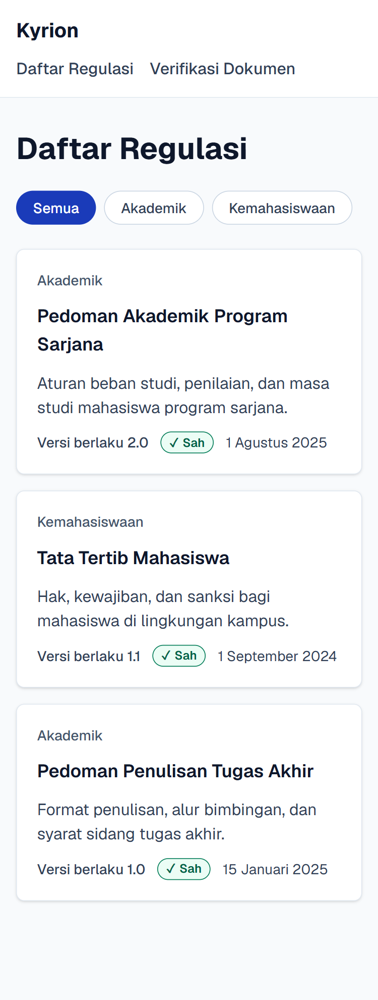
*Beranda di ponsel (375 px): kartu regulasi tersusun satu kolom.*

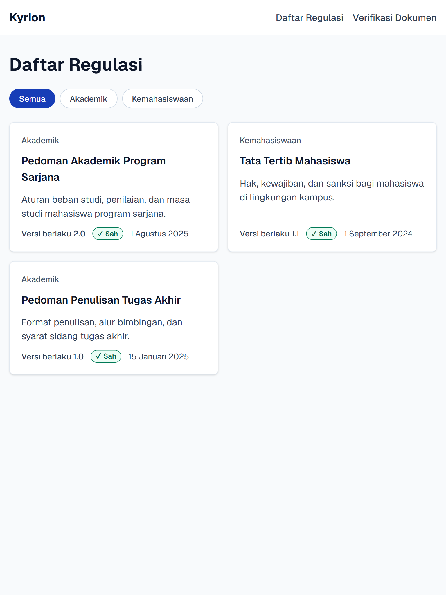
*Beranda di tablet (768 px): kartu regulasi tersusun dua kolom.*

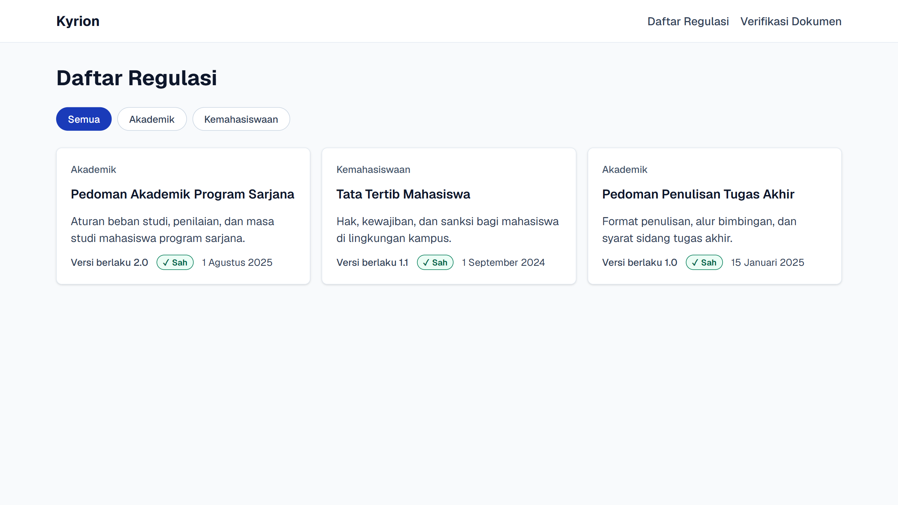
*Beranda di desktop (1280 px): kartu regulasi tersusun tiga kolom.*

**Detail Regulasi**

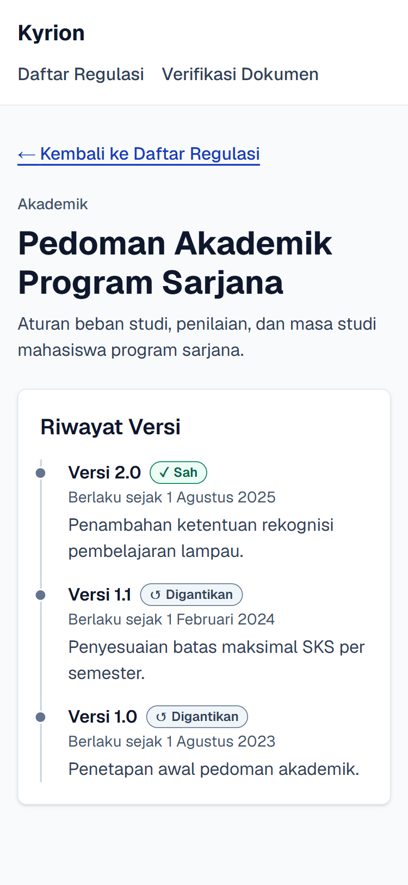
*Detail regulasi di ponsel (375 px) beserta linimasa riwayat versi.*

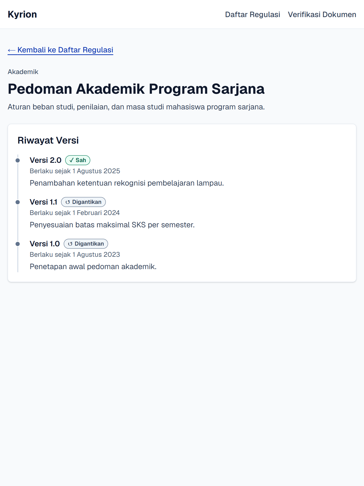
*Detail regulasi di tablet (768 px).*

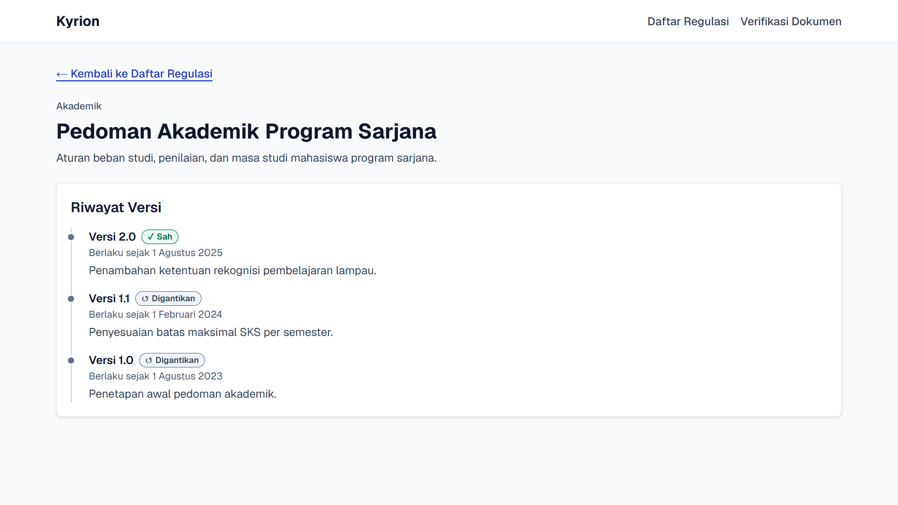
*Detail regulasi di desktop (1280 px).*

**Verifikasi Dokumen**

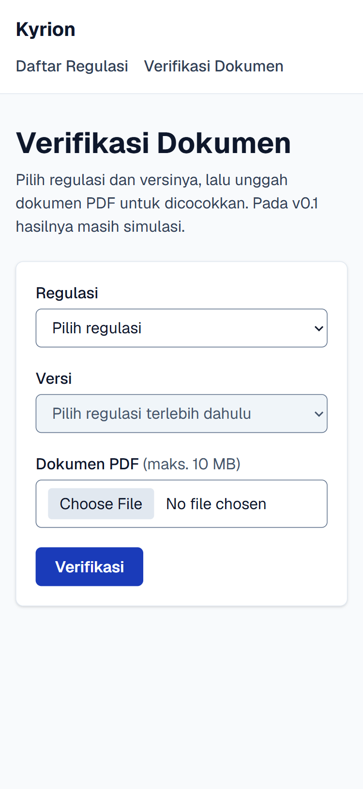
*Formulir verifikasi di ponsel (375 px).*

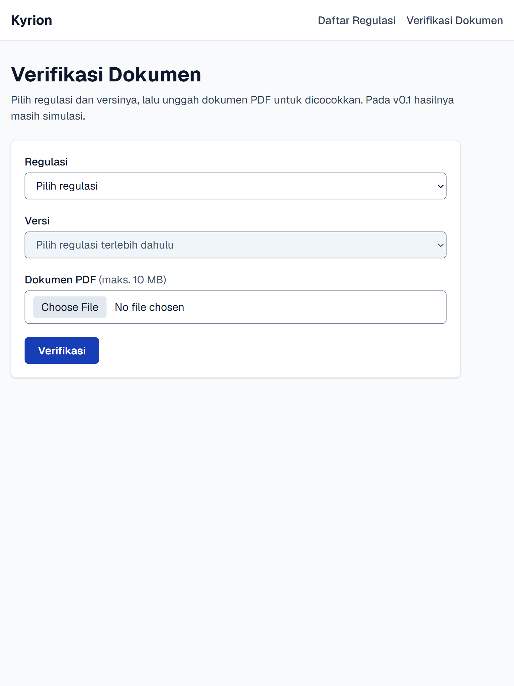
*Formulir verifikasi di tablet (768 px).*

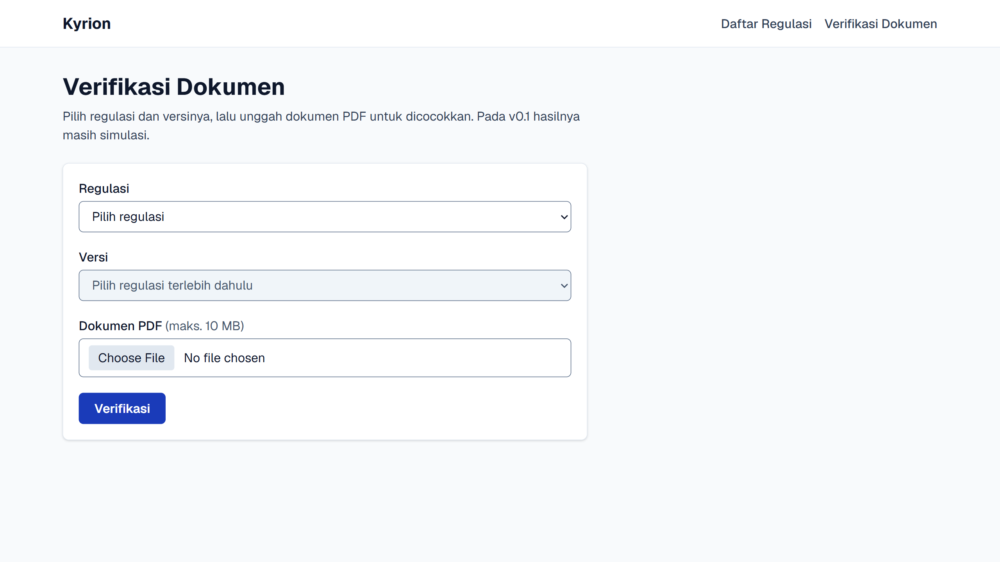
*Formulir verifikasi di desktop (1280 px).*

**Validasi Formulir**

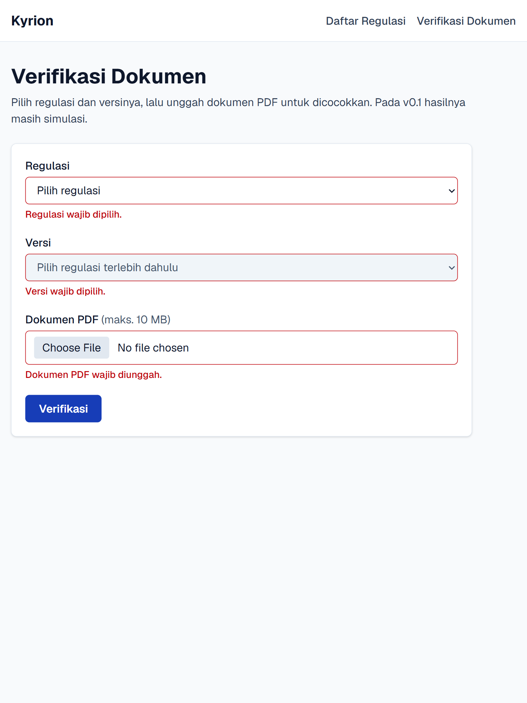
*Formulir dikirim dalam keadaan kosong. Setiap field menampilkan pesan galat: "Regulasi wajib dipilih.", "Versi wajib dipilih.", dan "Dokumen PDF wajib diunggah."*

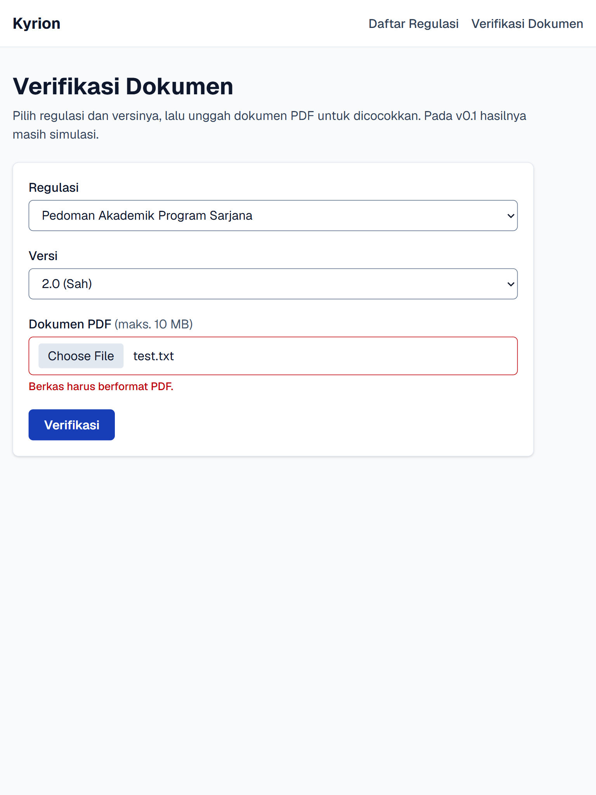
*Berkas `test.txt` diunggah dan ditolak dengan pesan "Berkas harus berformat PDF."*

## Penggunaan AI

Antarmuka v0.1 ini dibuat dengan bantuan Claude Code (asisten pemrograman AI dari Anthropic) berdasarkan prompt yang saya susun. Prompt tersebut menetapkan kebutuhan produk, struktur file, aturan aksesibilitas, dan prinsip Clean Code/SOLID. Saya kemudian meninjau, menjalankan, dan menguji hasilnya, termasuk pemeriksaan tipe, lint, build, dan audit Lighthouse. Rincian prompt dan keputusan yang diambil tercatat di [AI_LOG.md](AI_LOG.md).

**Pemilik produk:** Arif Mufti Tharsa
