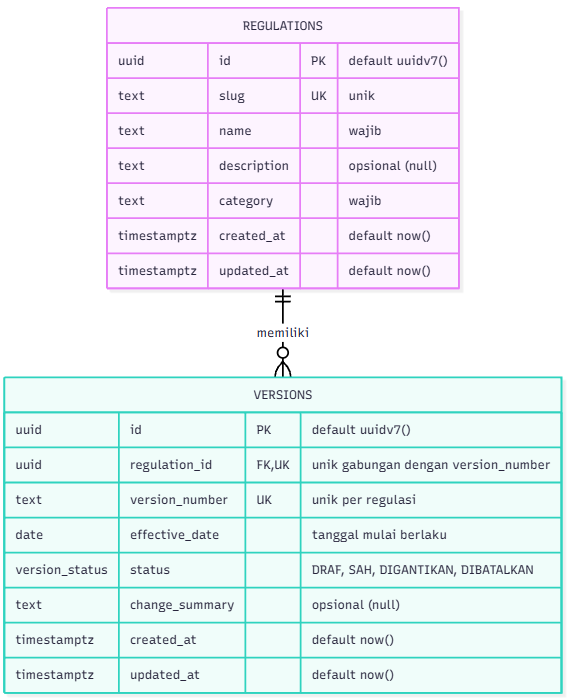

# Kyrion

Kyrion, dari kata Yunani *kyrion* yang berarti "yang sah, yang berlaku", adalah aplikasi web yang membantu sivitas akademika Universitas Pertamina mengetahui ketentuan resmi mana yang sedang berlaku, apa yang berubah antarversi, dan apakah sebuah dokumen regulasi asli.

> Status: **v0.2 (Tugas 2 PAW)**: antarmuka publik dan halaman admin dengan data dari PostgreSQL. Rilis sebelumnya, v0.1 (Tugas 1 PAW, Milestone 1), dibekukan pada tag `v0.1`.

## Permasalahan

Regulasi kampus dirilis sebagai berkas PDF terpisah yang direvisi setiap tahun akademik. Berkas-berkas itu tidak disertai riwayat versi, tanggal berlaku, maupun bukti keabsahan. Akibatnya mahasiswa berisiko mengikuti ketentuan yang sudah tidak berlaku.

## Sasaran Pengguna

| Peran | Kebutuhan |
|---|---|
| Pengunjung | Melihat daftar regulasi dan versi yang berlaku tanpa perlu masuk. |
| Mahasiswa | Memastikan ketentuan yang diikuti adalah versi sah, lalu memverifikasi dokumen yang dimiliki. |
| Admin Akademik | Mengelola regulasi dan menerbitkan versi baru. |

Catatan: v0.2 menambah fitur **Admin Akademik** (kelola regulasi dan versi Draf) di balik login. Login masih berupa satu akun demo dari variabel environment; autentikasi akun sebenarnya dan pembedaan peran belum ada.

## Fitur

**Halaman publik**

1. **Daftar regulasi dengan filter kategori** (`/`). Setiap regulasi ditampilkan sebagai kartu yang memuat kategori, nama, deskripsi, versi berlaku, status, dan tanggal berlaku. Versi berlaku dihitung dari tanggal hari ini (WIB); regulasi tanpa versi menampilkan "Belum ada versi.". Filter memakai parameter URL `?kategori=...`, dan kategori yang tidak dikenal diabaikan.
2. **Detail regulasi dengan linimasa versi** (`/regulasi/[slug]`). Header menampilkan versi yang berlaku hari ini. Riwayat versi diurutkan dari yang terbaru, dan hanya versi berstatus **Sah** atau **Digantikan** yang ditampilkan ke publik; status dibedakan dengan warna, simbol, dan teks. Versi yang tanggal berlakunya belum tiba diberi keterangan "Mulai berlaku". Slug yang tidak ada akan menampilkan halaman 404.
3. **Formulir verifikasi dokumen** (`/verifikasi`). Pengguna memilih regulasi, lalu versi (pilihan versi bergantung pada regulasi), lalu mengunggah PDF. Validasi sisi klien memeriksa bahwa:
   - semua field terisi;
   - berkas berformat PDF (MIME `application/pdf` atau ekstensi `.pdf`);
   - ukuran berkas maksimal 10 MB.

   Pesan galat ditampilkan per field dalam Bahasa Indonesia.

**Halaman admin (baru di v0.2)**

4. **Masuk** (`/masuk`). Login dengan akun demo; sesi disimpan di cookie HttpOnly. Saat login, header menampilkan Kelola Regulasi dan tombol Keluar.
5. **Kelola regulasi** (`/admin/regulasi`). Daftar semua regulasi beserta jumlah versinya; tambah, ubah, dan hapus regulasi. Slug dibuat server dari nama, dan hanya regulasi tanpa versi yang dapat dihapus.
6. **Kelola versi** (`/admin/regulasi/[slug]/versi`). Daftar semua versi dengan keempat status (Draf, Sah, Digantikan, Dibatalkan). Versi baru selalu Draf, dan hanya Draf yang dapat diubah atau dihapus. Tanggal mulai berlaku diisi lewat tiga kolom (tanggal, nama bulan, tahun).

Semua masukan admin divalidasi di server dengan Zod, dengan galat per field. Aturan dan hasil uji ada di bagian Tugas 2.

**Batasan v0.2:**
- Data regulasi tersimpan di PostgreSQL. Data awalnya adalah **data sintetis** (fiktif) dari seed `apps/web/prisma/seed.ts`.
- **Hasil verifikasi masih simulasi.** Isi PDF tidak dibaca. Fungsi sidik berkas (`lib/crypto/fingerprint.ts`) sudah ada dan diuji, tetapi belum dihubungkan ke alur verifikasi.
- Login masih satu akun demo. **Belum ada** akun Admin dengan hash kata sandi, pembedaan peran, pengesahan atau pembatalan versi lewat UI, maupun unggah PDF.

## Teknologi

Versi terpasang, sesuai `apps/web/package-lock.json` (rentang yang dideklarasikan ada di `apps/web/package.json`).

| Teknologi | Versi | Peran |
|---|---|---|
| Node.js | 24 LTS (dipakai pada v24.19.0) | Runtime |
| Next.js (App Router) | 16.4.2 | Kerangka web, Server Component, dan Server Action |
| React / React DOM | 19.3.1 | Antarmuka |
| TypeScript | 5.9.3 | Bahasa |
| Tailwind CSS | 4.3.3 | Gaya |
| PostgreSQL | 18 (image `postgres:18.6-trixie`) | Basis data |
| Docker Compose | v5.6.1 (dipakai pada pengembangan) | Menjalankan PostgreSQL lewat `compose.yaml` |
| Prisma ORM (+ `@prisma/adapter-pg`) | 7.10.1 | Skema, migrasi, dan akses data |
| Zod | 4.6.7 | Validasi di server |
| Vitest | 5.0.4 | Uji otomatis |
| tsx | 4.23.15 | Menjalankan seed |
| ESLint (`eslint-config-next`) | 9.39.5 (16.4.2) | Lint |

## Struktur Aplikasi

```
kyrion/
├── compose.yaml                    # PostgreSQL 18 (Docker Compose), port 127.0.0.1:5433
├── .env.example                    # Contoh POSTGRES_* untuk compose.yaml
├── AI_LOG.md                       # Log penggunaan AI
├── docs/                           # Dokumen praktikum dan bukti (praktikum, tugas-1, tugas-2)
├── security/                       # Inventaris aset, DFD, model ancaman, register risiko
└── apps/web/
    ├── app/
    │   ├── layout.tsx              # Kerangka halaman: lang="id", skip link, SiteHeader, <main id="konten">
    │   ├── page.tsx                # Beranda: Daftar Regulasi + filter kategori
    │   ├── error.tsx               # Halaman galat ramah (mis. basis data tidak terjangkau)
    │   ├── not-found.tsx           # Halaman 404 global
    │   ├── globals.css
    │   ├── favicon.ico
    │   ├── masuk/                  # Halaman masuk dan Server Action masuk/keluar
    │   ├── regulasi/               # layout, template, error; [slug]/page.tsx = detail + riwayat versi
    │   ├── verifikasi/
    │   │   └── page.tsx            # Halaman verifikasi dokumen (simulasi)
    │   └── admin/
    │       └── regulasi/           # Kelola regulasi: daftar, baru, [slug]/ubah, [slug]/hapus
    │           └── [slug]/versi/   # Kelola versi: daftar, baru, [versionId]/ubah, [versionId]/hapus
    ├── components/                 # Lihat tabel di bawah
    ├── lib/
    │   ├── data/                   # Repositori Prisma: regulations.ts (publik dan admin), versions.ts (admin)
    │   ├── domain/                 # Aturan murni beserta ujinya: slug, regulasi, versi, versi-admin, tanggal
    │   ├── crypto/
    │   │   └── fingerprint.ts      # Sidik SHA-256 berkas (Tugas 1; belum dipakai di alur verifikasi)
    │   ├── validation/
    │   │   └── verify-form.ts      # Validasi formulir verifikasi (fungsi murni, tanpa React)
    │   ├── prisma.ts               # Satu PrismaClient (server-only)
    │   ├── sesi.ts                 # Sesi cookie akun demo: bacaSesi() dan wajibAdmin()
    │   ├── skema.ts                # Skema Zod: regulasi, versi, masuk
    │   ├── status-form.ts          # Tipe state formulir Server Action
    │   ├── format.ts               # formatDate: "1 Agustus 2025" (id-ID, UTC)
    │   ├── styles.ts               # Kelas focus ring bersama
    │   └── types.ts                # Tipe dan konstanta bersama (VersionStatus, KATEGORI, ...)
    ├── prisma/
    │   ├── schema.prisma
    │   ├── migrations/
    │   └── seed.ts                 # Seed data sintetis (idempoten)
    ├── generated/prisma/           # Hasil prisma generate (diabaikan Git)
    ├── prisma.config.ts            # Konfigurasi Prisma 7: env dari .env.local, perintah seed
    ├── proxy.ts                    # Pemeriksaan cookie sesi untuk /admin/**
    ├── public/
    └── package.json
```

| Komponen | Peran |
|---|---|
| `SiteHeader` | Nama Kyrion dan navigasi utama. Tamu melihat Masuk; admin melihat Kelola Regulasi dan tombol Keluar (hanya tampilan, otorisasi tetap di `wajibAdmin()`). |
| `TautanNav` | Client Component. Tautan navigasi dengan `aria-current` pada halaman aktif. |
| `CategoryFilter` | Tautan filter kategori (`?kategori=...`) dengan opsi "Semua" dan `aria-current` pada kategori aktif. |
| `RegulationCard` | Kartu ringkasan satu regulasi beserta versi yang berlaku hari ini. |
| `CurrentVersionInfo` | Satu baris versi berlaku hari ini (nomor, status, tanggal), atau keterangan bila belum ada versi atau belum ada yang berlaku. Dipakai kartu dan halaman detail. |
| `StatusBadge` | Penanda status versi (Draf, Sah, Digantikan, Dibatalkan) berupa warna, simbol, dan teks. |
| `VersionTimeline` | Daftar riwayat versi, diurutkan dari yang terbaru; versi yang belum berlaku diberi keterangan "Mulai berlaku". |
| `VerifyForm` | Client Component. Mengelola pilihan regulasi/versi, berkas, dan pesan galat validasi. |
| `VerifyResult` | Menampilkan hasil verifikasi simulasi (`role="status"`) beserta penegasan bahwa pencocokan hash dokumen belum dihubungkan. |
| `FormMasuk`, `FormRegulasi`, `FormVersi` | Client Component. Formulir dengan `useActionState` yang memanggil Server Action dan menampilkan galat per field. |
| `FormHapus` | Client Component. Tombol konfirmasi hapus (regulasi dan versi) yang menampilkan pesan penolakan dari server. |

Client Component hanya yang disebut di tabel ini dan berkas `error.tsx`; selebihnya Server Component.

## Cara Menjalankan

Prasyarat: Node.js 24, npm, dan Docker Desktop (untuk PostgreSQL).

Aplikasi v0.2 membaca data dari PostgreSQL, sehingga basis data dan berkas environment harus disiapkan lebih dulu. Langkah lengkap (Docker Compose, `.env`, migrasi, seed, `npm run dev`) ada di [Tugas 2, bagian 2](#2-menjalankan-secara-lokal).

Untuk build produksi, jalankan dari `apps/web`:

```bash
npm run build
npm start
```

Build tidak membutuhkan basis data; `npm start` membutuhkannya saat halaman diminta.

Untuk cek tipe, lint, dan uji otomatis:

```bash
npx tsc --noEmit
npm run lint
npm test
```

## Bukti Tugas 1

### a. Lighthouse Accessibility

Kondisi uji (tanggal, versi Lighthouse dan Chrome, perangkat emulasi, mode server) tercatat di [KONDISI-UJI.md](docs/tugas-1/lighthouse/KONDISI-UJI.md).

| Halaman | URL | Skor Accessibility | Laporan |
|---|---|---|---|
| Beranda | `/` | 100 | [beranda.html](docs/tugas-1/lighthouse/beranda.html) |
| Detail regulasi | `/regulasi/pedoman-akademik` | 100 | [detail.html](docs/tugas-1/lighthouse/detail.html) |
| Verifikasi | `/verifikasi` | 100 | [verifikasi.html](docs/tugas-1/lighthouse/verifikasi.html) |

### b. Tangkapan Layar

Tangkapan layar diambil pada tiga lebar layar: 375 px (ponsel), 768 px (tablet), dan 1280 px (desktop).

**Beranda (Daftar Regulasi)**


*Beranda di ponsel (375 px): kartu regulasi tersusun satu kolom.*


*Beranda di tablet (768 px): kartu regulasi tersusun dua kolom.*


*Beranda di desktop (1280 px): kartu regulasi tersusun tiga kolom.*

**Detail Regulasi**


*Detail regulasi di ponsel (375 px) beserta linimasa riwayat versi.*


*Detail regulasi di tablet (768 px).*


*Detail regulasi di desktop (1280 px).*

**Verifikasi Dokumen**


*Formulir verifikasi di ponsel (375 px).*


*Formulir verifikasi di tablet (768 px).*


*Formulir verifikasi di desktop (1280 px).*

**Validasi Formulir**


*Formulir dikirim dalam keadaan kosong. Setiap field menampilkan pesan galat: "Regulasi wajib dipilih.", "Versi wajib dipilih.", dan "Dokumen PDF wajib diunggah."*


*Berkas `test.txt` diunggah dan ditolak dengan pesan "Berkas harus berformat PDF."*

## Dokumen Teknis Praktikum PAW

Dokumen Teknis Praktikum Pengembangan Aplikasi Web (052356) tersebar di dua repository:

- Modul 1–3: [praktikum-paw](https://github.com/arifmuftitharsa/praktikum-paw/tree/main/docs/praktikum)
- Modul 4 dan seterusnya: [docs/praktikum](docs/praktikum/) di repository ini

## Penggunaan AI

Antarmuka v0.1 ini dibuat dengan bantuan Claude Code (asisten pemrograman AI dari Anthropic) berdasarkan prompt yang saya susun. Prompt tersebut menetapkan kebutuhan produk, struktur file, aturan aksesibilitas, dan prinsip Clean Code/SOLID. Saya kemudian meninjau, menjalankan, dan menguji hasilnya, termasuk pemeriksaan tipe, lint, build, dan audit Lighthouse. Rincian prompt dan keputusan yang diambil tercatat di [AI_LOG.md](AI_LOG.md).

**Pemilik produk:** Arif Mufti Tharsa

## Kriptografi (Tugas 1)

Komponen yang dikerjakan: sidik data berkas versi regulasi (fitur F-30), berupa SHA-256 di `apps/web/lib/crypto/fingerprint.ts`.

### Kebutuhan keamanan data

| Data | Tujuan keamanan | Prioritas | Kebutuhan yang dapat diuji | Ditangani di |
| --- | --- | --- | --- | --- |
| Berkas versi regulasi | Integritas (deteksi perubahan) | Tinggi (kalau isinya berubah diam-diam, pengguna bakal ngikutin aturan yang salah) | `verifyFingerprint` mengembalikan `false` jika data berubah satu byte atau format sidik tidak valid, dan melempar `InputTooLargeError` jika input melebihi 10 MB. | T1 |
| Metadata status versi | Integritas dan autentisitas | Sedang (kalau statusnya tertukar, regulasi usang bisa dikira masih berlaku) | Sistem menolak pembaruan metadata jika verifikasi HMAC atas metadata gagal. | T2 (rencana) |
| Kredensial admin | Kerahasiaan dan autentisitas | Tinggi (kalau bocor, orang luar bisa seenaknya mengubah isi aturan) | Sistem menolak sesi masuk dan mengembalikan status 401 kalau kombinasi identitas dan hash kata sandi (scrypt + salt acak) tidak cocok. | T2/T3 (rencana) |
| Log audit | Integritas | Sedang (kalau riwayat bisa diedit, jejak aksi manipulasi bakal hilang) | Verifikasi rantai hash gagal kalau satu entri diubah atau dihapus. | T2/T3 (rencana) |

Hash tanpa kunci (seperti SHA-256) hanya bisa mendeteksi apakah data pernah berubah, tetapi tidak bisa membuktikan siapa yang mengubahnya, karena siapa pun bisa menghitung ulang hash baru. Pembuktian asal-usul dan keaslian pembuat data (autentisitas) baru terjamin ketika ditambahkan kunci rahasia, misalnya lewat HMAC atau tanda tangan digital.

Batas Tugas 1: yang dikerjakan baru fungsi sidik dan verifikasinya beserta tes. Penyimpanan sidik di database dan pemanggilan dari alur unggah berkas dikerjakan di tugas berikutnya.

### Rancangan komponen sidik berkas

- Masukan, proses, keluaran: bytes berkas (`Uint8Array`, maksimum 10 MB) -> SHA-256 -> string hex huruf kecil sepanjang 64 karakter. `verifyFingerprint` menerima bytes dan sidik yang diharapkan, lalu mengembalikan `true` hanya jika keduanya sama persis.
- Hex adalah encoding, bukan enkripsi: hex hanya cara menulis byte sebagai teks, dan siapa pun bisa membalikkannya tanpa kunci. Keamanan sidik berasal dari sifat SHA-256 yang satu arah dan tahan tabrakan, bukan dari kerahasiaan hex.
- Alasan memakai `node:crypto`: pustaka bawaan Node.js yang terpelihara dan memakai OpenSSL di belakangnya, sehingga tidak perlu dependensi tambahan dan tidak ada algoritma buatan sendiri.
- Perbandingan memakai `timingSafeEqual` (waktu konstan) dan format sidik divalidasi lebih dulu, sehingga input salah format gagal tertutup (`false`) dan tidak memicu galat tak terduga.
- Sumber keacakan: SHA-256 tidak membutuhkan kunci, jadi Tugas 1 tidak memakai nilai acak. Nilai rahasia di tugas berikutnya (kunci HMAC, nonce) akan dibangkitkan dengan CSPRNG (`crypto.randomBytes`), bukan `Math.random`.
- Sandi klasik hanya bahan belajar dan tidak dipakai untuk melindungi data produk.

### Cara menjalankan tes

Dari klon bersih, jalankan di folder `apps/web` (bukan di root repo):

```bash
cd apps/web
npm install
npm test
```

Cuplikan keluaran (11 tes lulus):

```
 RUN  v5.0.4 C:/Projects/kyrion/apps/web

 ✓ lib/crypto/fingerprint.test.ts (11 tests) 10ms
   ✓ fingerprint (4)
     ✓ menghasilkan SHA-256 sesuai vektor uji resmi FIPS 180-2 untuk "abc" 1ms
     ✓ menghasilkan SHA-256 yang benar untuk input kosong 0ms
     ✓ menerima input tepat sebesar MAX_INPUT_BYTES 7ms
     ✓ melempar InputTooLargeError untuk input sebesar MAX_INPUT_BYTES + 1 0ms
   ✓ verifyFingerprint (7)
     ✓ mengembalikan true untuk data asli dan false bila satu byte diubah 0ms
     ✓ mengembalikan false untuk expectedHex berformat salah: string bukan hex (64 karakter z) 0ms
     ✓ mengembalikan false untuk expectedHex berformat salah: hex 63 karakter 0ms
     ✓ mengembalikan false untuk expectedHex berformat salah: hex 65 karakter 0ms
     ✓ mengembalikan false untuk expectedHex berformat salah: hex huruf besar dari hash yang benar 0ms
     ✓ mengembalikan false untuk expectedHex berformat salah: string kosong 0ms
     ✓ melempar InputTooLargeError (bukan mengembalikan false) untuk data di atas MAX_INPUT_BYTES 0ms

 Test Files  1 passed (1)
      Tests  11 passed (11)
```

## Tugas 2 (v0.2): PostgreSQL, Prisma, dan CRUD Admin

> Bagian umum di atas sudah mengikuti v0.2. Bagian "Bukti Tugas 1" dan "Kriptografi (Tugas 1)" tetap menggambarkan v0.1 (tag `v0.1`). Bagian ini merinci pengujian v0.2.

### 1. Ringkasan

v0.2 mengganti data tiruan dengan **PostgreSQL 18** dan **Prisma ORM 7.10.1** (versinya dikunci karena tag `latest` npm untuk `prisma` mengarah ke Prisma 8 RC). Dua entitas berelasi, **Regulation 1–N Version**, dikelola lewat **CRUD lengkap di UI admin** (`/admin/regulasi`). Validasi memakai **Zod 4 di server** dengan galat per field. Data awal berupa **seed data sintetis** (4 regulasi, 8 versi).

### 2. Menjalankan secara lokal

Prasyarat: Node.js 24 dan Docker Desktop.

**Langkah 1, di root repo** (basis data):

```bash
cp .env.example .env
# isi POSTGRES_USER, POSTGRES_PASSWORD, dan POSTGRES_DB dengan nilai sendiri
docker compose up -d db
docker compose ps    # tunggu status (healthy)
```

**Langkah 2, di `apps/web`** (aplikasi):

```bash
cd apps/web
npm install
cp .env.example .env.local
# isi DATABASE_URL (host 127.0.0.1, port 5433; pengguna, kata sandi, dan nama DB sama dengan root .env)
# isi DEMO_EMAIL dan DEMO_KATA_SANDI untuk masuk sebagai admin
npx prisma migrate dev
npx prisma generate
npx prisma db seed
npm run dev
```

Buka http://localhost:3000, lalu masuk lewat `/masuk` untuk membuka `/admin/regulasi`.

- `.env` dan `.env.local` diabaikan Git dan tidak boleh di-commit.
- Perintah `prisma` membaca `DATABASE_URL` dari `.env.local` lewat `prisma.config.ts`, jadi berkas itu harus sudah ada.
- Prisma 7 tidak menjalankan `generate` dan seed otomatis setelah `migrate dev`, sehingga keduanya dijalankan eksplisit.
- Uji otomatis: `npm test`. Build produksi: `npm run build`, lalu `npm start`.

> **Peringatan:** seed memakai `upsert` sehingga aman dijalankan ulang tanpa menggandakan data, tetapi baris seed yang sudah diubah manual akan dikembalikan ke nilai awalnya.

### 3. Pemodelan data



Constraint berikut diambil dari `apps/web/prisma/schema.prisma` dan migrasi `apps/web/prisma/migrations/20261024092703_init`:

| Aturan | Implementasi di basis data |
|---|---|
| Slug regulasi unik | `UNIQUE INDEX regulations_slug_key` pada `regulations(slug)` |
| Nomor versi unik per regulasi | `UNIQUE INDEX versions_regulation_id_version_number_key` pada `versions(regulation_id, version_number)` |
| Versi tidak boleh yatim, regulasi dengan versi tidak boleh hilang | FK `versions.regulation_id` ke `regulations.id` dengan `ON DELETE RESTRICT` (`ON UPDATE CASCADE`) |
| Status versi | Enum `version_status`: `DRAF`, `SAH`, `DIGANTIKAN`, `DIBATALKAN` (bawaan `DRAF`) |
| Primary key | `UUID` dengan `DEFAULT uuidv7()`, dibuat oleh basis data |
| Tanggal mulai berlaku | `effective_date` bertipe `DATE` |
| Stempel waktu | `created_at` dan `updated_at` bertipe `TIMESTAMPTZ(3)` |

Versi yang berlaku tidak disimpan sebagai kolom; lapisan domain menghitungnya.

### 4. Aturan bisnis yang diuji

| Aturan | Lokasi utama |
|---|---|
| Versi baru selalu berstatus Draf. | `lib/data/versions.ts` |
| Hanya Draf yang dapat diubah atau dihapus, dan status diperiksa ulang di server saat aksi dijalankan. | `lib/domain/versi-admin.ts`, `lib/data/versions.ts` |
| Regulasi hanya dapat dihapus bila tidak punya versi. | `lib/domain/regulasi.ts`, FK `RESTRICT` |
| Nomor versi unik per regulasi. | Unique index, galat P2002 ditampilkan sebagai pesan di field |
| Halaman publik hanya menampilkan versi Sah dan Digantikan. | `lib/data/regulations.ts` |
| Versi berlaku adalah versi Sah atau Digantikan dengan tanggal mulai berlaku kurang dari atau sama dengan hari ini (WIB) yang paling baru. | `lib/domain/versi.ts`, `lib/domain/tanggal.ts` |
| Tanggal dimasukkan lewat tiga kolom (tanggal, nama bulan, tahun) agar tidak bergantung pada bahasa browser. | `components/FormVersi.tsx`, `lib/skema.ts` |

### 5. Skenario uji CRUD dan relasi

Tanggal uji: 25 Oktober 2026. Bukti ada di [docs/tugas-2/screenshots](docs/tugas-2/screenshots/).

| No | Entitas | Operasi | Tujuan | Masukan | Hasil diharapkan | Hasil aktual | Status | Bukti |
|---|---|---|---|---|---|---|---|---|
| 1 | Regulasi | Create | Menambah regulasi baru | Nama "Pedoman Cuti Akademik", kategori Akademik, deskripsi sintetis | Tersimpan, slug dibuat server | Muncul di daftar admin; baris ada di DB dengan slug pedoman-cuti-akademik | Lulus | [skenario-01-regulasi-create-ui.png](docs/tugas-2/screenshots/skenario-01-regulasi-create-ui.png), [skenario-01-regulasi-create-db.png](docs/tugas-2/screenshots/skenario-01-regulasi-create-db.png) |
| 2 | Regulasi | Read | Alamat yang tidak ada ditangani | Buka /regulasi/tidak-ada | Halaman tidak ditemukan, status 404 | "Regulasi tidak ditemukan", Network: 404 Not Found | Lulus | [skenario-02-regulasi-read-ui.png](docs/tugas-2/screenshots/skenario-02-regulasi-read-ui.png) |
| 3 | Regulasi | Update | Mengubah deskripsi | Deskripsi diganti teks baru | Tersimpan, deskripsi baru tampil | Deskripsi baru tampil di halaman publik; updated_at lebih baru dari created_at | Lulus | [skenario-03-regulasi-update-ui.png](docs/tugas-2/screenshots/skenario-03-regulasi-update-ui.png), [skenario-03-regulasi-update-db.png](docs/tugas-2/screenshots/skenario-03-regulasi-update-db.png) |
| 4 | Regulasi | Delete | Menghapus regulasi tanpa versi | Hapus Pedoman Cuti Akademik | Terhapus | Hilang dari daftar; count di DB = 0 | Lulus | [skenario-04-regulasi-delete-ui.png](docs/tugas-2/screenshots/skenario-04-regulasi-delete-ui.png), [skenario-04-regulasi-delete-db.png](docs/tugas-2/screenshots/skenario-04-regulasi-delete-db.png) |
| 5 | Versi | Create | Menambah versi | Versi 15 Pedoman Tugas Akhir, 1 Agustus 2027, ringkasan | Tersimpan sebagai Draf | Tampil paling atas sebagai Draf; DB: 15, DRAF, 2027-08-01 | Lulus | [skenario-05-versi-create-ui.png](docs/tugas-2/screenshots/skenario-05-versi-create-ui.png), [skenario-05-versi-create-db.png](docs/tugas-2/screenshots/skenario-05-versi-create-db.png) |
| 6 | Versi | Read | Daftar versi admin | Buka daftar versi Pedoman Akademik | Terurut dari tanggal terbaru, status tampil | Lima versi terurut 1 Agu 2027 → 15 Jan 2025 dengan label status | Lulus | [skenario-06-versi-read-ui.png](docs/tugas-2/screenshots/skenario-06-versi-read-ui.png) |
| 7 | Versi | Update | Mengubah versi Draf | Ringkasan versi 15 diganti | Tersimpan, status tetap Draf | Ringkasan baru tampil; DB: status DRAF, updated_at lebih baru | Lulus | [skenario-07-versi-update-ui.png](docs/tugas-2/screenshots/skenario-07-versi-update-ui.png), [skenario-07-versi-update-db.png](docs/tugas-2/screenshots/skenario-07-versi-update-db.png) |
| 8 | Versi | Delete | Menghapus versi Draf | Hapus versi 15 | Terhapus, versi lain utuh | Versi 15 hilang; DB tinggal 14, 13, 12, 11 | Lulus | [skenario-08-versi-delete-ui.png](docs/tugas-2/screenshots/skenario-08-versi-delete-ui.png), [skenario-08-versi-delete-db.png](docs/tugas-2/screenshots/skenario-08-versi-delete-db.png) |
| 9 | Relasi | Read | Publik hanya melihat versi yang pernah disahkan | Buka /regulasi/pedoman-tugas-akhir | Hanya versi 11; Draf dan Dibatalkan tidak tampil | Versi berlaku 11 dan riwayat hanya versi 11, padahal DB berisi 4 versi | Lulus | [skenario-09-relasi-read-ui.png](docs/tugas-2/screenshots/skenario-09-relasi-read-ui.png), [skenario-08-versi-delete-db.png](docs/tugas-2/screenshots/skenario-08-versi-delete-db.png) |
| 10 | Relasi | Delete | Regulasi yang masih punya versi tidak boleh dihapus | Hapus Pedoman Tugas Akhir (4 versi) | Ditolak dengan pesan jelas | "Regulasi ini memiliki 4 versi dan tidak dapat dihapus…"; DB tetap 4 versi | Lulus | [skenario-10-relasi-delete-ui.png](docs/tugas-2/screenshots/skenario-10-relasi-delete-ui.png), [skenario-10-relasi-delete-db.png](docs/tugas-2/screenshots/skenario-10-relasi-delete-db.png) |

**Hasil: 10 dari 10 lulus** (ambang 0,9 × 10 = 9).

### 6. Penolakan masukan (validasi Zod)

Validasi browser dimatikan lewat `noValidate` agar yang diuji adalah validasi server.

| No | Entitas | Masukan | Pesan galat | Status | Bukti |
|---|---|---|---|---|---|
| Z1 | Regulasi | Nama "Abc" | "Nama regulasi minimal 5 karakter" di kolom nama | Lulus | [zod-01-regulasi-nama-pendek.png](docs/tugas-2/screenshots/zod-01-regulasi-nama-pendek.png) |
| Z2 | Versi | 31 Juni 2027 | "Tanggal mulai berlaku tidak valid" | Lulus | [zod-02-versi-tanggal-mustahil.png](docs/tugas-2/screenshots/zod-02-versi-tanggal-mustahil.png) |
| Z3 | Versi | Bulan tidak dipilih | "Pilih bulan" | Lulus | [zod-03-versi-bulan-kosong.png](docs/tugas-2/screenshots/zod-03-versi-bulan-kosong.png) |

### 7. Uji tambahan

Dilakukan manual pada 24 Oktober 2026, tanpa tangkapan layar terlampir:

- Nomor versi ganda ditolak saat tambah dan saat ubah (galat P2002 ditampilkan di field nomor versi).
- Nomor versi yang sama di regulasi lain diterima.
- ID versi milik regulasi lain menghasilkan 404.
- Hapus versi yang statusnya diubah menjadi Sah setelah halaman konfirmasi dibuka ditolak oleh server.
- Saat DB mati, halaman galat ramah tampil (diuji di mode produksi) dengan kode galat yang cocok dengan digest di log server.

Uji otomatis: `npm test` menjalankan **43 uji Vitest**. Berkas ujinya: `lib/domain/regulasi.test.ts`, `lib/domain/slug.test.ts`, `lib/domain/tanggal.test.ts`, `lib/domain/versi-admin.test.ts`, `lib/domain/versi.test.ts`, dan `lib/crypto/fingerprint.test.ts` (dari Tugas 1).

### 8. Temuan selama pengujian dan perbaikannya

| Temuan | Perbaikan |
|---|---|
| Nama regulasi ganda sempat diterima, karena slug di seed ditulis manual dan tidak dihitung dari nama sehingga pengecekan slug unik tidak mendeteksinya. | Slug seed dihitung dengan `createSlug(nama)`; commit `99e0d9e`. |
| `<input type="date">` mengikuti bahasa browser, sehingga 01/07/2027 tersimpan sebagai 7 Januari. | Diganti tiga kolom (tanggal, nama bulan, tahun); commit `33f58d2`. |

### 9. Keterbatasan yang diketahui

- Judul tab masih judul halaman asal pada halaman yang memanggil `notFound()` sendiri.
- Login masih akun demo dari `.env.local` dengan pembandingan kata sandi apa adanya. Pada rilis berikutnya diganti akun Admin dari seed dengan hash kata sandi.
- Pengesahan versi dan unggah PDF belum tersedia.
- Kategori masih teks tetap.
