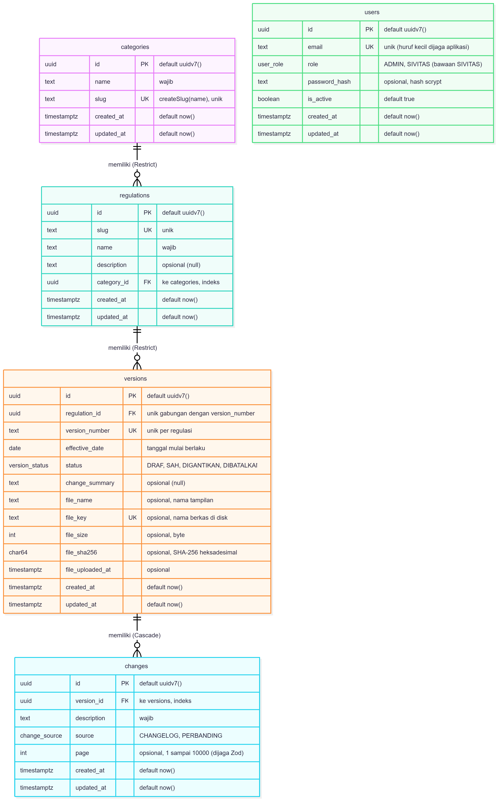

# Kyrion

Kyrion, dari kata Yunani *kyrion* yang berarti "yang sah, yang berlaku", adalah aplikasi web yang membantu sivitas akademika Universitas Pertamina mengetahui ketentuan resmi mana yang sedang berlaku, apa yang berubah antarversi, dan apakah sebuah dokumen regulasi asli.

> Status: **v0.2 (Tugas 2 PAW)**: antarmuka publik dan halaman admin dengan data dari PostgreSQL. Rilis sebelumnya, v0.1 (Tugas 1 PAW, Milestone 1), dibekukan pada tag `v0.1`.

## Daftar Isi

- [Permasalahan](#permasalahan)
- [Sasaran Pengguna](#sasaran-pengguna)
- [Fitur](#fitur)
- [Teknologi](#teknologi)
- [Struktur Aplikasi](#struktur-aplikasi)
- [Cara Menjalankan](#cara-menjalankan)
- [Tugas 2 (v0.2): PostgreSQL, Prisma, dan CRUD Admin](#tugas-2-v02-postgresql-prisma-dan-crud-admin)
- [Bukti Tugas 1](#bukti-tugas-1)
- [Kriptografi (Tugas 1)](#kriptografi-tugas-1)
- [Dokumen Teknis Praktikum PAW](#dokumen-teknis-praktikum-paw)
- [Penggunaan AI](#penggunaan-ai)

## Permasalahan

Regulasi kampus dirilis sebagai berkas PDF terpisah yang direvisi setiap tahun akademik. Berkas-berkas itu tidak disertai riwayat versi, tanggal berlaku, maupun bukti keabsahan. Akibatnya mahasiswa berisiko mengikuti ketentuan yang sudah tidak berlaku.

## Sasaran Pengguna

| Peran | Kebutuhan |
|---|---|
| Pengunjung | Melihat daftar regulasi dan versi yang berlaku tanpa perlu masuk. |
| Mahasiswa | Memastikan ketentuan yang diikuti adalah versi sah, lalu memverifikasi dokumen yang dimiliki. |
| Admin Akademik | Mengelola regulasi dan menerbitkan versi baru. |

Catatan: v0.2 menambah fitur **Admin Akademik** (kelola kategori, regulasi, versi Draf beserta berkas PDF, dan butir perubahan versi) di balik login. Login memakai akun Admin di tabel `users` dengan kata sandi yang disimpan sebagai hash scrypt. Peran SIVITAS sudah ada di skema tetapi belum dipakai, dan pengesahan versi belum tersedia.

## Fitur

**Halaman publik**

1. **Daftar regulasi dengan filter kategori** (`/`). Setiap regulasi ditampilkan sebagai kartu yang memuat kategori, nama, deskripsi, versi berlaku, status, dan tanggal berlaku. Versi berlaku dihitung dari tanggal hari ini (WIB); regulasi tanpa versi menampilkan "Belum ada versi.". Filter memakai parameter URL `?kategori=...` dengan daftar kategori dari tabel `categories`, dan kategori yang tidak dikenal diabaikan.
2. **Detail regulasi dengan linimasa versi** (`/regulasi/[slug]`). Header menampilkan versi yang berlaku hari ini. Riwayat versi diurutkan dari yang terbaru, dan hanya versi berstatus **Sah** atau **Digantikan** yang ditampilkan ke publik; status dibedakan dengan warna, simbol, dan teks. Versi yang tanggal berlakunya belum tiba diberi keterangan "Mulai berlaku". Slug yang tidak ada akan menampilkan halaman 404. Versi yang punya berkas menampilkan tautan **Unduh PDF**; unduhan publik hanya untuk versi Sah atau Digantikan, dan hash berkas dicocokkan ulang sebelum dikirim. Bila regulasi punya minimal dua versi, bagian **Bandingkan Versi** (`?dari=&ke=`) menampilkan butir perubahan di antara dua versi beserta sumber dan halamannya.
3. **Formulir verifikasi dokumen** (`/verifikasi`). Pengguna memilih regulasi, lalu versi (pilihan versi bergantung pada regulasi), lalu mengunggah PDF. Validasi sisi klien memeriksa bahwa:
   - semua field terisi;
   - berkas berformat PDF (MIME `application/pdf` atau ekstensi `.pdf`);
   - ukuran berkas maksimal 10 MB.

   Pesan galat ditampilkan per field dalam Bahasa Indonesia.

**Halaman admin (baru di v0.2)**

4. **Masuk** (`/masuk`). Login dengan akun Admin dari seed (kata sandi berhash scrypt). Email salah dan kata sandi salah mendapat pesan yang sama, dan akun nonaktif ditolak. Sesi disimpan di cookie HttpOnly. Saat login, header menampilkan Kelola Regulasi dan tombol Keluar.
5. **Kelola regulasi** (`/admin/regulasi`). Daftar semua regulasi beserta jumlah versinya; tambah, ubah, dan hapus regulasi. Kategori dipilih dari tabel kategori. Slug dibuat server dari nama, dan hanya regulasi tanpa versi yang dapat dihapus.
6. **Kelola versi** (`/admin/regulasi/[slug]/versi`). Daftar semua versi dengan keempat status (Draf, Sah, Digantikan, Dibatalkan). Versi baru selalu Draf, dan hanya Draf yang dapat diubah atau dihapus. Tanggal mulai berlaku diisi lewat tiga kolom (tanggal, nama bulan, tahun). Form versi menerima unggah PDF opsional (maksimal 10 MB, divalidasi dengan magic bytes `%PDF-`); daftar menampilkan tautan Unduh PDF dan jumlah perubahan tiap versi.
7. **Kelola kategori** (`/admin/kategori`, dari tombol di halaman Kelola Regulasi). Tambah, ganti nama, dan hapus kategori. Slug dibuat server dari nama sehingga nama serupa (beda huruf besar-kecil atau spasi) ditolak, dan hanya kategori tanpa regulasi yang dapat dihapus.
8. **Kelola perubahan** (`/admin/regulasi/[slug]/versi/[versionId]/perubahan`). Mencatat butir perubahan sebuah versi: deskripsi, sumber (Changelog atau Perbandingan), dan halaman opsional. Hanya versi Draf yang perubahannya dapat ditambah, diubah, atau dihapus; versi Sah, Digantikan, dan Dibatalkan terkunci.

Semua masukan admin divalidasi di server dengan Zod, dengan galat per field. Aturan dan hasil uji ada di bagian Tugas 2.

**Batasan v0.2:**
- Data regulasi tersimpan di PostgreSQL. Data awalnya adalah **data sintetis** (fiktif) dari seed `apps/web/prisma/seed.ts`.
- **Hasil verifikasi (`/verifikasi`) masih simulasi.** Isi PDF yang diunggah di halaman itu tidak dibaca. Fungsi sidik berkas (`lib/crypto/fingerprint.ts`) sudah dipakai saat unggah dan unduh berkas versi di halaman admin, tetapi belum dihubungkan ke alur verifikasi.
- **Belum ada** pengesahan atau pembatalan versi lewat UI, pembedaan peran SIVITAS, ganti atau reset kata sandi, maupun perbandingan perubahan otomatis (butir perubahan dicatat manual oleh Admin).

## Teknologi

Versi terpasang, sesuai `apps/web/package-lock.json` (rentang yang dideklarasikan ada di `apps/web/package.json`).

| Teknologi | Versi | Peran |
|---|---|---|
| Node.js | 24 LTS (dipakai pada v24.19.0) | Runtime |
| Next.js (App Router) | 16.4.2 | Kerangka web, Server Component, dan Server Action |
| React / React DOM | 19.3.1 | Antarmuka |
| TypeScript | 5.9.3 | Bahasa |
| Tailwind CSS | 4.3.3 | Gaya |
| PostgreSQL | 18 (image `postgres:18.6-trixie`) | Basis data |
| Docker Compose | v5.6.1 (dipakai pada pengembangan) | Menjalankan PostgreSQL lewat `compose.yaml` |
| Prisma ORM (+ `@prisma/adapter-pg`) | 7.10.1 | Skema, migrasi, dan akses data |
| Zod | 4.6.7 | Validasi di server |
| Vitest | 5.0.4 | Uji otomatis |
| tsx | 4.23.15 | Menjalankan seed |
| ESLint (`eslint-config-next`) | 9.39.5 (16.4.2) | Lint |

## Struktur Aplikasi

```
kyrion/
├── compose.yaml                    # PostgreSQL 18 (Docker Compose), port 127.0.0.1:5433
├── .env.example                    # Contoh POSTGRES_* untuk compose.yaml
├── AI_LOG.md                       # Log penggunaan AI
├── docs/                           # Dokumen praktikum dan bukti (praktikum, tugas-1, tugas-2)
├── security/                       # Inventaris aset, DFD, model ancaman, register risiko
└── apps/web/
    ├── app/
    │   ├── layout.tsx              # Kerangka halaman: lang="id", skip link, SiteHeader, <main id="konten">
    │   ├── page.tsx                # Beranda: Daftar Regulasi + filter kategori
    │   ├── error.tsx               # Halaman galat ramah (mis. basis data tidak terjangkau)
    │   ├── not-found.tsx           # Halaman 404 global
    │   ├── globals.css
    │   ├── favicon.ico
    │   ├── masuk/                  # Halaman masuk dan Server Action masuk/keluar
    │   ├── regulasi/               # layout, template, error; [slug]/page.tsx = detail + riwayat versi + banding; [slug]/versi/[versionId]/berkas = unduhan PDF publik
    │   ├── verifikasi/
    │   │   └── page.tsx            # Halaman verifikasi dokumen (simulasi)
    │   └── admin/
    │       ├── kategori/           # Kelola kategori: daftar, baru, [slug]/ubah, [slug]/hapus
    │       └── regulasi/           # Kelola regulasi: daftar, baru, [slug]/ubah, [slug]/hapus
    │           └── [slug]/versi/   # Kelola versi: daftar, baru, [versionId]/ubah, [versionId]/hapus,
    │                               #   [versionId]/berkas (unduhan admin), [versionId]/perubahan/** (Change)
    ├── components/                 # Lihat tabel di bawah
    ├── lib/
    │   ├── data/                   # Repositori Prisma: regulations, versions, categories, users, changes
    │   ├── domain/                 # Aturan murni beserta ujinya: slug, regulasi, kategori, versi, versi-admin, tanggal, berkas-pdf, perubahan, banding
    │   ├── crypto/
    │   │   ├── fingerprint.ts      # Sidik SHA-256 berkas (F-30); dipakai saat unggah dan unduh PDF
    │   │   ├── password.ts         # Hash dan verifikasi kata sandi dengan scrypt dan salt acak
    │   │   └── batas.ts            # MAX_INPUT_BYTES (10 MB); tanpa impor, aman dibundel ke klien
    │   ├── validation/
    │   │   └── verify-form.ts      # Validasi formulir verifikasi (fungsi murni, tanpa React)
    │   ├── prisma.ts               # Satu PrismaClient (server-only)
    │   ├── autentikasi.ts          # Verifikasi kredensial Admin terhadap tabel users
    │   ├── sesi.ts                 # Sesi cookie: bacaSesi() dan wajibAdmin() (memeriksa baris users aktif berperan ADMIN)
    │   ├── penyimpanan.ts          # Simpan, baca, dan hapus PDF di disk (di luar public/)
    │   ├── unduhan-pdf.ts          # Respons unduhan PDF; hash dicocokkan ulang sebelum dikirim
    │   ├── skema.ts                # Skema Zod: regulasi, kategori, versi, perubahan, banding, masuk
    │   ├── status-form.ts          # Tipe state formulir Server Action
    │   ├── format.ts               # formatDate: "1 Agustus 2025" (id-ID, UTC)
    │   ├── styles.ts               # Kelas focus ring bersama
    │   └── types.ts                # Tipe dan konstanta bersama (VersionStatus, ChangeSource, label tampilan, ...)
    ├── prisma/
    │   ├── schema.prisma
    │   ├── migrations/
    │   └── seed.ts                 # Seed data sintetis (idempoten)
    ├── generated/prisma/           # Hasil prisma generate (diabaikan Git)
    ├── prisma.config.ts            # Konfigurasi Prisma 7: env dari .env.local, perintah seed
    ├── proxy.ts                    # Pemeriksaan cookie sesi untuk /admin/**
    ├── storage/                    # PDF versi (KYRION_STORAGE_DIR; diabaikan Git)
    ├── public/
    └── package.json
```

| Komponen | Peran |
|---|---|
| `SiteHeader` | Nama Kyrion dan navigasi utama. Tamu melihat Masuk; admin melihat Kelola Regulasi dan tombol Keluar (hanya tampilan, otorisasi tetap di `wajibAdmin()`). |
| `TautanNav` | Client Component. Tautan navigasi dengan `aria-current` pada halaman aktif. |
| `CategoryFilter` | Tautan filter kategori (`?kategori=...`) dengan opsi "Semua" dan `aria-current` pada kategori aktif. |
| `RegulationCard` | Kartu ringkasan satu regulasi beserta versi yang berlaku hari ini. |
| `CurrentVersionInfo` | Satu baris versi berlaku hari ini (nomor, status, tanggal), atau keterangan bila belum ada versi atau belum ada yang berlaku. Dipakai kartu dan halaman detail. |
| `StatusBadge` | Penanda status versi (Draf, Sah, Digantikan, Dibatalkan) berupa warna, simbol, dan teks. |
| `VersionTimeline` | Daftar riwayat versi, diurutkan dari yang terbaru; versi yang belum berlaku diberi keterangan "Mulai berlaku"; versi yang punya berkas menampilkan tautan Unduh PDF. |
| `BandingVersi` | Server Component. Formulir GET `?dari=&ke=` dan hasil perbandingan perubahan antarversi (butir, sumber, halaman), dengan pesan galat untuk pilihan yang tidak valid. |
| `VerifyForm` | Client Component. Mengelola pilihan regulasi/versi, berkas, dan pesan galat validasi. |
| `VerifyResult` | Menampilkan hasil verifikasi simulasi (`role="status"`) beserta penegasan bahwa pencocokan hash dokumen belum dihubungkan. |
| `FormMasuk`, `FormRegulasi`, `FormKategori`, `FormVersi`, `FormPerubahan` | Client Component. Formulir dengan `useActionState` yang memanggil Server Action dan menampilkan galat per field. `FormVersi` juga memuat unggah PDF dengan cek ukuran di klien. |
| `FormHapus` | Client Component. Tombol konfirmasi hapus (regulasi, versi, kategori, dan perubahan) yang menampilkan pesan penolakan dari server. |

Client Component hanya yang disebut di tabel ini dan berkas `error.tsx`; selebihnya Server Component.

## Cara Menjalankan

Prasyarat: Node.js 24, npm, dan Docker Desktop (untuk PostgreSQL).

Aplikasi v0.2 membaca data dari PostgreSQL, sehingga basis data dan berkas environment harus disiapkan lebih dulu. Langkah lengkap (Docker Compose, `.env`, migrasi, seed, `npm run dev`) ada di [Tugas 2, bagian 2](#2-menjalankan-secara-lokal).

Untuk build produksi, jalankan dari `apps/web`:

```bash
npm run build
npm start
```

Build tidak membutuhkan basis data; `npm start` membutuhkannya saat halaman diminta.

Untuk cek tipe, lint, dan uji otomatis:

```bash
npx tsc --noEmit
npm run lint
npm test
```

## Tugas 2 (v0.2): PostgreSQL, Prisma, dan CRUD Admin

> Bagian umum di awal README sudah mengikuti v0.2. Bagian "Bukti Tugas 1" dan "Kriptografi (Tugas 1)" di bawah tetap menggambarkan v0.1 (tag `v0.1`), dengan satu catatan status per v0.2 di bagian Kriptografi. Bagian ini merinci pengujian v0.2.

### 1. Ringkasan

v0.2 mengganti data tiruan dengan **PostgreSQL 18** dan **Prisma ORM 7.10.1** (versinya dikunci karena tag `latest` npm untuk `prisma` mengarah ke Prisma 8 RC). Lima tabel: **Category 1–N Regulation 1–N Version 1–N Change**, ditambah **User** (akun Admin, tanpa relasi ke tabel lain). Kategori, regulasi, versi (termasuk berkas PDF), dan butir perubahan dikelola lewat **UI admin**. Validasi memakai **Zod 4 di server** dengan galat per field. Data awal berupa **seed data sintetis** (2 kategori, 4 regulasi, 8 versi, 6 butir perubahan) dan 1 akun Admin dari variabel environment.

### 2. Menjalankan secara lokal

Prasyarat: Node.js 24 dan Docker Desktop.

**Langkah 1, di root repo** (basis data):

```bash
cp .env.example .env
# isi POSTGRES_USER, POSTGRES_PASSWORD, dan POSTGRES_DB dengan nilai sendiri
docker compose up -d db
docker compose ps    # tunggu status (healthy)
```

**Langkah 2, di `apps/web`** (aplikasi):

```bash
cd apps/web
npm install
cp .env.example .env.local
# isi DATABASE_URL (host 127.0.0.1, port 5433; pengguna, kata sandi, dan nama DB sama dengan root .env)
# isi ADMIN_SEED_EMAIL dan ADMIN_SEED_PASSWORD (minimal 15 karakter): seed membuat akun Admin dari keduanya
# KYRION_STORAGE_DIR opsional (kosong = apps/web/storage)
npx prisma migrate dev
npx prisma generate
npx prisma db seed
npm run dev
```

Buka http://localhost:3000, lalu masuk lewat `/masuk` dengan email dan kata sandi dari `ADMIN_SEED_*` untuk membuka `/admin/regulasi`.

- `.env` dan `.env.local` diabaikan Git dan tidak boleh di-commit.
- `ADMIN_SEED_*` hanya dibaca oleh seed lalu disimpan sebagai hash scrypt di tabel `users`. Bila keduanya kosong atau kata sandi kurang dari 15 karakter, seed berhenti sebelum menulis apa pun.
- PDF versi disimpan di `KYRION_STORAGE_DIR` (kosong = `apps/web/storage`, diabaikan Git). Lokasi di dalam folder `public/` ditolak.
- Perintah `prisma` membaca `DATABASE_URL` dari `.env.local` lewat `prisma.config.ts`, jadi berkas itu harus sudah ada.
- Prisma 7 tidak menjalankan `generate` dan seed otomatis setelah `migrate dev`, sehingga keduanya dijalankan eksplisit.
- Uji otomatis: `npm test`. Build produksi: `npm run build`, lalu `npm start`.

> **Peringatan:** seed memakai `upsert` sehingga aman dijalankan ulang tanpa menggandakan data, tetapi baris seed yang sudah diubah manual akan dikembalikan ke nilai awalnya. Butir perubahan milik versi seed dihapus lalu dibuat ulang, dan hash kata sandi Admin dihitung ulang (dengan salt baru) pada setiap seed.

### 3. Pemodelan data



Sumber diagram: [erd-v0.2.mmd](docs/tugas-2/erd-v0.2.mmd). ERD awal Modul 6 (dua tabel) tetap tersimpan di [modul-06-erd.png](docs/praktikum/img/modul-06-erd.png).

Constraint berikut diambil dari `apps/web/prisma/schema.prisma` dan lima migrasi di `apps/web/prisma/migrations/` (`init`, `kategori`, `users`, `berkas_versi`, `perubahan_versi`):

| Aturan | Implementasi di basis data |
|---|---|
| Slug regulasi unik | `UNIQUE INDEX regulations_slug_key` pada `regulations(slug)` |
| Nomor versi unik per regulasi | `UNIQUE INDEX versions_regulation_id_version_number_key` pada `versions(regulation_id, version_number)` |
| Versi tidak boleh yatim, regulasi dengan versi tidak boleh hilang | FK `versions.regulation_id` ke `regulations.id` dengan `ON DELETE RESTRICT` (`ON UPDATE CASCADE`) |
| Status versi | Enum `version_status`: `DRAF`, `SAH`, `DIGANTIKAN`, `DIBATALKAN` (bawaan `DRAF`) |
| Primary key | `UUID` dengan `DEFAULT uuidv7()`, dibuat oleh basis data |
| Tanggal mulai berlaku | `effective_date` bertipe `DATE` |
| Stempel waktu | `created_at` dan `updated_at` bertipe `TIMESTAMPTZ(3)` |
| Nama kategori unik (lewat slug) | `UNIQUE INDEX categories_slug_key` pada `categories(slug)` |
| Kategori yang dipakai tidak boleh hilang | FK `regulations.category_id` ke `categories.id` dengan `ON DELETE RESTRICT`, ditambah index `regulations_category_id_idx`; kolom teks `category` dihapus di migrasi `kategori` |
| Email akun unik | `UNIQUE INDEX users_email_key` pada `users(email)` |
| Peran akun | Enum `user_role`: `ADMIN`, `SIVITAS` (bawaan `SIVITAS`); `password_hash` boleh null |
| Satu berkas milik satu versi | `UNIQUE INDEX versions_file_key_key` pada `versions(file_key)`; `file_sha256` bertipe `CHAR(64)` |
| Kelima kolom berkas terisi atau kosong bersama | Dijaga aplikasi (tanpa CHECK di DB) |
| Change milik satu versi | FK `changes.version_id` ke `versions.id` dengan `ON DELETE CASCADE`, ditambah index `changes_version_id_idx` |
| Sumber perubahan | Enum `change_source`: `CHANGELOG`, `PERBANDINGAN`; `page` bertipe `INTEGER` dan boleh null (rentang 1–10000 dijaga Zod, bukan DB) |

Versi yang berlaku tidak disimpan sebagai kolom; lapisan domain menghitungnya.

### 4. Aturan bisnis yang diuji

| Aturan | Lokasi utama |
|---|---|
| Versi baru selalu berstatus Draf. | `lib/data/versions.ts` |
| Hanya Draf yang dapat diubah atau dihapus, dan status diperiksa ulang di server saat aksi dijalankan. | `lib/domain/versi-admin.ts`, `lib/data/versions.ts` |
| Regulasi hanya dapat dihapus bila tidak punya versi. | `lib/domain/regulasi.ts`, FK `RESTRICT` |
| Nomor versi unik per regulasi. | Unique index, galat P2002 ditampilkan sebagai pesan di field |
| Halaman publik hanya menampilkan versi Sah dan Digantikan. | `lib/data/regulations.ts` |
| Versi berlaku adalah versi Sah atau Digantikan dengan tanggal mulai berlaku kurang dari atau sama dengan hari ini (WIB) yang paling baru. | `lib/domain/versi.ts`, `lib/domain/tanggal.ts` |
| Tanggal dimasukkan lewat tiga kolom (tanggal, nama bulan, tahun) agar tidak bergantung pada bahasa browser. | `components/FormVersi.tsx`, `lib/skema.ts` |
| Kategori hanya dapat dihapus bila tanpa regulasi; nama serupa (beda huruf besar-kecil atau spasi) ditolak lewat slug. | `lib/domain/kategori.ts`, `lib/data/categories.ts`, FK `RESTRICT` |
| Login memakai hash scrypt; email salah dan kata sandi salah mendapat satu pesan yang sama; akun nonaktif ditolak. | `lib/crypto/password.ts`, `lib/autentikasi.ts`, `lib/sesi.ts` |
| Berkas PDF divalidasi (magic bytes `%PDF-`, maksimal 10 MB, juga dicek di klien), disimpan dengan nama buatan server di luar `public/`, dan sidik SHA-256 dicatat. | `lib/domain/berkas-pdf.ts`, `lib/penyimpanan.ts`, `lib/crypto/fingerprint.ts` |
| Unduhan publik hanya untuk versi Sah dan Digantikan; hash berkas dicocokkan ulang sebelum dikirim. | `lib/data/regulations.ts`, `lib/unduhan-pdf.ts` |
| Change hanya dapat ditambah, diubah, dan dihapus pada versi Draf; penjaganya transaksi yang mengunci baris versi berstatus Draf. | `lib/domain/perubahan.ts`, `lib/data/changes.ts` |
| Banding hanya antar versi Sah dan Digantikan; versi yang sama ditolak; urutan terbalik ditukar otomatis dan versi di antaranya ikut. | `lib/domain/banding.ts`, `components/BandingVersi.tsx` |

### 5. Skenario uji CRUD dan relasi

Tanggal uji: 25 Oktober 2026. Bukti ada di [docs/tugas-2/screenshots](docs/tugas-2/screenshots/).

| No | Entitas | Operasi | Tujuan | Masukan | Hasil diharapkan | Hasil aktual | Status | Bukti |
|---|---|---|---|---|---|---|---|---|
| 1 | Regulasi | Create | Menambah regulasi baru | Nama "Pedoman Cuti Akademik", kategori Akademik, deskripsi sintetis | Tersimpan, slug dibuat server | Muncul di daftar admin; baris ada di DB dengan slug pedoman-cuti-akademik | Lulus | [skenario-01-regulasi-create-ui.png](docs/tugas-2/screenshots/skenario-01-regulasi-create-ui.png), [skenario-01-regulasi-create-db.png](docs/tugas-2/screenshots/skenario-01-regulasi-create-db.png) |
| 2 | Regulasi | Read | Alamat yang tidak ada ditangani | Buka /regulasi/tidak-ada | Halaman tidak ditemukan, status 404 | "Regulasi tidak ditemukan", Network: 404 Not Found | Lulus | [skenario-02-regulasi-read-ui.png](docs/tugas-2/screenshots/skenario-02-regulasi-read-ui.png) |
| 3 | Regulasi | Update | Mengubah deskripsi | Deskripsi diganti teks baru | Tersimpan, deskripsi baru tampil | Deskripsi baru tampil di halaman publik; updated_at lebih baru dari created_at | Lulus | [skenario-03-regulasi-update-ui.png](docs/tugas-2/screenshots/skenario-03-regulasi-update-ui.png), [skenario-03-regulasi-update-db.png](docs/tugas-2/screenshots/skenario-03-regulasi-update-db.png) |
| 4 | Regulasi | Delete | Menghapus regulasi tanpa versi | Hapus Pedoman Cuti Akademik | Terhapus | Hilang dari daftar; count di DB = 0 | Lulus | [skenario-04-regulasi-delete-ui.png](docs/tugas-2/screenshots/skenario-04-regulasi-delete-ui.png), [skenario-04-regulasi-delete-db.png](docs/tugas-2/screenshots/skenario-04-regulasi-delete-db.png) |
| 5 | Versi | Create | Menambah versi | Versi 15 Pedoman Tugas Akhir, 1 Agustus 2027, ringkasan | Tersimpan sebagai Draf | Tampil paling atas sebagai Draf; DB: 15, DRAF, 2027-08-01 | Lulus | [skenario-05-versi-create-ui.png](docs/tugas-2/screenshots/skenario-05-versi-create-ui.png), [skenario-05-versi-create-db.png](docs/tugas-2/screenshots/skenario-05-versi-create-db.png) |
| 6 | Versi | Read | Daftar versi admin | Buka daftar versi Pedoman Akademik | Terurut dari tanggal terbaru, status tampil | Tiga versi terurut 1 Agu 2027 → 1 Agu 2024 dengan label status Sah dan Digantikan | Lulus | [skenario-06-versi-read-ui.png](docs/tugas-2/screenshots/skenario-06-versi-read-ui.png) |
| 7 | Versi | Update | Mengubah versi Draf | Ringkasan versi 15 diganti | Tersimpan, status tetap Draf | Ringkasan baru tampil; DB: status DRAF, updated_at lebih baru | Lulus | [skenario-07-versi-update-ui.png](docs/tugas-2/screenshots/skenario-07-versi-update-ui.png), [skenario-07-versi-update-db.png](docs/tugas-2/screenshots/skenario-07-versi-update-db.png) |
| 8 | Versi | Delete | Menghapus versi Draf | Hapus versi 15 | Terhapus, versi lain utuh | Versi 15 hilang; DB tinggal 14, 13, 12, 11 | Lulus | [skenario-08-versi-delete-ui.png](docs/tugas-2/screenshots/skenario-08-versi-delete-ui.png), [skenario-08-versi-delete-db.png](docs/tugas-2/screenshots/skenario-08-versi-delete-db.png) |
| 9 | Relasi | Read | Publik hanya melihat versi yang pernah disahkan | Buka /regulasi/pedoman-tugas-akhir | Hanya versi 11; Draf dan Dibatalkan tidak tampil | Versi berlaku 11 dan riwayat hanya versi 11, padahal DB berisi 4 versi | Lulus | [skenario-09-relasi-read-ui.png](docs/tugas-2/screenshots/skenario-09-relasi-read-ui.png), [skenario-08-versi-delete-db.png](docs/tugas-2/screenshots/skenario-08-versi-delete-db.png) |
| 10 | Relasi | Delete | Regulasi yang masih punya versi tidak boleh dihapus | Hapus Pedoman Tugas Akhir (4 versi) | Ditolak dengan pesan jelas | "Regulasi ini memiliki 4 versi dan tidak dapat dihapus…"; DB tetap 4 versi | Lulus | [skenario-10-relasi-delete-ui.png](docs/tugas-2/screenshots/skenario-10-relasi-delete-ui.png), [skenario-10-relasi-delete-db.png](docs/tugas-2/screenshots/skenario-10-relasi-delete-db.png) |

**Hasil skenario 1–10: 10 dari 10 lulus** (ambang 0,9 × 10 = 9).

#### Skenario lanjutan C1–C4

Skenario 11–20 membuktikan fitur yang ditambahkan setelah skenario 1–10: kategori (F-10), akun Admin (F-20 v0.2), berkas PDF (F-12, F-05), dan perbandingan perubahan antarversi (F-04). **[N]** menandai uji negatif (penolakan). Semua skenario di bawah dijalankan sendiri pada 25 Oktober 2026.

| No | Entitas | Operasi | Tujuan | Langkah dan masukan | Hasil diharapkan | Hasil aktual | Status | Bukti |
|---|---|---|---|---|---|---|---|---|
| 11 | Kategori | Create | Menambah kategori (F-10) | `/admin/kategori/baru`, nama "Keuangan" | Tersimpan, slug `keuangan` dibuat server, muncul di daftar dan di filter beranda | Kategori baru muncul di UI dan baris tersimpan di tabel `categories` dengan slug `keuangan`. | Lulus | [skenario-11-kategori-create-ui.png](docs/tugas-2/screenshots/skenario-11-kategori-create-ui.png), [skenario-11-kategori-create-db.png](docs/tugas-2/screenshots/skenario-11-kategori-create-db.png) |
| 12 | Kategori | Delete | [N] Kategori yang dipakai tidak boleh dihapus (F-10) | Hapus "Akademik" (dipakai Pedoman Akademik dan Pedoman Tugas Akhir) | Ditolak: "Kategori ini dipakai 2 regulasi dan tidak dapat dihapus. Hanya kategori tanpa regulasi yang dapat dihapus." | Ditolak karena masih punya regulasi. Pesan di halaman hapus: "Kategori ini dipakai 2 regulasi dan tidak dapat dihapus. Hanya kategori tanpa regulasi yang dapat dihapus." | Lulus | [skenario-12-kategori-delete-ui.png](docs/tugas-2/screenshots/skenario-12-kategori-delete-ui.png) |
| 13 | Akun | Read | Masuk dengan akun Admin dari seed; kata sandi tersimpan sebagai hash (F-20 v0.2) | Masuk di `/masuk` dengan kredensial dari `.env.local`; `psql`: `select email, role, is_active, left(password_hash, 17) as awal, length(password_hash) from users;` | Masuk ke `/admin/regulasi`; DB: role ADMIN, hash berawalan `scrypt$65536$8$2$`, bukan kata sandi asli | Login Admin berhasil; header menampilkan "Masuk sebagai admin@contoh.ac.id". Query DB: `role` ADMIN, `is_active` t, awalan `scrypt$65536$8$2$`, panjang `password_hash` 86; tidak ada kata sandi polos. | Lulus | [skenario-13-akun-read-ui.png](docs/tugas-2/screenshots/skenario-13-akun-read-ui.png), [skenario-13-akun-read-db.png](docs/tugas-2/screenshots/skenario-13-akun-read-db.png) |
| 14 | Berkas | Create | Unggah PDF ke versi Draf (F-12) | Pedoman Magang Mahasiswa, tambah versi "2026" berlaku 1 Januari 2026, unggah PDF uji (maksimal 10 MB). Sebelum mengunggah, catat `Get-FileHash -Algorithm SHA256` berkas asli (dipakai skenario 16) | Tersimpan sebagai Draf; kolom Berkas menampilkan "Unduh PDF (…)"; DB: `file_name`, `file_size`, dan `file_sha256` (64 heksadesimal) terisi | Versi "2026" (Draf, 1 Januari 2026) di Pedoman Magang Mahasiswa dengan `sintetis-1.pdf` tersimpan; UI menampilkan "Unduh PDF (15 KB)". DB: `file_name` sintetis-1.pdf, `file_size` 15442, `file_sha256` 30407bc2…1849d3, sama dengan Get-FileHash berkas asli. | Lulus | [skenario-14-berkas-create-ui.png](docs/tugas-2/screenshots/skenario-14-berkas-create-ui.png), [skenario-14-berkas-create-db.png](docs/tugas-2/screenshots/skenario-14-berkas-create-db.png) |
| 15 | Berkas | Create | [N] Berkas bukan PDF ditolak walau berekstensi .pdf (F-12) | Tambah versi "2027" di Pedoman Magang Mahasiswa, pilih berkas uji `bukan-pdf.pdf` | Galat di kolom berkas: "Berkas bukan PDF yang valid."; isian lain tetap terisi | Berkas `bukan-pdf.pdf` pada versi "2027" ditolak; "Berkas bukan PDF yang valid." tampil di bawah kolom berkas dan isian lain tetap terisi. | Lulus | [skenario-15-berkas-create-ui.png](docs/tugas-2/screenshots/skenario-15-berkas-create-ui.png) |
| 16 | Berkas | Read | Berkas yang diunduh publik identik dengan berkas asli dan sidik di DB (F-05) | Persiapan: lewat `psql`, ubah status versi "2026" menjadi SAH (pengesahan belum ada di UI). Buka `/regulasi/pedoman-magang-mahasiswa`, klik "Unduh PDF versi 2026", lalu `Get-FileHash -Algorithm SHA256` pada berkas hasil unduhan | DevTools: `Content-Type: application/pdf` dan `Content-Disposition: attachment`; ketiga nilai sama: berkas asli (skenario 14), `file_sha256` di DB, dan berkas unduhan (Get-FileHash huruf besar, DB huruf kecil) | Setelah status versi "2026" diubah ke SAH lewat `psql` (belum ada UI pengesahan sampai v0.3), unduhan dari halaman publik: status 200, `Content-Type: application/pdf`, `Content-Disposition: attachment; filename="sintetis-1.pdf"`, `Content-Length: 15442`, `Cache-Control: no-store`, `X-Content-Type-Options: nosniff`; hash berkas asli, hasil unduhan, dan DB identik. Catatan: pada percobaan pertama berkas di penyimpanan ternyata 15443 byte dengan hash berbeda sehingga server menjawab 500 "Berkas gagal diverifikasi: isinya tidak sama dengan yang tercatat.", penyebabnya belum dipastikan (dugaan: berkas diubah dari luar aplikasi), lalu versi dihapus lewat UI dan diunggah ulang, dan percobaan kedua berhasil seperti di atas. | Lulus | [skenario-16-berkas-read-ui.png](docs/tugas-2/screenshots/skenario-16-berkas-read-ui.png), [skenario-16-berkas-read-db.png](docs/tugas-2/screenshots/skenario-16-berkas-read-db.png) |
| 17 | Perubahan | Create | Mencatat butir perubahan pada versi Draf (F-04) | Pedoman Tugas Akhir versi 13 (Draf), menu Perubahan, Tambah: deskripsi uji, sumber Changelog, halaman 5 | Tampil di daftar dengan label "Changelog" dan halaman 5 | Pada Versi 13 (Draf) Pedoman Tugas Akhir, perubahan "[DATA SINTETIS] Uji skenario 17" (sumber Changelog, halaman 5) tampil di daftar perubahan. | Lulus | [skenario-17-perubahan-create-ui.png](docs/tugas-2/screenshots/skenario-17-perubahan-create-ui.png) |
| 18 | Relasi | Read | Banding antarversi dengan sumber; versi di tengah ikut; urutan terbalik ditukar (F-04) | `/regulasi/pedoman-akademik`, versi lama 2027/2028, versi baru 2024/2025, Bandingkan | Catatan "Urutan dibalik: ditampilkan dari versi lama ke versi baru."; kelompok 2025/2026 dan 2027/2028 masing-masing berisi 2 butir dengan sumber dan "hlm."; 2024/2025 tidak tampil | Versi lama 2027/2028 dan versi baru 2024/2025: tampil "Urutan dibalik: ditampilkan dari versi lama ke versi baru." dengan judul "Perubahan dari versi 2024/2025 ke versi 2027/2028". Dikelompokkan per versi: 2025/2026 (2 butir) dan 2027/2028 (2 butir). | Lulus | [skenario-18-relasi-read-ui.png](docs/tugas-2/screenshots/skenario-18-relasi-read-ui.png) |
| 19 | Relasi | Read | [N] Memilih versi yang sama ditolak (F-04) | Pilih 2025/2026 pada kedua pilihan | "Pilih dua versi yang berbeda untuk dibandingkan." | Pesan "Pilih dua versi yang berbeda untuk dibandingkan."; tidak ada daftar perubahan. | Lulus | [skenario-19-relasi-read-ui.png](docs/tugas-2/screenshots/skenario-19-relasi-read-ui.png) |
| 20 | Perubahan | Create | [N] Perubahan tidak dapat ditambah ke versi Sah walau lewat URL langsung (N-07) | Buka langsung `/admin/regulasi/pedoman-tugas-akhir/versi/<id versi 11>/perubahan/baru` | Tanpa formulir; pesan "Perubahan pada versi berstatus Sah tidak dapat diubah. Hanya perubahan pada versi Draf yang dapat diubah." | Versi 11 (Sah) Pedoman Tugas Akhir, `/perubahan/baru` lewat URL langsung: halaman menampilkan "Perubahan pada versi berstatus Sah tidak dapat diubah. Hanya perubahan pada versi Draf yang dapat diubah." dan formulir tidak ditampilkan. | Lulus | [skenario-20-perubahan-create-ui.png](docs/tugas-2/screenshots/skenario-20-perubahan-create-ui.png) |

Data uji dibersihkan setelah pengujian: versi "2026" dihapus lewat UI (folder penyimpanan kosong), dua perubahan uji dan kategori Keuangan dihapus.

**Hasil skenario 11–20: 10 dari 10 lulus. Gabungan skenario 1–20: 20 dari 20 lulus (20/20 = 100%; ambang 0,9 × 20 = 18).** Uji penolakan Zod Z1–Z4: 4 dari 4 lulus.

### 6. Penolakan masukan (validasi Zod)

Validasi browser dimatikan lewat `noValidate` agar yang diuji adalah validasi server.

| No | Entitas | Masukan | Pesan galat | Status | Bukti |
|---|---|---|---|---|---|
| Z1 | Regulasi | Nama "Abc" | "Nama regulasi minimal 5 karakter" di kolom nama | Lulus | [zod-01-regulasi-nama-pendek.png](docs/tugas-2/screenshots/zod-01-regulasi-nama-pendek.png) |
| Z2 | Versi | 31 Juni 2027 | "Tanggal mulai berlaku tidak valid" | Lulus | [zod-02-versi-tanggal-mustahil.png](docs/tugas-2/screenshots/zod-02-versi-tanggal-mustahil.png) |
| Z3 | Versi | Bulan tidak dipilih | "Pilih bulan" | Lulus | [zod-03-versi-bulan-kosong.png](docs/tugas-2/screenshots/zod-03-versi-bulan-kosong.png) |
| Z4 | Perubahan | Formulir Ubah perubahan "[DATA SINTETIS] Uji Zod halaman nol" di Versi 13, sumber Changelog, halaman `0` | "Halaman harus bilangan bulat 1 sampai 10000" di kolom halaman, dan pesan umum "Periksa kembali isian formulir."; isian lain tetap terisi. Formulir Tambah memakai skema Zod yang sama (`skemaPerubahan` lewat `periksaMasukan`) | Lulus | [zod-04-perubahan-halaman-nol.png](docs/tugas-2/screenshots/zod-04-perubahan-halaman-nol.png) |

### 7. Uji tambahan

Dilakukan manual pada 24 Oktober 2026, tanpa tangkapan layar terlampir:

- Nomor versi ganda ditolak saat tambah dan saat ubah (galat P2002 ditampilkan di field nomor versi).
- Nomor versi yang sama di regulasi lain diterima.
- ID versi milik regulasi lain menghasilkan 404.
- Hapus versi yang statusnya diubah menjadi Sah setelah halaman konfirmasi dibuka ditolak oleh server.
- Saat DB mati, halaman galat ramah tampil (diuji di mode produksi) dengan kode galat yang cocok dengan digest di log server.

Uji otomatis: `npm test` menjalankan **106 uji Vitest di 12 berkas** (semua lulus). Berkas ujinya: `lib/domain/regulasi.test.ts`, `lib/domain/slug.test.ts`, `lib/domain/tanggal.test.ts`, `lib/domain/versi-admin.test.ts`, `lib/domain/versi.test.ts`, dan `lib/crypto/fingerprint.test.ts` (dari Tugas 1), ditambah berkas yang datang bersama C1–C4: `lib/domain/kategori.test.ts`, `lib/crypto/password.test.ts`, `lib/domain/berkas-pdf.test.ts`, `lib/format.test.ts`, `lib/domain/banding.test.ts`, dan `lib/domain/perubahan.test.ts`.

### 8. Temuan selama pengujian dan perbaikannya

| Temuan | Perbaikan |
|---|---|
| Nama regulasi ganda sempat diterima, karena slug di seed ditulis manual dan tidak dihitung dari nama sehingga pengecekan slug unik tidak mendeteksinya. | Slug seed dihitung dengan `createSlug(nama)`; commit `99e0d9e`. |
| `<input type="date">` mengikuti bahasa browser, sehingga 01/07/2027 tersimpan sebagai 7 Januari. | Diganti tiga kolom (tanggal, nama bulan, tahun); commit `33f58d2`. |
| Unggah PDF: berkas opsional yang tidak dipilih terbaca sebagai berkas bernama "undefined" (busboy di Next), dan body yang melewati batas terpotong di proxy sebelum validasi server berjalan. | Pemeriksaan berkas opsional yang mengenali nama "undefined" dan cek ukuran di klien; diperbaiki sebelum commit `51dc49a`. |
| Kolom Halaman di formulir perubahan tampil sebaris dengan labelnya, tidak seperti kolom lain. | Input diberi kelas `block` seperti kolom lain; commit `4c8e97a`. |
| Skenario 16, percobaan pertama: berkas di penyimpanan ternyata 15443 byte dengan hash berbeda dari catatan DB, sehingga unduhan ditolak 500 "Berkas gagal diverifikasi: isinya tidak sama dengan yang tercatat." Penyebabnya belum dipastikan (dugaan: berkas diubah dari luar aplikasi). | Tidak ada perubahan kode: versi dihapus lewat UI lalu diunggah ulang, dan percobaan kedua berhasil. |

### 9. Keterbatasan yang diketahui

- Judul tab masih judul halaman asal pada halaman yang memanggil `notFound()` sendiri.
- Peran SIVITAS ada di skema tetapi belum dipakai, dan belum ada ganti atau reset kata sandi.
- Pengesahan dan pembatalan versi belum tersedia di UI, sehingga uji unduhan publik memerlukan `psql` untuk menandai versi Sah.
- Sesi tersimpan di memori server dan hilang saat server dimulai ulang.
- Butir perubahan dicatat manual oleh Admin; perbandingan otomatis belum ada.
- Cascade dari `versions` ke `changes` dijaga basis data (FK `ON DELETE CASCADE`). Yang dijaga aplikasi adalah larangan menghapus versi non-Draf; bila sebuah versi dihapus langsung lewat `psql`, butir perubahannya ikut terhapus.

## Bukti Tugas 1

### a. Lighthouse Accessibility

Kondisi uji (tanggal, versi Lighthouse dan Chrome, perangkat emulasi, mode server) tercatat di [KONDISI-UJI.md](docs/tugas-1/lighthouse/KONDISI-UJI.md).

| Halaman | URL | Skor Accessibility | Laporan |
|---|---|---|---|
| Beranda | `/` | 100 | [beranda.html](docs/tugas-1/lighthouse/beranda.html) |
| Detail regulasi | `/regulasi/pedoman-akademik` | 100 | [detail.html](docs/tugas-1/lighthouse/detail.html) |
| Verifikasi | `/verifikasi` | 100 | [verifikasi.html](docs/tugas-1/lighthouse/verifikasi.html) |

### b. Tangkapan Layar

Tangkapan layar diambil pada tiga lebar layar: 375 px (ponsel), 768 px (tablet), dan 1280 px (desktop).

**Beranda (Daftar Regulasi)**


*Beranda di ponsel (375 px): kartu regulasi tersusun satu kolom.*


*Beranda di tablet (768 px): kartu regulasi tersusun dua kolom.*


*Beranda di desktop (1280 px): kartu regulasi tersusun tiga kolom.*

**Detail Regulasi**


*Detail regulasi di ponsel (375 px) beserta linimasa riwayat versi.*


*Detail regulasi di tablet (768 px).*


*Detail regulasi di desktop (1280 px).*

**Verifikasi Dokumen**


*Formulir verifikasi di ponsel (375 px).*


*Formulir verifikasi di tablet (768 px).*


*Formulir verifikasi di desktop (1280 px).*

**Validasi Formulir**


*Formulir dikirim dalam keadaan kosong. Setiap field menampilkan pesan galat: "Regulasi wajib dipilih.", "Versi wajib dipilih.", dan "Dokumen PDF wajib diunggah."*


*Berkas `test.txt` diunggah dan ditolak dengan pesan "Berkas harus berformat PDF."*

## Kriptografi (Tugas 1)

Komponen yang dikerjakan: sidik data berkas versi regulasi (fitur F-30), berupa SHA-256 di `apps/web/lib/crypto/fingerprint.ts`.

### Kebutuhan keamanan data

| Data | Tujuan keamanan | Prioritas | Kebutuhan yang dapat diuji | Ditangani di |
| --- | --- | --- | --- | --- |
| Berkas versi regulasi | Integritas (deteksi perubahan) | Tinggi (kalau isinya berubah diam-diam, pengguna bakal ngikutin aturan yang salah) | `verifyFingerprint` mengembalikan `false` jika data berubah satu byte atau format sidik tidak valid, dan melempar `InputTooLargeError` jika input melebihi 10 MB. | T1 |
| Metadata status versi | Integritas dan autentisitas | Sedang (kalau statusnya tertukar, regulasi usang bisa dikira masih berlaku) | Sistem menolak pembaruan metadata jika verifikasi HMAC atas metadata gagal. | T2 (rencana) |
| Kredensial admin | Kerahasiaan dan autentisitas | Tinggi (kalau bocor, orang luar bisa seenaknya mengubah isi aturan) | Sistem menolak sesi masuk dan mengembalikan status 401 kalau kombinasi identitas dan hash kata sandi (scrypt + salt acak) tidak cocok. | T2/T3 (rencana) |
| Log audit | Integritas | Sedang (kalau riwayat bisa diedit, jejak aksi manipulasi bakal hilang) | Verifikasi rantai hash gagal kalau satu entri diubah atau dihapus. | T2/T3 (rencana) |

Hash tanpa kunci (seperti SHA-256) hanya bisa mendeteksi apakah data pernah berubah, tetapi tidak bisa membuktikan siapa yang mengubahnya, karena siapa pun bisa menghitung ulang hash baru. Pembuktian asal-usul dan keaslian pembuat data (autentisitas) baru terjamin ketika ditambahkan kunci rahasia, misalnya lewat HMAC atau tanda tangan digital.

Batas Tugas 1: yang dikerjakan baru fungsi sidik dan verifikasinya beserta tes. Penyimpanan sidik di database dan pemanggilan dari alur unggah berkas dikerjakan di tugas berikutnya.

### Rancangan komponen sidik berkas

- Masukan, proses, keluaran: bytes berkas (`Uint8Array`, maksimum 10 MB) -> SHA-256 -> string hex huruf kecil sepanjang 64 karakter. `verifyFingerprint` menerima bytes dan sidik yang diharapkan, lalu mengembalikan `true` hanya jika keduanya sama persis.
- Hex adalah encoding, bukan enkripsi: hex hanya cara menulis byte sebagai teks, dan siapa pun bisa membalikkannya tanpa kunci. Keamanan sidik berasal dari sifat SHA-256 yang satu arah dan tahan tabrakan, bukan dari kerahasiaan hex.
- Alasan memakai `node:crypto`: pustaka bawaan Node.js yang terpelihara dan memakai OpenSSL di belakangnya, sehingga tidak perlu dependensi tambahan dan tidak ada algoritma buatan sendiri.
- Perbandingan memakai `timingSafeEqual` (waktu konstan) dan format sidik divalidasi lebih dulu, sehingga input salah format gagal tertutup (`false`) dan tidak memicu galat tak terduga.
- Sumber keacakan: SHA-256 tidak membutuhkan kunci, jadi Tugas 1 tidak memakai nilai acak. Nilai rahasia di tugas berikutnya (kunci HMAC, nonce) akan dibangkitkan dengan CSPRNG (`crypto.randomBytes`), bukan `Math.random`.
- Sandi klasik hanya bahan belajar dan tidak dipakai untuk melindungi data produk.

### Cara menjalankan tes

Dari klon bersih, jalankan di folder `apps/web` (bukan di root repo):

```bash
cd apps/web
npm install
npm test
```

Cuplikan keluaran (11 tes lulus):

```
 RUN  v5.0.4 C:/Projects/kyrion/apps/web

 ✓ lib/crypto/fingerprint.test.ts (11 tests) 10ms
   ✓ fingerprint (4)
     ✓ menghasilkan SHA-256 sesuai vektor uji resmi FIPS 180-2 untuk "abc" 1ms
     ✓ menghasilkan SHA-256 yang benar untuk input kosong 0ms
     ✓ menerima input tepat sebesar MAX_INPUT_BYTES 7ms
     ✓ melempar InputTooLargeError untuk input sebesar MAX_INPUT_BYTES + 1 0ms
   ✓ verifyFingerprint (7)
     ✓ mengembalikan true untuk data asli dan false bila satu byte diubah 0ms
     ✓ mengembalikan false untuk expectedHex berformat salah: string bukan hex (64 karakter z) 0ms
     ✓ mengembalikan false untuk expectedHex berformat salah: hex 63 karakter 0ms
     ✓ mengembalikan false untuk expectedHex berformat salah: hex 65 karakter 0ms
     ✓ mengembalikan false untuk expectedHex berformat salah: hex huruf besar dari hash yang benar 0ms
     ✓ mengembalikan false untuk expectedHex berformat salah: string kosong 0ms
     ✓ melempar InputTooLargeError (bukan mengembalikan false) untuk data di atas MAX_INPUT_BYTES 0ms

 Test Files  1 passed (1)
      Tests  11 passed (11)
```

### Status per v0.2

Bagian Kriptografi di atas dibekukan sebagai v0.1. Per v0.2, kata sandi akun Admin disimpan sebagai hash scrypt dengan salt acak (`lib/crypto/password.ts`), dan sidik SHA-256 (`fingerprint`) dipakai saat unggah berkas versi (dicatat di `file_sha256`) dan saat unduh (dicocokkan ulang sebelum dikirim).

## Dokumen Teknis Praktikum PAW

Dokumen Teknis Praktikum Pengembangan Aplikasi Web (052356) tersebar di dua repository:

- Modul 1–3: [praktikum-paw](https://github.com/arifmuftitharsa/praktikum-paw/tree/main/docs/praktikum)
- Modul 4 dan seterusnya: [docs/praktikum](docs/praktikum/) di repository ini

## Penggunaan AI

Pengembangan Kyrion dibantu oleh Claude, asisten AI dari Anthropic. Bagian ini menjelaskan untuk apa Claude dipakai, apa yang tetap menjadi tanggung jawab saya, dan bagaimana hasilnya diverifikasi. Catatan per sesi tercatat di [AI_LOG.md](AI_LOG.md).

### Peran Claude

1. **Memahami konsep dan tugas.** Claude membantu saya memahami konsep yang baru bagi saya, seperti Next.js App Router, Server Component dan Server Action, Prisma, validasi Zod, serta sesi berbasis cookie. Claude juga membantu menafsirkan ketentuan setiap tugas dari RPS, slide, dan halaman LMS.
2. **Merencanakan alur pengerjaan.** Claude membantu memecah setiap tugas menjadi langkah kecil yang berurutan, sehingga saya dapat mengeksekusi dan memeriksa hasilnya satu per satu.
3. **Menyusun dan menyesuaikan PRD.** Claude membantu menyusun dokumen kebutuhan produk Kyrion dan menyesuaikannya ketika ada keputusan baru.
4. **Menulis kode.** Sebagian besar kode v0.1 dan v0.2 ditulis oleh Claude berdasarkan instruksi dan rencana yang terlebih dahulu saya telaah dan setujui. Claude juga menjalankan pemeriksaan otomatis, yaitu uji Vitest, pemeriksaan tipe, lint, dan build.
5. **Merancang pengujian.** Claude membantu merancang skenario uji manual, termasuk kasus penolakan dan uji keamanan, yang kemudian saya jalankan sendiri.

### Peran dan tanggung jawab saya

- **Menetapkan keputusan.** Kebutuhan produk dan keputusan teknis ditetapkan oleh saya. Setiap rencana perubahan kode saya telaah sebelum dijalankan, lalu saya setujui, revisi, atau tolak. Contohnya, masukan tanggal diganti menjadi tiga kolom setelah saya menilai format tanggal bawaan browser membingungkan.
- **Menjalankan pengujian.** Pada v0.1 saya menjalankan audit Lighthouse dan memeriksa tampilan di tiga ukuran layar. Pada v0.2 saya menjalankan 20 skenario CRUD dan relasi, 4 uji penolakan Zod, serta pengecekan langsung ke basis data dengan `psql`. Uji manual ini menemukan masalah yang lolos dari uji otomatis, yaitu dua bug pada tahap awal, dua bug pada unggah PDF, dan satu masalah tata letak formulir perubahan, ditambah satu kejadian pada skenario 16 yang penyebabnya belum dipastikan (lihat Tugas 2, bagian 8).
- **Memahami kode.** Saya memastikan dapat menjelaskan setiap bagian kode yang dikumpulkan, termasuk alasan di balik setiap keputusan rancangan.

### Batasan penggunaan

- Claude tidak menerima isi berkas `.env`, kata sandi, token, maupun kredensial lain.
- Semua hasil uji, tangkapan layar, dan skor Lighthouse berasal dari pengujian saya sendiri. Claude tidak membuat data bukti.
- Commit memakai identitas saya, tanpa mencantumkan Claude sebagai kontributor.
- Penggunaan AI mengikuti ketentuan setiap mata kuliah. Kuis dan ujian dikerjakan tanpa AI.

**Pemilik produk:** Arif Mufti Tharsa
