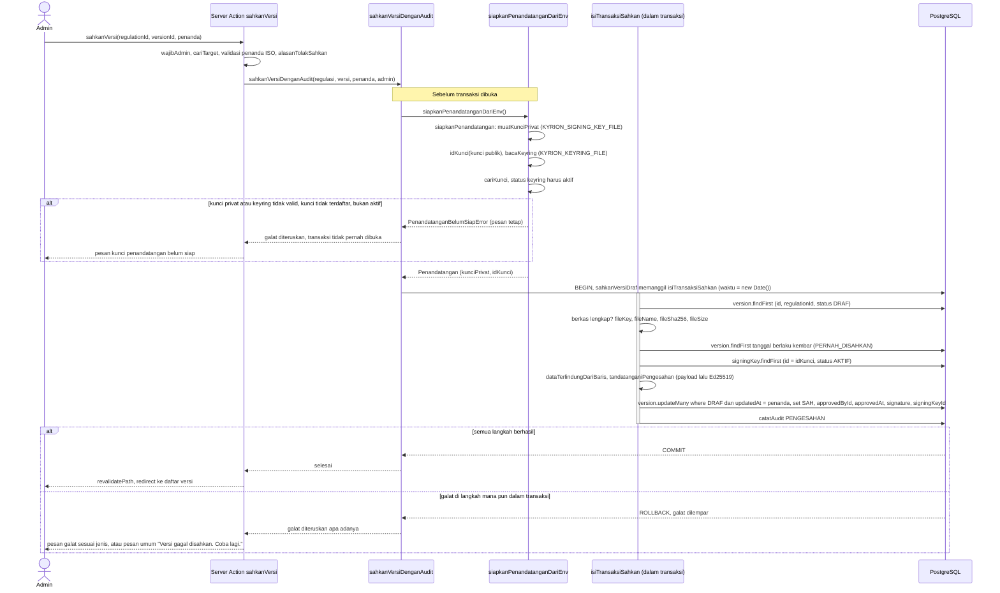
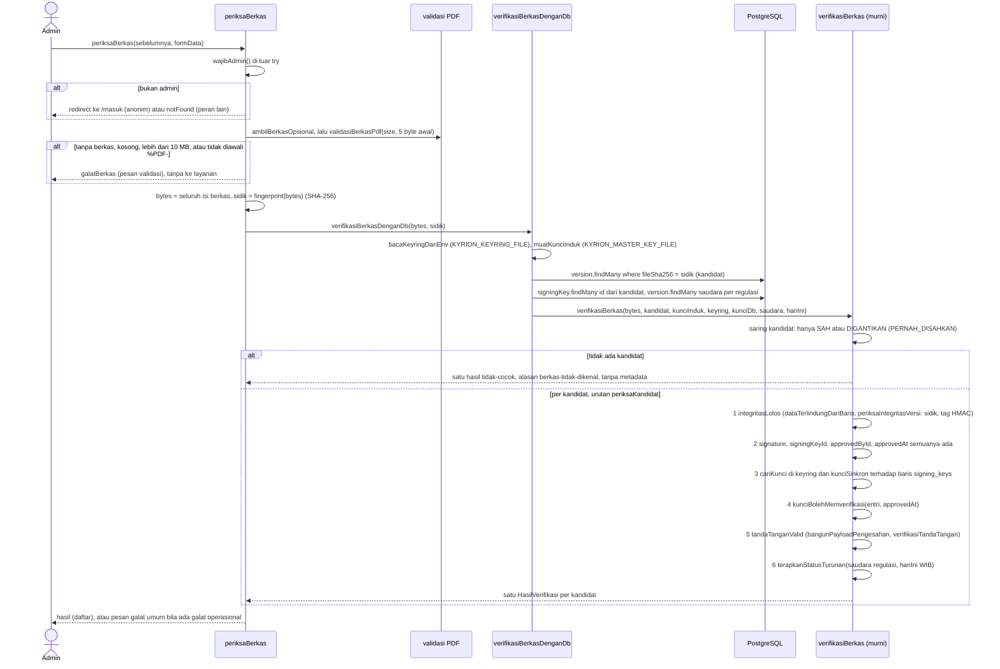

# Alur tanda tangan pengesahan (F-32) dan verifikasi berkas (F-33)

Dokumen ini hanya memuat hal yang dapat dicocokkan dengan kode di `apps/web` dan dengan
[KEPUTUSAN.md](../../KEPUTUSAN.md) bagian 10 (K-7 sampai K-10). Peran tiap kunci ada di
[peran-kunci.md](peran-kunci.md).

## 1. Pengesahan versi (F-32)

Berkas: `app/admin/regulasi/[slug]/versi/actions.ts` (`sahkanVersi`), `lib/data/versions.ts`
(`sahkanVersiDenganAudit`, `sahkanVersiDraf`), `lib/data/penandatangan-env.ts`
(`siapkanPenandatanganDariEnv`), `lib/crypto/penandatangan.ts` (`siapkanPenandatangan`),
`lib/data/pengesahan.ts` (`isiTransaksiSahkan`), `lib/crypto/tanda-tangan-pengesahan.ts`
(`tandatanganiPengesahan`). Route API `.../versions/[versionId]/approval/route.ts` juga memanggil
`sahkanVersiDenganAudit`, sehingga memakai alur yang sama mulai dari langkah itu.

### 1.1 Titik gagal tertutup

Setiap galat di bawah menghentikan pengesahan: tidak ada baris `versions` yang berubah dan tidak
ada baris audit (transaksi di-rollback, atau transaksi belum dibuka).

| Titik | Kondisi | Galat | Pesan ke admin (`sahkanVersi`) |
|---|---|---|---|
| Sebelum transaksi | `KYRION_SIGNING_KEY_FILE` belum diatur, berkas tidak terbaca, PEM rusak, bukan Ed25519, izin POSIX longgar; `KYRION_KEYRING_FILE` belum diatur atau keyring tidak valid; kunci privat tidak terdaftar di keyring; status bukan `aktif` | `PenandatanganTidakValid` atau `KeyringTidakValid`, dibungkus `PenandatanganBelumSiapError` | `PESAN_KUNCI_BELUM_SIAP` (tanpa jalur berkas) |
| Dalam transaksi | Versi tidak ada sebagai `DRAF` untuk regulasi itu | `VersionNotEditableError` | Dibaca ulang: pesan versi berubah atau pesan bukan draf |
| Dalam transaksi | `fileKey`, `fileName`, `fileSha256` kosong, atau `fileSize` null | `VersionWithoutFileError` | `PESAN_TANPA_BERKAS` |
| Dalam transaksi | Ada versi `PERNAH_DISAHKAN` lain dengan tanggal berlaku sama | `VersionEffectiveDateTakenError` | `PESAN_TANGGAL_KEMBAR` |
| Dalam transaksi | Kunci tidak ada di tabel `signing_keys` atau statusnya bukan `AKTIF` | `PenandatanganBelumSiapError` | `PESAN_KUNCI_BELUM_SIAP` |
| Dalam transaksi | `tandatanganiPengesahan` melempar (misalnya kunci privat rusak, atau `RangeError` dari payload) | Galat apa adanya | Pesan umum "Versi gagal disahkan. Coba lagi."; log hanya `error.name` |
| Dalam transaksi | `updateMany` tidak mengenai baris (status atau `updatedAt` berubah sejak halaman konfirmasi) | `VersionNotEditableError` | Sama dengan baris pertama kondisi versi berubah |
| Dalam transaksi | `catatAudit` gagal | Galat merambat, transaksi rollback | Pesan umum |

Penandatanganan memakai nilai yang dibaca di dalam transaksi yang sama (`saat`), bukan nilai dari
halaman. `isiTransaksiSahkan` tidak pernah menulis `DIGANTIKAN` dan tidak menyentuh `integrityTag`.

### 1.2 Isi payload (K-7)

`bangunPayloadPengesahan` (`lib/crypto/payload-pengesahan.ts`) menyusun byte dengan fungsi
`bagian` dari `lib/crypto/kanonis.ts`: setiap bagian diawali panjang 4 byte (big-endian), lalu isi
UTF-8. Urutannya:

| No | Isi | Sumber |
|---|---|---|
| 1 | `kyrion/pengesahan-versi/v1` | `LABEL_PENGESAHAN` (pemisah domain) |
| 2 | Keluaran `kanonisasiVersi` utuh, yaitu label `kyrion:version:v1` lalu `id`, `regulationId`, `versionNumber`, `effectiveDate`, `fileSha256`, `fileName`, `fileSize` | `kanonisasiVersi`; tujuh field terlindung F-31 |
| 3 | `SAH` | Literal di kode, bukan masukan |
| 4 | `approvedById` | UUID huruf kecil; id admin pengesah |
| 5 | `approvedAt` | `toISOString()` (UTC, milidetik); nilai yang sama ditulis ke `versions.approved_at` |
| 6 | `signingKeyId` | 32 hex huruf kecil; mengikat tanda tangan pada satu kunci |

Validasi: `approvedById` harus UUID huruf kecil, `approvedAt` harus `Date` yang valid,
`signingKeyId` harus 32 hex huruf kecil; selain itu `RangeError` yang hanya menyebut nama field.
Tanda tangan: `tandatangani` (Ed25519, 64 byte, deterministik), disimpan di `versions.signature`
bersama `versions.signing_key_id`.

## 2. Verifikasi berkas (F-33)

Berkas: `app/admin/verifikasi/actions.ts` (`periksaBerkas`), `lib/sesi.ts` (`wajibAdmin`),
`lib/domain/berkas-pdf.ts` (`ambilBerkasOpsional`, `validasiBerkasPdf`), `lib/crypto/fingerprint.ts`,
`lib/data/verifikasi-berkas.ts` (`verifikasiBerkasDenganDb`), `lib/crypto/verifikasi-pengesahan.ts`
(`verifikasiBerkas`, `periksaKandidat`). `verifikasiBerkas` murni: tanpa DB, variabel lingkungan,
atau jam.

### 2.1 Urutan pemeriksaan per kandidat

Persis seperti `periksaKandidat`. Langkah yang gagal langsung mengembalikan `tidak-cocok` dengan
alasan di kolom kedua; langkah berikutnya tidak dijalankan.

| No | Pemeriksaan | Alasan bila gagal | Teks (`TEKS_ALASAN`) |
|---|---|---|---|
| 1 | `integritasLolos`: `dataTerlindungDariBaris` tidak null dan `periksaIntegritasVersi` tidak melempar (sidik berkas dan tag HMAC cocok). Galat apa pun dihitung gagal | `integritas-gagal` | Catatan versi gagal pemeriksaan integritas. |
| 2 | `signature`, `signingKeyId`, `approvedById`, `approvedAt` semuanya terisi | `tanpa-tanda-tangan` | Versi tidak bertanda tangan. |
| 3 | `cariKunci(keyring, signingKeyId)` menemukan entri **dan** `kunciSinkron` terhadap baris `signing_keys` bernilai benar (kunci publik, status, tiga stempel waktu sama sampai milidetik) | `kunci-tidak-sinkron` | Kunci tidak dikenal atau tidak sinkron. |
| 4 | `kunciBolehMemverifikasi(entri, approvedAt)` | `kunci-dicabut`, `kunci-dirotasi-sebelum-penandatanganan`, atau `kunci-sebelum-dibuat` | Teks per alasan |
| 5 | `tandaTanganValid`: payload dibangun ulang dari baris dan `verifikasiTandaTangan` dengan kunci publik dari keyring | `tanda-tangan-tidak-valid` | Tanda tangan tidak valid. |
| 6 | `terapkanStatusTurunan` atas versi saudara per regulasi dengan `hariIni` | Tidak ada kegagalan: `DIGANTIKAN` menjadi `asli-digantikan` (alasan `bukan-berlaku`), selain itu `asli-sah` (alasan `berlaku`) | Berkas asli dan sah, atau asli tetapi digantikan |

Hasil `asli-sah` dan `asli-digantikan` memuat `versi.status`; hasil `tidak-cocok` dari kandidat
memuat `regulasi`, `nomorVersi`, `tanggalBerlaku` tanpa `status`.

### 2.2 Titik gagal tertutup

| Titik | Kondisi | Perilaku |
|---|---|---|
| `wajibAdmin` | Anonim, atau pengguna bukan admin (Sivitas) | `redirect("/masuk")` untuk anonim, `notFound()` untuk peran lain (`jagaHalaman`); layanan tidak dipanggil |
| `ambilBerkasOpsional` | Tidak ada berkas | `galatBerkas`: "Pilih berkas PDF yang akan diperiksa." |
| `validasiBerkasPdf` | Ukuran 0, lebih dari `MAX_INPUT_BYTES` (10 MB), atau awal berkas bukan `%PDF-` | `galatBerkas` dengan pesan validasi |
| `fingerprint`, `bacaKeyringDariEnv`, `muatKunciInduk`, kueri DB, atau galat tak terduga di `verifikasiBerkas` | Termasuk `KeyringTidakValid`, `KunciTidakValid`, `InputTooLargeError`, dan `Error` "Daftar versi regulasi tidak memuat kandidat." | `catch` di `periksaBerkas`: hanya `error.name` ke log, jawaban `{ pesan }` galat umum. Bukan hasil verifikasi, tanpa detail |
| Tidak ada kandidat `SAH` atau `DIGANTIKAN` | Berkas tidak dikenal, atau cocok hanya dengan `DRAF` atau `DIBATALKAN` | Satu hasil `berkas-tidak-dikenal` tanpa metadata; keberadaan draf tidak bocor |
| Langkah 1 sampai 5 per kandidat | Lihat bagian 2.1; fungsi pembantu (`integritasLolos`, `kunciSinkron`, `tandaTanganValid`) menangkap galat apa pun dan mengembalikan `false` | `tidak-cocok` dengan alasan langkah itu |
| Beberapa kandidat (sidik sama pada beberapa versi) | Satu hasil per kandidat tanpa agregasi | Kandidat yang gagal tidak tersembunyi di balik kandidat yang lolos |

### 2.3 Isi payload

Payload yang diverifikasi sama dengan yang ditandatangani di bagian 1.2 (K-7): `tandaTanganValid`
memanggil `bangunPayloadPengesahan` dengan tujuh field dari baris kandidat ditambah `approvedById`,
`approvedAt`, dan `signingKeyId` dari baris yang sama, lalu memeriksa tanda tangan 64 byte
(`verifikasiTandaTangan` menolak panjang lain dan tidak pernah melempar). Hasil verifikasi tidak
memuat tanda tangan, kunci, atau tag; hanya `hasil`, `alasan`, dan metadata versi
(`regulasi`, `nomorVersi`, `tanggalBerlaku`, dan `status` pada hasil asli).
