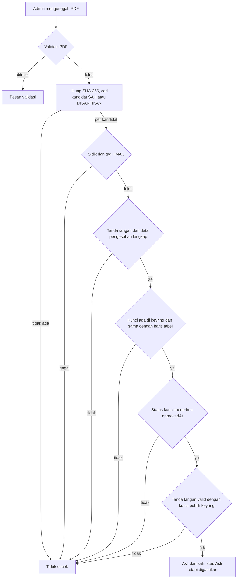

# Rancangan fitur F-33: verifikasi berkas terhadap catatan pengesahan

Nomor baris kode merujuk keadaan repository pada commit `20d3516`.

Jalur kode relatif ke `apps/web/`. ID `A-xx`, `B-xx`, `T-xx`, dan `M-xx` merujuk
[tabel-skenario-krip-0.3.md](tabel-skenario-krip-0.3.md) (disingkat "tabel skenario"). Keputusan
`K-x` ada di [KEPUTUSAN.md](../../KEPUTUSAN.md) bagian 10. Klaim yang diturunkan dari pembacaan
kode atau dokumen tanpa uji atau pernyataan tertulis yang mendukungnya ditandai
**Inferensi, belum diuji**.

Tingkat bukti: uji otomatis yang dirujuk berjalan pada fungsi murni, tiruan transaksi Prisma, atau
Server Action dengan layanan tiruan, serta fungsi layanan data dengan klien Prisma tiruan
(`verifikasi-berkas.test.ts`, B-03). Tidak ada uji otomatis yang menjalankan basis data nyata,
`storage/`, atau browser (tabel skenario, "Cara membaca").

## 1. Masalah yang diselesaikan

- Hash SHA-256 polos (F-30) tidak memakai rahasia. Penyerang yang bisa menulis basis data dan
  folder penyimpanan dapat mengganti PDF lalu menimpa `file_sha256` (KEPUTUSAN bagian 1.2).
- Tag HMAC (F-31) tidak mencakup `status` (KEPUTUSAN bagian 3.3 dan bagian 7 nomor 1) dan tidak
  melindungi dari pihak yang bisa membaca kunci induk (bagian 7 nomor 3).
- Tanpa F-33, Admin yang memegang sebuah PDF tidak punya pemeriksaan di Kyrion untuk membuktikan
  tiga hal: berkas itu cocok dengan versi yang pernah disahkan; pengesahannya (pengesah dan waktu)
  ditandatangani dengan kunci yang masih diterima; dan apakah versi itu masih berlaku atau sudah
  digantikan ([alur-tanda-tangan.md](alur-tanda-tangan.md) bagian 2.1; A-05 sampai A-09, B-01,
  B-02).

Batas masalah: F-33 hanya memeriksa berkas yang diunggah Admin. Unduhan hanya memeriksa sidik
berkas dan tag HMAC, bukan tanda tangan Ed25519 (`lib/integritas-versi.ts:35-47`;
[keamanan.md](../keamanan.md) bagian "4. Kategori OWASP Top 10:2025", baris "A08 Software or Data
Integrity Failures", dan bagian "6. Keterbatasan dan risiko sisa", baris "Unduhan tidak memeriksa
tanda tangan Ed25519"). F-33 juga tidak memverifikasi data yang tampil di halaman regulasi.

## 2. Pengguna

Pengguna fitur adalah Admin. Matriks akses ada di [keamanan.md](../keamanan.md) bagian "2. Matriks
akses", baris "`/admin/**` (19 halaman)" dan "Aksi admin (15)".

| Peran | Halaman `/admin/verifikasi` dan aksi `periksaBerkas` | Sumber |
|---|---|---|
| Admin | Boleh | Matriks akses |
| Sivitas | Halaman 404; aksi `notFound`, layanan tidak dipanggil | Matriks akses; alur bagian 2.2; B-09 (tingkat Server Action, `wajibAdmin` ditiru) |
| Anonim | Dialihkan ke `/masuk` | Matriks akses; alur bagian 2.2 |

`periksaBerkas` memanggil `wajibAdmin()` di luar `try`, karena Server Action adalah endpoint publik.
Berkas yang diunggah hanya dibaca ke memori dan tidak disimpan (`app/admin/verifikasi/actions.ts`;
T-15).

## 3. Ancaman

| Ancaman | Bagaimana terjadi | Kontrol | ID uji |
|---|---|---|---|
| Isi PDF diubah | Berkas di penyimpanan atau salinan yang diperiksa diganti | Sidik SHA-256 dan tag HMAC | A-04 (fungsi murni); B-03 (uji otomatis di layanan data dengan klien Prisma tiruan, dan bukti manual) |
| Metadata versi diubah | Penulisan langsung ke basis data | Tag HMAC dan payload tertanda | A-05, T-11, T-13 |
| `DRAF` diubah menjadi `SAH` | Penulisan langsung ke basis data tanpa tanda tangan | Hasil asli mensyaratkan tanda tangan | A-06 |
| Tanda tangan dipindahkan | `signature` dan `signing_key_id` disalin dari versi lain | Identitas dan field versi masuk payload (K-7) | A-07 |
| Pengesah atau waktu pengesahan diganti | `approved_by_id` atau `approved_at` diubah | Keduanya masuk payload (K-7) | A-08, T-03 |
| Kunci rujukan ditukar | `signing_key_id` diganti ke kunci lain yang terdaftar | `signingKeyId` masuk payload (K-7) | A-09 |
| Kunci publik palsu atau diubah di tabel | Penyerang menulis `signing_keys` | Keyring sebagai akar kepercayaan, `kunciSinkron` (K-10) | B-07, T-12 |
| Kunci privat bocor | Berkas PEM dikuasai pihak lain | Pencabutan: semua tanda tangan kunci itu ditolak (K-9) | B-06; `lib/crypto/keyring.test.ts > kunciBolehMemverifikasi > dicabut selalu ditolak` |
| Kunci dipakai di luar masa berlakunya | Tanda tangan setelah rotasi atau sebelum kunci dibuat | `kunciBolehMemverifikasi` (K-9) | B-05, T-12, T-08 |
| Keberadaan draf bocor lewat hasil | PDF identik versi `DRAF` atau `DIBATALKAN` diunggah | Hasil sama dengan berkas tidak dikenal | B-04 |
| Hasil atau galat membocorkan rahasia atau detail | Membaca respons pemeriksaan | Hasil hanya metadata aman; galat operasional umum | T-14, T-15 |
| Masukan bukan PDF atau terlalu besar | Unggahan sembarang | Validasi sebelum layanan dipanggil | B-08 |
| Pengesahan tanpa kunci yang siap | Berkas privat hilang atau kunci bukan aktif | Gagal tertutup, tidak ada perubahan | A-10 |

Penyerang yang bisa menulis **berkas keyring** tidak punya kontrol di kode dan dibahas di bagian 7.

## 4. Cara kerja ringkas



Tiga hasil: "Asli dan sah", "Asli tetapi digantikan", dan "Tidak cocok" beserta alasannya. Galat
operasional (keyring, kunci induk, basis data) bukan hasil verifikasi: Admin menerima pesan umum
(alur bagian 2.2; T-15). Rincian pengesahan dan verifikasi ada di
[alur-tanda-tangan.md](alur-tanda-tangan.md) bagian 1 dan 2.

## 5. Pengelolaan kunci yang dipadukan dengan fitur

Peran tiap kunci ada di [peran-kunci.md](peran-kunci.md).

| Aspek | Rancangan | Sumber |
|---|---|---|
| Pembangkitan | `bangkitkanPasanganKunci` (Ed25519), lewat perintah `buat` atau `putar` | peran-kunci bagian 1; `prisma/kelola-kunci.ts:72-81` |
| Kunci privat | Berkas PEM PKCS#8 di luar repository, flag `wx`, mode `0o600` | K-8; `lib/crypto/operasi-kunci.ts:149-157` |
| Kunci publik | Keyring (JSON, hanya kunci publik, di luar basis data dan repository, ditulis atomik) dan tabel `signing_keys` | K-10; `lib/crypto/keyring.ts:114-124` |
| Urutan operasi | Kunci privat (pada `buat` dan `putar`), lalu transaksi basis data, keyring ditulis terakhir | K-10; `lib/crypto/operasi-kunci.ts:173-191`, `216-282`; T-09 |

Perintah operator, dijalankan dari `apps/web`, jalur contoh di luar repository
(`prisma/kelola-kunci.ts:3-6`):

```
npx tsx prisma/kelola-kunci.ts buat  --out C:\kyrion-keys\kunci-1.pem
npx tsx prisma/kelola-kunci.ts putar --out C:\kyrion-keys\kunci-2.pem
npx tsx prisma/kelola-kunci.ts cabut --id <32 hex>
```

Skrip menolak jalan bila akar repository tidak ditemukan atau `KYRION_KEYRING_FILE` kosong
(`prisma/kelola-kunci.ts:56-62`). Argumen yang diterima diperiksa di baris 93-105.

### 5.1 Akar kepercayaan

Kunci publik untuk memverifikasi diambil dari keyring, bukan dari basis data (K-10). Saat
verifikasi, baris `signing_keys` **untuk kunci yang dirujuk kandidat** harus sama dengan entri
keyring dalam lima hal: kunci publik, status, `dibuatPada`, `dirotasiPada`, dan `dicabutPada`
(`lib/crypto/verifikasi-pengesahan.ts:69-82`, `135-138`; `lib/data/verifikasi-berkas.ts:31-34`;
B-07, T-12). Baris lain di tabel tidak dibandingkan.

Pemeriksaan saat pengesahan lebih sempit: kunci privat harus cocok dengan entri keyring berstatus
`aktif` (`lib/crypto/penandatangan.ts`), dan tabel harus memuat baris dengan id itu berstatus
`AKTIF` (`lib/data/pengesahan.ts:66-70`). Kunci publik dan stempel waktu di tabel tidak
dibandingkan pada jalur ini (A-10 untuk penolakannya).

### 5.2 Hubungan status kunci dengan hasil verifikasi

| Keadaan | Hasil verifikasi atas versi yang merujuk kunci | Sumber dan uji |
|---|---|---|
| `aktif` | Diteruskan ke pemeriksaan tanda tangan bila `approvedAt` tidak sebelum `dibuatPada` | `lib/crypto/keyring.ts:180-188`; B-01, T-12 |
| `dirotasi` | Diterima hanya untuk `approvedAt` sampai `dirotasiPada` (dan tidak sebelum `dibuatPada`) | K-9; B-05, T-12 |
| `dicabut` | Ditolak: `kunci-dicabut` | K-9; B-06 |
| Tabel berbeda dari keyring, atau kunci tidak ada di salah satunya | `kunci-tidak-sinkron` | K-10; B-07, T-12 |
| Keyring tidak ada atau rusak | Bukan hasil verifikasi: galat operasional dengan pesan umum | `lib/data/verifikasi-env.ts`; T-08, T-15 |

Kolom hasil mengandaikan pemeriksaan sebelumnya lolos. Bila sidik atau tag HMAC gagal, alasannya
`integritas-gagal`; bila data tanda tangan tidak lengkap, `tanpa-tanda-tangan`
(`lib/crypto/verifikasi-pengesahan.ts:130-141`).

## 6. Penanganan kompromi kunci tanda tangan

### 6.1 Langkah operator

1. **Tentukan id kunci** (32 hex) dari berkas keyring atau tabel `signing_keys`.
   `prisma/kelola-kunci.ts` tidak punya perintah untuk menampilkan daftar kunci.
2. **Cabut**, dari `apps/web`:

   ```
   npx tsx prisma/kelola-kunci.ts cabut --id <32 hex>
   ```

   Berlaku untuk kunci `aktif` maupun `dirotasi` (`lib/crypto/operasi-kunci.ts:271-275`; T-09).
   Skrip mencetak id dan status; bila tidak ada kunci aktif tersisa, skrip mencetak peringatan
   (`prisma/kelola-kunci.ts:83-88`).
3. **Bila yang dicabut kunci aktif, buat kunci baru** dengan `buat`, ke berkas yang belum ada:

   ```
   npx tsx prisma/kelola-kunci.ts buat  --out C:\kyrion-keys\kunci-2.pem
   ```

   `putar` tidak bisa dipakai karena menolak bila tidak ada kunci aktif
   (`lib/crypto/keyring.ts:147-150`; T-09). Selama belum ada kunci aktif, pengesahan gagal tertutup
   (A-10). `buat` hanya menolak bila sudah ada kunci aktif (`lib/crypto/keyring.ts:140-143`);
   `buat` sesudah pencabutan satu-satunya kunci aktif tidak punya uji khusus
   (**Inferensi, belum diuji**).
4. **Arahkan `KYRION_SIGNING_KEY_FILE`** ke berkas privat baru (`prisma/kelola-kunci.ts:76`) dan
   mulai ulang server ([README.md](../../README.md), "Menyiapkan kunci penandatangan").
5. **Periksa hasilnya**: PDF versi yang ditandatangani kunci lama, yang pemeriksaan integritasnya
   masih lolos, harus menghasilkan "Tidak cocok" dengan "Kunci penandatangan sudah dicabut."
   (`lib/crypto/hasil-verifikasi.ts`). Langkah manual ini belum punya bukti tersimpan.

### 6.2 Bila operasi gagal

- Gagal sebelum keyring ditulis: transaksi di-rollback. Pada `buat` dan `putar`, berkas privat
  milik proses itu dihapus sebisanya (`lib/crypto/operasi-kunci.ts:173-207`; K-10; T-09).
- Gagal sesudah keyring ditulis: `KeadaanTidakPasti`. Tidak ada perubahan atau penghapusan
  otomatis. Skrip mencetak langkah pemulihan manual (`prisma/kelola-kunci.ts:33-40`, `118-120`;
  K-10; T-09). Penyamaan harus mencakup kelima hal di bagian 5.1.
- **Inferensi, belum diuji:** teks pemulihan manual mengizinkan dua arah penyamaan. Bila yang gagal
  adalah `cabut` karena kompromi, menyamakan keyring ke basis data yang belum mencatat pencabutan
  akan membatalkan pencabutan. Arah yang aman adalah menyamakan basis data ke keyring yang sudah
  `dicabut`.

### 6.3 Dampak pada versi yang sudah ditandatangani

- Semua tanda tangan oleh kunci yang dicabut ditolak, termasuk yang dibuat sebelum kompromi (K-9;
  `lib/crypto/keyring.ts:181`; B-06).
- Tanda tangan ulang belum ada dan ditunda ke v1.0 (`prisma/kelola-kunci.ts:88`; KEPUTUSAN bagian
  10.6). Versi terdampak menjadi "Tidak cocok".
- Versi yang ditandatangani kunci lain tidak ditolak oleh pencabutan ini
  (**Inferensi, belum diuji**; pemeriksaan status kunci berlaku per kunci rujukan).

### 6.4 Bukti dan tingkatnya

| Bukti | Yang dibuktikan | Tingkat |
|---|---|---|
| B-06 (`lib/crypto/verifikasi-pengesahan.test.ts:213`) | Kandidat dengan kunci dicabut menghasilkan `kunci-dicabut` | Fungsi murni |
| `lib/crypto/keyring.test.ts:155` | Kunci dicabut selalu ditolak | Fungsi murni |
| T-09 (`lib/crypto/operasi-kunci.test.ts:269`, `285`; kegagalan `312`, `341`) | `cabut` mengubah status di keyring dan permintaan ubah ke basis data; perilaku saat gagal (diuji lewat `putar` dan `buat`) | Basis data tiruan |
| M-02 ([krip-0.3-k4-keyring.json](bukti/krip-0.3-k4-keyring.json)) | Isi keyring sesudah buat, putar, dan cabut | Manual; hanya status kunci, **bukan** bukti verifikasi |

**Tidak ada uji ujung ke ujung** "cabut lalu verifikasi" pada basis data nyata di bukti yang
dirujuk tabel skenario. Dokumen ini tidak mengklaim prosedur 6.1 sudah dilatih sebagai respons
insiden.

### 6.5 Celah yang tidak tercakup dokumen lain

- **Inferensi, belum diuji:** `putar` saja tidak cukup saat kompromi. Kunci `dirotasi` masih
  diterima untuk `approvedAt <= dirotasiPada`, sedangkan `approvedAt` adalah isi payload yang
  ditentukan oleh pembuat tanda tangan, sehingga pemegang kunci privat dapat memundurkannya (tidak
  sebelum `dibuatPada`). Pemalsuan yang lolos tetap membutuhkan kunci induk HMAC (peran-kunci
  bagian 1) dan kemampuan menulis basis data.
- **Inferensi, belum diuji:** memulihkan keyring **dan** basis data dari cadangan yang dibuat
  sebelum pencabutan membuat keduanya sinkron dengan kunci yang belum dicabut, sehingga tanda
  tangannya diterima lagi. Sesudah pemulihan cadangan, status pencabutan harus diperiksa dan
  pencabutan diulang bila hilang.
- **Inferensi, belum diuji:** keyring dibaca ulang pada tiap pemeriksaan dan tiap penyiapan
  penandatangan (`lib/data/verifikasi-env.ts`, `lib/crypto/penandatangan.ts:67`), sehingga
  pencabutan berlaku tanpa mulai ulang server selama proses membaca berkas keyring yang sama dengan
  yang ditulis operator.
- **Inferensi, belum diuji:** daftar versi terdampak hanya dapat dicari lewat kolom
  `versions.signing_key_id`; alatnya tidak ada di kode yang dirujuk dokumen ini.
- **Inferensi, belum diuji:** mengesahkan versi baru dengan tanggal berlaku yang sama ditolak selama
  versi lama masih tercatat pernah disahkan (`lib/data/pengesahan.ts:54-63`), sehingga versi
  terdampak tidak dapat diganti pada tanggal yang sama.
- Fakta kode: `cabut` tidak menghapus berkas privat (`lib/crypto/operasi-kunci.ts:262-282`).
  Penanganan berkas privat yang bocor sesudah dicabut tidak diatur di dokumen kriptografi.

## 7. Asumsi dan batas keamanan

### 7.1 Yang diasumsikan tepercaya

| Asumsi | Dasar |
|---|---|
| Berkas keyring dan hak tulisnya. Keyring adalah akar kepercayaan | K-10; KEPUTUSAN bagian 10.6 |
| Berkas kunci privat dan kunci induk HMAC hanya terbaca pihak berwenang | K-8; KEPUTUSAN bagian 6.1 dan 7 nomor 3 |
| Server aplikasi, kodenya, dan proses yang berjalan tidak diubah penyerang | **Inferensi, belum diuji** |
| Operator yang menjalankan `kelola-kunci.ts` bertindak benar | **Inferensi, belum diuji** |
| Jam server benar, karena `approvedAt` dan stempel siklus kunci berasal dari aplikasi (K-7; `lib/crypto/operasi-kunci.ts:90-91`) | **Inferensi, belum diuji** |

### 7.2 Yang tidak dilindungi

Tujuh butir KEPUTUSAN bagian 10.6, semuanya relevan:

1. CHECK di basis data menjaga bentuk data, bukan transisi status; akar kepercayaannya keyring.
2. Di Windows, mode `0o600` tidak ditegakkan; folder kunci dilindungi dengan ACL. Di server, kunci
   masuk lewat volume atau secret, tidak ke image Docker.
3. Tanda tangan ulang setelah pencabutan belum ada; versi bertanda tangan kunci dicabut menjadi
   "tidak cocok". Ditunda ke v1.0.
4. Versi Sah dari seed tidak berberkas dan tidak bertanda tangan. Pemeriksa melaporkannya "tidak
   bertanda tangan", tidak pernah "asli dan sah" (lihat juga M-03).
5. Satu PDF dapat melekat pada beberapa versi; satu hasil per kandidat tanpa agregasi.
6. Versi Sah dengan tanggal berlaku di masa depan tetap dilabeli "asli dan sah".
7. Tidak ada pemulihan otomatis setelah kegagalan sesudah keyring ditulis.

Batas lain:

- Keyring tidak ditandatangani atau di-MAC. Selain izin berkas atau ACL, kode tidak melindungi
  integritasnya (peran-kunci bagian 1, baris kunci publik; [keamanan.md](../keamanan.md) bagian
  "6. Keterbatasan dan risiko sisa", baris "Keyring tidak ditandatangani").
- Unduhan tidak memeriksa tanda tangan Ed25519 (`lib/integritas-versi.ts:35-47`; keamanan.md bagian
  "6. Keterbatasan dan risiko sisa", baris "Unduhan tidak memeriksa tanda tangan Ed25519").
- **Inferensi, belum diuji:** karena itu, pencabutan kunci tidak menghentikan unduhan versi
  terdampak dan tidak mengubah status versinya.
- Kunci induk HMAC tidak punya rotasi atau pencabutan di kode. Bila hilang, F-33 mengembalikan
  pesan galat umum. Bila bocor, tidak ada alat tanggapan lengkap (peran-kunci bagian 1).
- Perbandingan tabel dengan keyring hanya mencakup baris yang dirujuk kandidat (bagian 5.1).
- **Inferensi, belum diuji:** tanda tangan tidak memuat bukti waktu dari pihak ketiga, sehingga
  `approvedAt` tidak membuktikan kapan tanda tangan benar-benar dibuat.
- F-33 bukan verifikasi mandiri oleh pihak luar: pemeriksaan hanya tersedia bagi Admin dan
  dijalankan di server Kyrion (bagian 2).

## 8. Rujukan

Dokumen: [KEPUTUSAN.md](../../KEPUTUSAN.md) (bagian 1.2, 3.3, 6.1, 7, 10);
[alur-tanda-tangan.md](alur-tanda-tangan.md); [peran-kunci.md](peran-kunci.md);
[tabel-skenario-krip-0.3.md](tabel-skenario-krip-0.3.md); [keamanan.md](../keamanan.md);
[README.md](../../README.md).

Kode (`apps/web/`): `prisma/kelola-kunci.ts`; `lib/crypto/keyring.ts`, `operasi-kunci.ts`,
`penandatangan.ts`, `verifikasi-pengesahan.ts`, `hasil-verifikasi.ts`; `lib/data/verifikasi-berkas.ts`,
`verifikasi-env.ts`, `pengesahan.ts`; `lib/integritas-versi.ts`;
`app/admin/verifikasi/actions.ts`.

ID uji dan bukti: A-04 sampai A-10; B-01 sampai B-09; T-03, T-08, T-09, T-11 sampai T-15; M-02, M-03.
