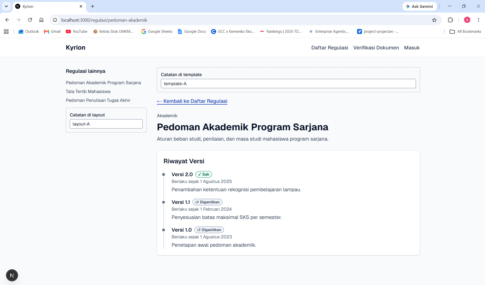
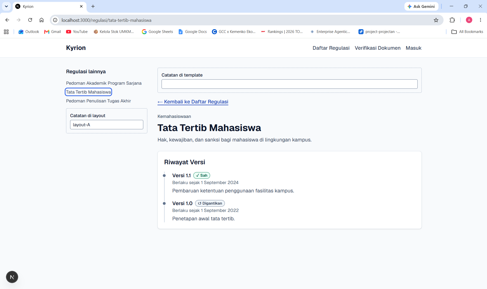
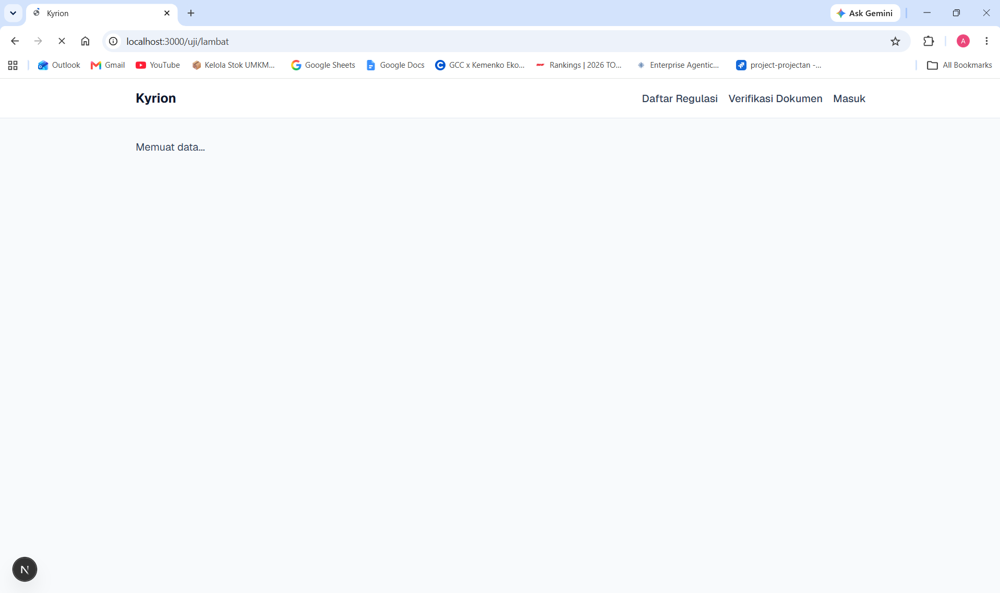
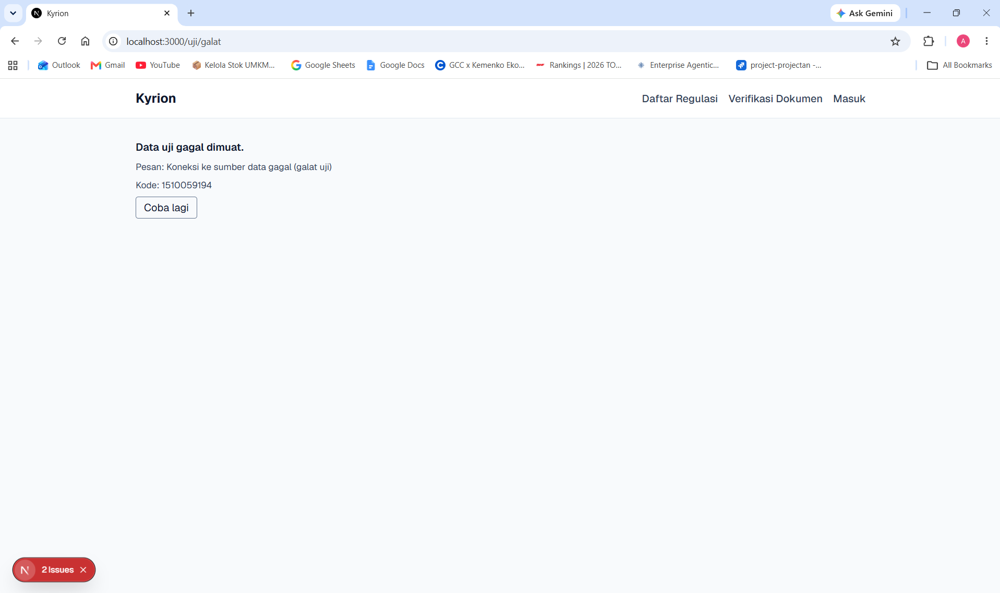
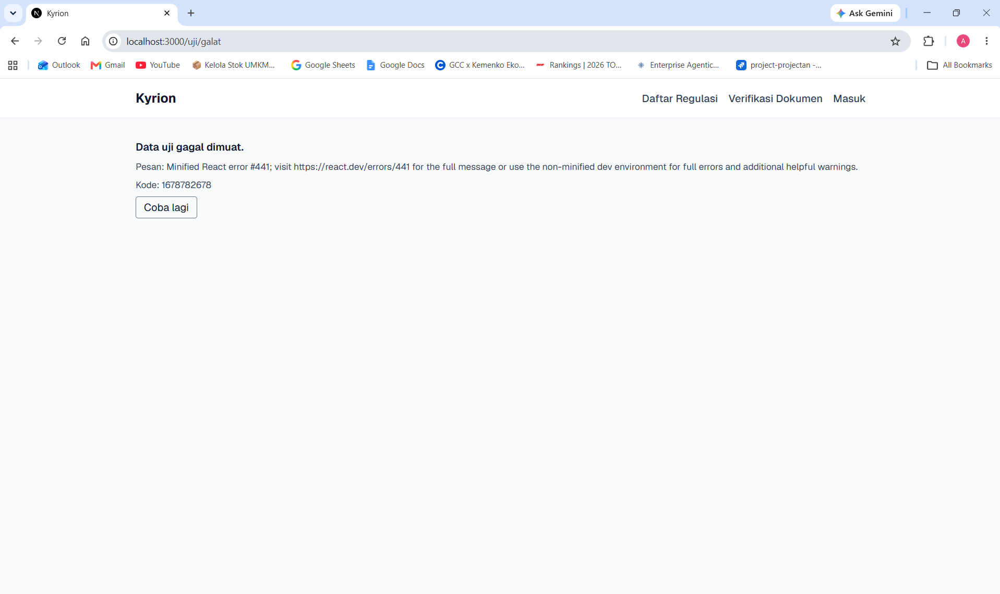
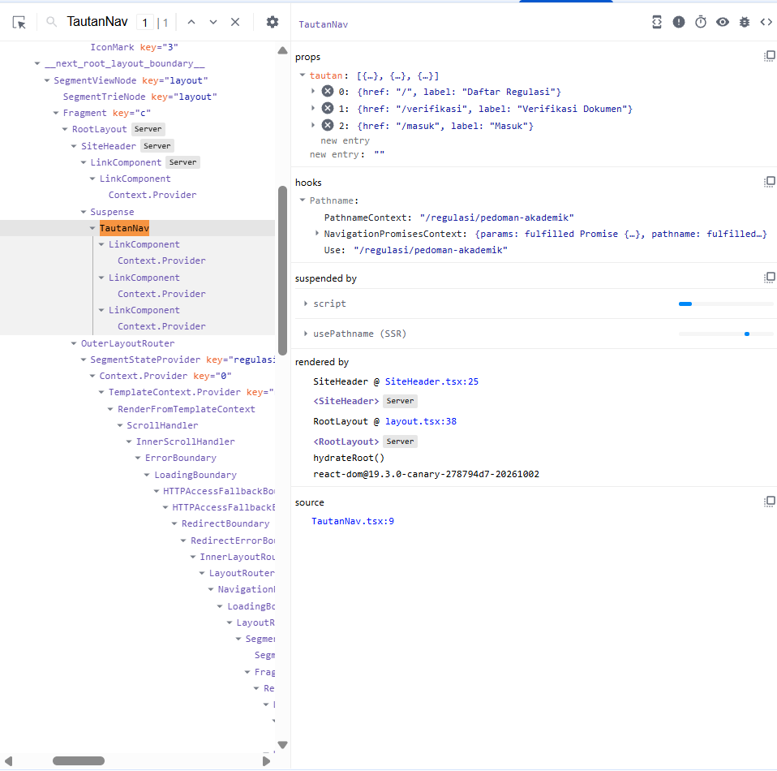
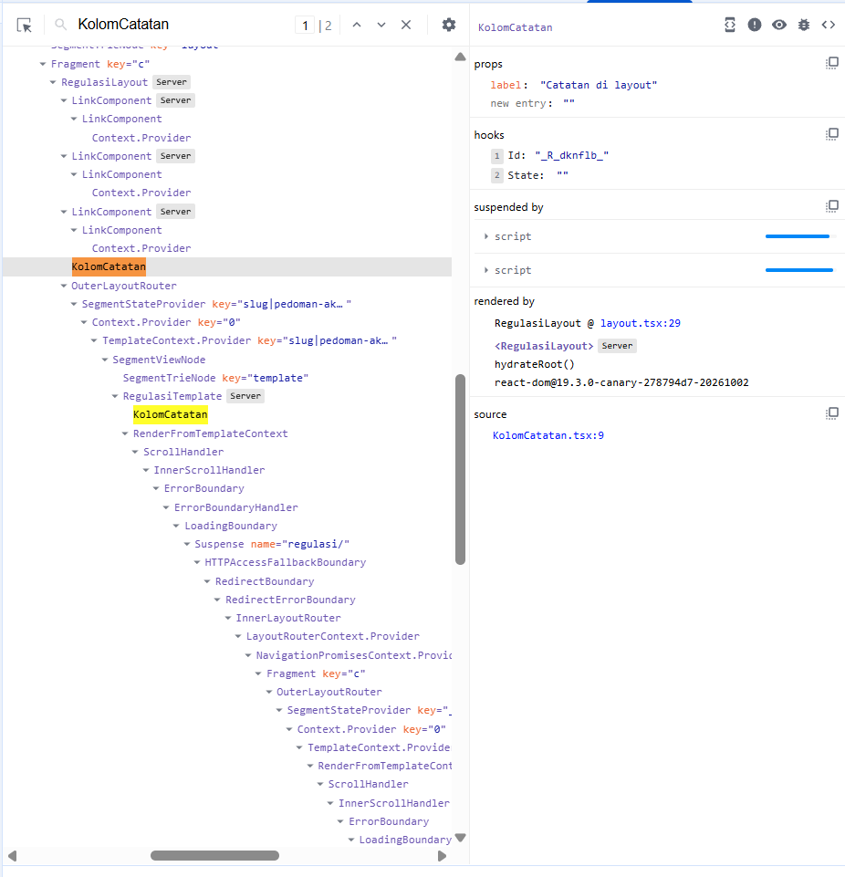
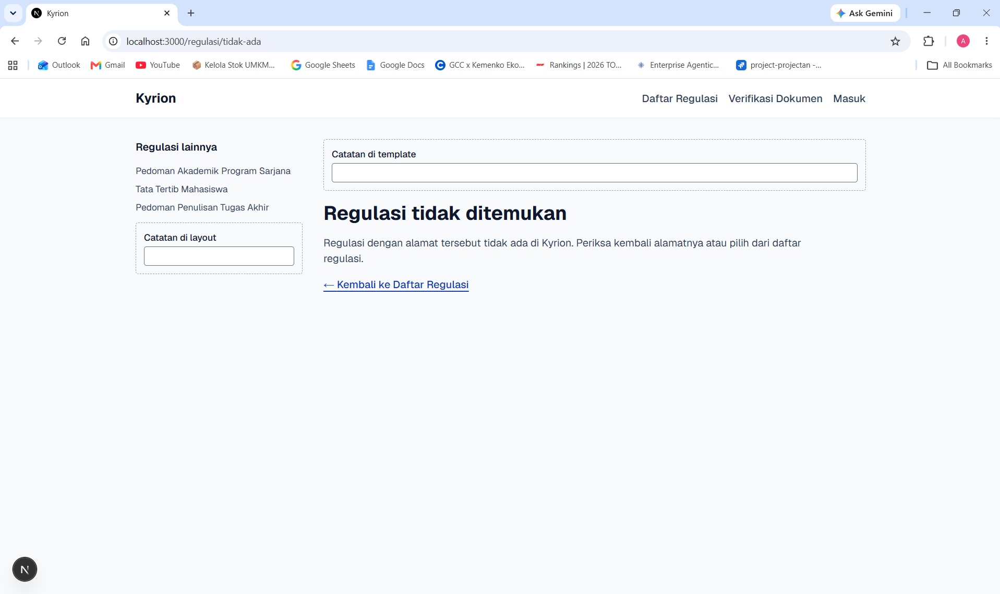
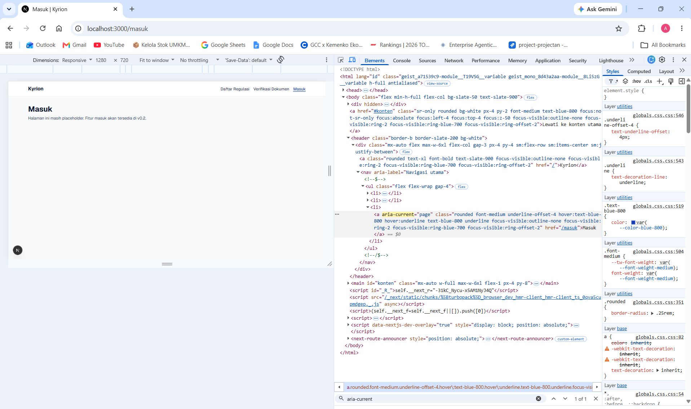

# Dokumen Teknis Modul 4 — Next.js App Router

Nama/NIM : Arif Mufti Tharsa / 105224041
Repositori : https://github.com/arifmuftitharsa/kyrion
Versi Next.js dan mode Cache Components (aktif/tidak) : Next.js 16.4.2, Cache Components tidak aktif (`next.config.ts` tidak memuat `cacheComponents`)

Dokumen Teknis Modul 1–3 tetap ada di repositori praktikum: https://github.com/arifmuftitharsa/praktikum-paw/tree/main/docs/praktikum

## 1. Peta Rute

| URL | Berkas di `app/` | Jenis rute | Isi halaman |
|---|---|---|---|
| `/` | `app/page.tsx` | Rute statis di struktur folder, tapi dirender saat ada permintaan (ƒ Dynamic) karena membaca `searchParams` untuk filter `?kategori=...`. Nilainya baru ketahuan saat permintaan masuk. | Daftar regulasi dengan filter kategori |
| `/regulasi/[slug]` | `app/regulasi/[slug]/page.tsx` | Rute dinamis (segmen `[slug]`), ditandai ● SSG. `generateStaticParams` mengembalikan slug dari `getRegulations()`, jadi HTML tiga slug dibuat saat build. | Detail regulasi dan riwayat versi |
| `/verifikasi` | `app/verifikasi/page.tsx` | Rute statis (○ Static). Halamannya tidak membaca data permintaan, jadi dibuat saat build. `VerifyForm` memang Client Component, tapi halamannya tetap statis. | Formulir verifikasi dokumen |
| `/masuk` | `app/masuk/page.tsx` | Rute statis (○ Static), placeholder tanpa data permintaan. | Placeholder halaman masuk (belum ada login) |

Rute pengganti `/tentang` adalah `/masuk`, berupa rute statis sesuai rancangan Kyrion. PRD-Kyrion.md bagian 4 membedakan Pengunjung (tanpa login) dari Mahasiswa dan Admin Akademik (perlu masuk), jadi halaman masuk pasti dibutuhkan produk, sedangkan `/tentang` tidak ada di rancangan. Isinya baru placeholder, formulir dan autentikasi menyusul di modul berikutnya.

Tabel rute dari `npm run build` (Next.js 16.4.2, setelah `app/uji/` dihapus):

```
Route (app)
┌ ƒ /
├ ○ /_not-found
├ ○ /masuk
├   /regulasi/[slug]
│ ├ ● /regulasi/pedoman-akademik
│ ├ ● /regulasi/tata-tertib-mahasiswa
│ └ ● /regulasi/pedoman-tugas-akhir
└ ○ /verifikasi


○  (Static)   prerendered as static content
●  (SSG)      prerendered as static HTML (uses generateStaticParams)
ƒ  (Dynamic)  server-rendered on demand
```

## 2. Layout, Template, dan Berkas Khusus

Pohon folder `app/` akhir (`tree app /F /A` dari `apps/web`, setelah `app/uji/` dihapus):

```
C:\PROJECTS\KYRION\APPS\WEB\APP
|   favicon.ico
|   globals.css
|   layout.tsx
|   not-found.tsx
|   page.tsx
|   
+---masuk
|       page.tsx
|       
+---regulasi
|   |   error.tsx
|   |   layout.tsx
|   |   loading.tsx
|   |   template.tsx
|   |   
|   \---[slug]
|           not-found.tsx
|           page.tsx
|           
\---verifikasi
        page.tsx
```

**Uji layout dan template.** `KolomCatatan` dipakai sebagai kolom uji di `layout.tsx` dan `template.tsx`.





Di screenshot sebelum (`/regulasi/pedoman-akademik`), aku isi kolom layout dengan `layout-A` dan kolom template dengan `template-A`. Setelah pindah ke Tata Tertib Mahasiswa lewat tautan di panel (`/regulasi/tata-tertib-mahasiswa`), kolom layout masih `layout-A`, sedangkan kolom template kosong lagi. Jadi layout dipertahankan saat halaman anak berganti, sedangkan template dibuat ulang sehingga state input-nya hilang.

**Uji `loading.tsx` dan `error.tsx`** lewat rute sementara `app/uji/`. `loading.tsx` uji ada di `app/uji/lambat/` (bukan di `app/uji/`) dan jedanya 10 detik, bukan 2 detik seperti di modul, supaya tampilan loading sempat difoto.







Di mode dev, `error.tsx` menampilkan pesan asli "Koneksi ke sumber data gagal (galat uji)" dengan Kode (`digest`) 1510059194. Di mode produksi pesan aslinya tidak muncul. Yang tampil pesan umum "Minified React error #441; visit https://react.dev/errors/441 for the full message or use the non-minified dev environment for full errors and additional helpful warnings." dengan Kode 1678782678. Nilai Kode di dua percobaan itu beda, dan aku tidak menganggapnya sama. `digest` berguna untuk mencocokkan galat yang dilaporkan pengguna dengan log di server, tanpa membocorkan pesan asli (yang bisa berisi detail internal) ke browser.

Kode demo dan rute uji (`KolomCatatan`, `app/uji/`) dihapus setelah bukti diambil, di commit terpisah tanpa mengubah riwayat:

- Commit saat kode demo dan rute uji masih ada: `64dfc7c`
- Commit hapus `app/uji/`: `f8d1b6f`
- Commit hapus `KolomCatatan` (sekaligus merapikan `layout.tsx` dan `template.tsx`): `9163b68`

Pengganti `KolomCatatan` di `layout.tsx` adalah panel tautan regulasi (`<aside aria-label="Panel regulasi">`), dan `template.tsx` tinggal jadi pembungkus `<div>`.

## 3. Rute Dinamis dan Validasi params

`params` di Next.js 16 berupa Promise, jadi di-`await`. Validasinya dua lapis di `app/regulasi/[slug]/page.tsx`. Pertama format slug dicek dengan `FORMAT_SLUG = /^[a-z0-9]+(?:-[a-z0-9]+)*$/`, lalu dicari apakah slug itu ada di data. Keduanya memanggil `notFound()`.

Perintah uji, dijalankan bergantian di dev dan produksi (port 3000):

```
curl.exe -s -o NUL -w "%{http_code}" http://localhost:3000/<URL>
```

| URL | Harapan | Status produksi (`npm start`) | Status dev (`npm run dev`) |
|---|---|---|---|
| `/regulasi/pedoman-akademik` | Halaman detail | 200 | 200 |
| `/regulasi/tidak-ada` | 404 (lolos format, tidak ada di data) | 404 | 200 |
| `/regulasi/Pedoman-Akademik` | 404 (ditolak format: huruf besar) | 200 di permintaan pertama, 404 di permintaan berikutnya | 200 |
| `/regulasi/pedoman--akademik` | 404 (ditolak format: tanda hubung ganda) | 404 | 200 |
| `/abc` | 404 global (`app/not-found.tsx`) | 404 | 404 |

Pengamatan tambahan:

- Produksi diuji setelah `npm run build` bersih, satu putaran curl. Status 200 untuk `Pedoman-Akademik` terulang di dua build.
- Permintaan berikutnya ke URL yang sama: 404 dengan `x-nextjs-cache: HIT` dan `Content-Length` 15052 (halaman detail: 21922).
- `Tata-Tertib-Mahasiswa` (slug asli, huruf besar) yang tidak didahului permintaan huruf kecil: langsung 404 dengan `x-nextjs-cache: MISS`.
- Isi respons 200 pertama di produksi tidak aku periksa.
- Dev: `/regulasi/tidak-ada` berstatus 200, tapi isinya memuat "Regulasi tidak ditemukan" dan `noindex` (31423 karakter). Halaman valid memuat "Riwayat Versi" (29248 karakter).

**Penjelasan.** Kode mengecek `slug` dua kali: bentuknya dulu (huruf kecil, angka, tanda hubung tunggal), baru apakah slug ada di data. Format dicek duluan karena murah (satu regex, tanpa menyentuh data) dan langsung membuang masukan yang bentuknya mustahil valid. Keduanya sama-sama memanggil `notFound()`, jadi dari luar hasilnya sama-sama halaman 404 dan status tidak menunjukkan lapisan mana yang menolak. Cek status saja juga tidak cukup: di dev, slug yang tidak ada tetap berstatus 200 padahal isinya halaman "tidak ditemukan". Dugaanku penyebabnya `loading.tsx` di segmen `regulasi`, karena dengan streaming status 200 sudah terkirim sebelum `notFound()` jalan. Isi respons yang memuat halaman 404 dan `noindex` cocok dengan dugaan itu, tapi mekanismenya belum aku buktikan terpisah. Di produksi, 200 pada permintaan pertama `Pedoman-Akademik` belum bisa aku jelaskan, hanya terbukti bisa diulang dari build bersih.

## 4. Pembagian Server dan Client Components

| Komponen / berkas | Jenis | Alasan |
|---|---|---|
| `app/layout.tsx` (RootLayout) | Server | Cuma kerangka halaman (`html`, skip link, `SiteHeader`, `<main id="konten">`). Tidak butuh state atau event, jadi nggak menambah JavaScript ke browser. |
| `components/SiteHeader.tsx` | Server | Isinya daftar tautan tetap. Bagian interaktifnya dipisah ke `TautanNav`, jadi header sendiri nggak perlu jadi Client Component. |
| `components/TautanNav.tsx` | Client (`"use client"`) | Butuh `usePathname`, hook yang hanya ada di Client Component, untuk menandai tautan aktif dengan `aria-current="page"`. Di `SiteHeader` dibungkus `<Suspense>` dengan fallback tautan yang sama tanpa `aria-current`, supaya bagian halaman lain nggak tertahan komponen yang bergantung pada path. |
| `components/VerifyForm.tsx` | Client | Mengelola state pilihan regulasi dan versi, berkas, pesan galat, dan submit, semuanya butuh interaktivitas di browser. Data regulasi diterima lewat props dari Server Component. |
| `RegulationCard`, `VersionTimeline`, `StatusBadge`, `CategoryFilter` | Server | Cuma menampilkan data dari props, tanpa state atau event. `CategoryFilter` memakai tautan `?kategori=...`, bukan state client. |
| `app/regulasi/layout.tsx`, `template.tsx`, `loading.tsx` | Server | Tidak punya state atau event. Layout menyusun panel tautan dari data, template membungkus anak, loading hanya menampilkan teks status. |
| `app/regulasi/error.tsx` | Client (wajib) | Error boundary butuh state di browser untuk menampilkan UI galat dan tombol "Coba lagi" yang memanggil `retry`. |
| `components/KolomCatatan.tsx` (demo, sudah dihapus) | Client | Komponen uji. Punya state untuk membedakan layout dan template, dan mengimpor `lib/data/regulations.ts` untuk memicu galat `server-only`. |

Hasil uji impor `lib/data/regulations.ts` (berisi `import "server-only"`) dari Client Component `KolomCatatan`, disalin dari terminal `npm run dev` (dipotong ke bagian yang relevan):

```
x ./lib/data/regulations.ts:1:1
Error: You're importing a module that depends on "server-only". This API is only available in Server Components in the App Router, but you are using it in the Pages Router.
    Learn more: https://nextjs.org/docs/app/building-your-application/rendering/server-components
> 1 | import "server-only";
    | ^^^^^^^^^^^^^^^^^^^^^

Ecmascript file had an error

Import traces:
  #1 [Server Component]:
    ./lib/data/regulations.ts
    ./app/regulasi/[slug]/page.tsx

  #3 [Client Component Browser]:
    ./lib/data/regulations.ts [Client Component Browser]
    ./components/KolomCatatan.tsx [Client Component Browser]
    ./components/KolomCatatan.tsx [Server Component]
    ./app/regulasi/layout.tsx [Server Component]
```

Pesan itu menyebut "Pages Router" padahal Kyrion memakai App Router. Itu teks bawaan Next.js 16.4.2, memang tampil begitu. Jejak #1 menunjukkan Server Component boleh mengimpor modul itu, sedangkan #3 (lewat `KolomCatatan`) ditolak.

React Developer Tools, tab Components (label Server untuk komponen server, hook dan props untuk komponen client):







`aria-current` pada tautan aktif, dicek di DevTools (bukan curl):



## 5. Verifikasi

Dijalankan dari `apps/web` setelah kode demo dan rute uji dihapus.

```
> npx tsc --noEmit
(tidak ada keluaran)

> npm run lint

> web@0.1.0 lint
> eslint

(tidak ada galat dan tidak ada peringatan)

> npm run build

> web@0.1.0 build
> next build

▲ Next.js 16.4.2 (Turbopack)
✓ Running next.config.ts took 19ms

  Creating an optimized production build ...
✓ Compiled successfully in 204ms
  Running TypeScript ...
  Finished TypeScript in 885ms ...
  Collecting page data using 8 workers ...
✓ Collecting page data using 8 workers in 515ms
  Generating static pages using 8 workers (0/9) ...
  Generating static pages using 8 workers (2/9) 
  Generating static pages using 8 workers (4/9) 
  Generating static pages using 8 workers (6/9) 
✓ Generating static pages using 8 workers (9/9) in 541ms
  Finalizing page optimization ...
✓ Finalizing page optimization in 9ms
```

Tabel rute dari build yang sama ada di Bagian 1.

## 6. Kendala dan Penyelesaian

| Kendala | Yang teramati | Penyelesaian |
|---|---|---|
| `npm run build` dijalankan dari root repo | `ENOENT package.json` | Jalankan dari `apps/web`, tempat `package.json` berada. |
| `app/not-found.tsx` tertempel terpotong dan salah ketik (`underlineunderline-offset-4`) | Galat "default export is not a React Component in /_not-found/not-found" | Tempel ulang seluruh berkas, cek pakai `Select-String`, restart dev server. Kenapa galat sempat bertahan setelah diperbaiki, belum terbukti. |
| Port 3000 masih dipakai server lama (dua kali) | `EADDRINUSE` saat `npm start` | Cari PID dengan `netstat -ano \| findstr :3000`, pastikan prosesnya `node` lewat `Get-Process -Id`, lalu `Stop-Process`. |
| Screenshot terambil dari server lama tanpa TautanNav | Menu aktif tidak muncul | Ambil ulang dari server yang benar. |
| `curl` + `Select-String` untuk `aria-current` hasilnya kosong di mesinku | Atribut tidak terbaca lewat curl | Dicek lewat DevTools di browser. Penyebab di curl/PowerShell belum terselesaikan. |
| Galat tipe `tsc` dari `.next/types/validator.ts` setelah `app/uji` dihapus | Cache tipe usang | `npm run build` membangkitkan tipe ulang, `tsc` jadi bersih. |
| Problems `1` di VS Code padahal `tsc` dan lint bersih | Diagnostik usang dari `app/uji/error.tsx` | Restart TS Server, angkanya jadi 0. |
| Hasil curl beda dari harapan | Dev: semua `/regulasi/...` berstatus 200 (isinya 404 untuk slug yang tidak ada). Produksi: `Pedoman-Akademik` 200 di permintaan pertama | Isi respons diperiksa, bukan cuma status, dan hasilnya dicatat apa adanya di Bagian 3. Penyebab 200 di produksi belum terjelaskan. |

## 7. Catatan Pemanfaatan AI

Alat: Claude (chat, claude.ai, Project Praktikum PAW). AI membantu aku memahami soal, lalu konsep, dan cara mengerjakannya, dengan panduan satu langkah kecil setiap kali.

| Tahap | Perintah utama | Bagian yang digunakan | Cara memverifikasi |
|---|---|---|---|
| Memahami soal | "bantu langkah Modul 4 praktikum PAW, satu langkah kecil, terapkan ke Kyrion" | Memetakan tugas Modul 4 ke Kyrion: rute apa yang dibuat, apa yang diuji, apa yang harus dibuktikan di DT. | Dicocokkan dengan modul dan rubrik Dokumen Teknis. |
| Memahami konsep | Minta penjelasan intuisi lalu istilah teknis: layout vs template, `loading.tsx`, `error.tsx`, `not-found.tsx`, rute dinamis dan `generateStaticParams`, Server vs Client Component, `server-only`. | Penjelasan konsep dan soal latihan konsep. | Dibuktikan sendiri lewat uji: screenshot layout/template, galat dev vs produksi, curl, galat `server-only`, React Developer Tools. |
| Cara mengerjakan | Minta langkah dan kode per berkas: `app/regulasi/`, `app/not-found.tsx`, `TautanNav`, `SiteHeader`, `server-only`. | Kode per berkas yang aku tempel dan jalankan sendiri di `apps/web`. | `npx tsc --noEmit`, `npm run lint`, dan `npm run build` aku jalankan sendiri, hasilnya bersih. |
| Menyusun Dokumen Teknis | "lengkapi seluruh Dokumen Teknis Modul 4" | Kerangka dan draf teks dokumen ini, termasuk penjelasan di Bagian 1, 3, dan 4, disusun AI dari keluaran terminal dan hasil uji yang aku kirim. | Semua keluaran dan angka berasal dari mesinku. Drafnya aku baca dan cocokkan dengan kode dan keluaran. Hal yang belum terbukti (penyebab status 200 di dev dan produksi) ditulis sebagai dugaan. |
