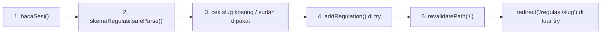
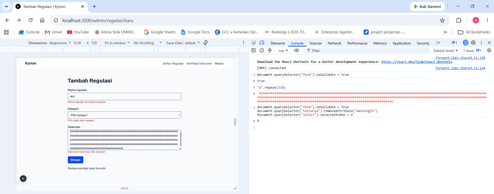
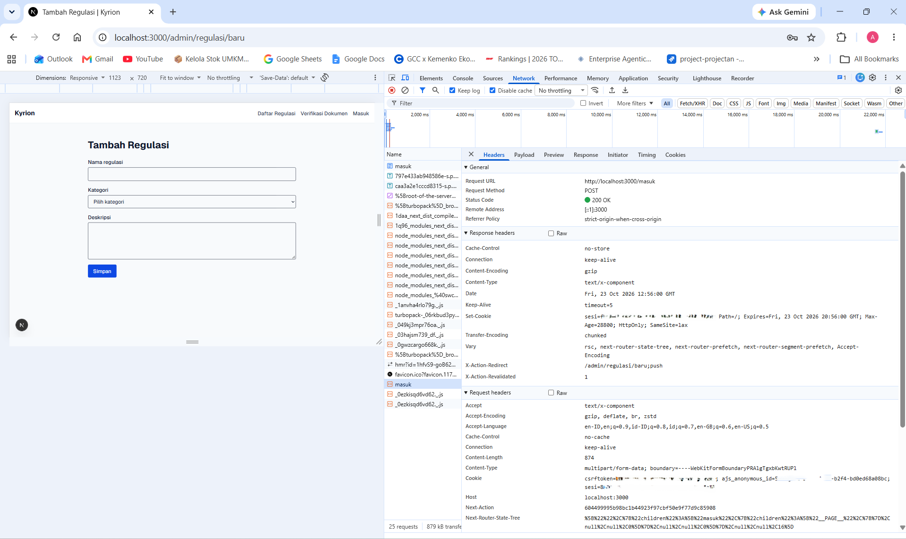
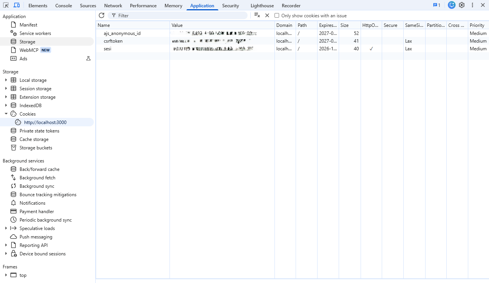
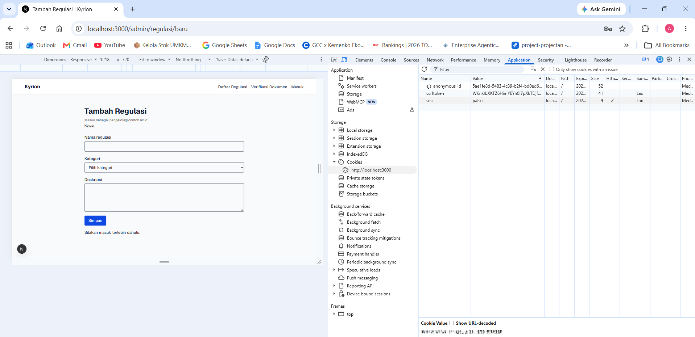

# Dokumen Teknis Modul 5 — Formulir, Validasi, Session, dan Cookie

- **Nama/NIM:** Arif Mufti Tharsa / 105224041
- **Repositori:** https://github.com/arifmuftitharsa/kyrion
- **Versi:** Next.js 16.4.2, React 19.3.1, Zod 4.6.7
- **Branch:** `praktikum/modul-05`

Di Kyrion, contoh "tambah item" dari modul aku terapkan jadi **formulir Tambah Regulasi** untuk Admin Akademik (PRD F-11), di rute `/admin/regulasi/baru`. Login demo dipasang di halaman `/masuk` yang sebelumnya cuma placeholder dari Modul 4.

## 1. Skema Validasi

Skema ada di `apps/web/lib/skema.ts`. Daftar kategori diambil dari `KATEGORI` di `lib/types.ts`, jadi `z.enum` dan tipe TypeScript `Kategori` berasal dari satu sumber yang sama.

| Kolom | Aturan Zod | Pesan galat |
|---|---|---|
| `name` | `z.string().trim().min(5).max(120)` | "Nama regulasi minimal 5 karakter" / "Nama regulasi maksimal 120 karakter" |
| `category` | `z.enum(KATEGORI)` → `"Akademik"` atau `"Kemahasiswaan"` | "Pilih salah satu kategori" |
| `description` | `z.string().trim().min(10).max(300)` | "Deskripsi minimal 10 karakter" / "Deskripsi maksimal 300 karakter" |

Skema login (`skemaMasuk`): `email` pakai `z.email()`, `kataSandi` minimal 8 karakter.

**Aturan semantik** (dicek di Server Action, setelah `safeParse` berhasil):

| Aturan | Kenapa tidak bisa di skema |
|---|---|
| Slug hasil nama tidak boleh sudah dipakai regulasi lain → "Regulasi dengan nama ini sudah ada" | Butuh data yang sudah tersimpan. Skema cuma lihat bentuk isian |
| Slug hasil nama tidak boleh kosong → "Nama harus mengandung huruf atau angka" | Nama `"!!!!!"` lolos `min(5)`, tapi slug-nya jadi kosong |

Cek unik sengaja pakai **slug**, bukan nama mentah. "Peraturan Akademik" dan "peraturan  akademik" beda tulisannya tapi slug-nya sama, jadi URL-nya juga bakal bentrok. Dari sisi bisnis, dua regulasi dengan nama sama bikin riwayat versinya terpecah, padahal tujuan Kyrion justru supaya mahasiswa tahu satu versi yang berlaku.

**Beda dengan Tugas Pendahuluan:** di TP aku merancang formulir "Bertanya ke Asisten". Waktu dicocokkan ke PRD, formulir itu fitur v1.0, tipe pertanyaannya di PRD 6.5 ditentukan sistem (bukan dipilih mahasiswa), dan alurnya tidak punya mutasi + redirect seperti yang diajarkan modul. Jadi untuk praktikum aku pakai Tambah Regulasi yang memang dibutuhkan untuk Tugas 2. Kotak centang tidak dipakai karena Regulasi tidak punya kolom boolean yang bermakna.

## 2. Alur Server Action

Aksi `simpanRegulasi` ada di `apps/web/app/admin/regulasi/actions.ts`:



| Urutan | Kalau gagal |
|---|---|
| 1. Sesi | `{ pesan: "Silakan masuk terlebih dahulu." }` |
| 2. Validasi bentuk | `{ galat: z.flattenError(...).fieldErrors, pesan, nilai }` |
| 3. Validasi semantik | `{ galat: { name: [...] }, nilai }` |
| 4. Mutasi | `console.error` di log server, pengguna dapat pesan umum "Regulasi gagal disimpan. Coba lagi." |
| 5. `revalidatePath` + `redirect` | `redirect` sengaja di luar `try`, karena `redirect` melempar exception khusus yang bakal ketangkap `catch` kalau ada di dalam `try` |

`nilai` dikembalikan setiap gagal validasi supaya isian tidak hilang, karena React 19 mengosongkan formulir setelah aksi selesai.

**Pembagian berkas:**

| Berkas | Jenis | Alasan |
|---|---|---|
| `app/admin/regulasi/baru/page.tsx` | Server Component (async) | Cek sesi di server, redirect ke `/masuk` kalau tidak ada |
| `app/masuk/page.tsx` | Server Component | Cuma merender formulir |
| `components/FormRegulasi.tsx` | Client Component | Butuh `useActionState` untuk galat per kolom dan status pending |
| `components/FormMasuk.tsx` | Client Component | Sama, untuk login |
| `app/admin/regulasi/actions.ts` | `"use server"` | `simpanRegulasi` |
| `app/masuk/actions.ts` | `"use server"` | `masuk` dan `keluar` |
| `lib/sesi.ts` | Server-only (`import "server-only"`) | `buatSesi`, `bacaSesi`, `hapusSesi` |
| `lib/data/regulations.ts` | Server-only | Data tiruan + `createSlug`, `isSlugTaken`, `addRegulation` |
| `proxy.ts` | Proxy (jalan sebelum render) | Pemeriksaan optimistik rute `/admin/:path*` |

## 3. Bukti Uji Validasi

Semua uji dijalankan manual di `npm run dev` (Chrome DevTools), plus `curl`. Kasus 3–5 dijalankan dengan validasi klien dilewati: `document.querySelector("form").noValidate = true`.

| # | Masukan | Hasil yang diharapkan | Hasil nyata | Validasi klien dilewati? |
|---|---|---|---|---|
| 1 | Nama "Pedoman Beasiswa Internal", Akademik, deskripsi sah | Tersimpan, pindah ke `/regulasi/pedoman-beasiswa-internal` | Sesuai. Regulasi muncul di daftar "Regulasi lainnya" | Tidak |
| 2 | Nama sama dengan #1 | Ditolak "Regulasi dengan nama ini sudah ada", isian lain tetap | Sesuai | Tidak |
| 3 | Nama "abc" | "Nama regulasi minimal 5 karakter" | Sesuai | **Ya** |
| 4 | Kategori kosong (`selectedIndex = 0`) | "Pilih salah satu kategori" | Sesuai | **Ya** |
| 5 | Deskripsi 310 karakter (atribut `maxlength` dihapus) | "Deskripsi maksimal 300 karakter" | Sesuai | **Ya** |
| 6 | Login dengan kata sandi salah | "Email atau kata sandi salah." | Sesuai | Tidak |
| 7 | Login dengan akun demo yang benar | Cookie `sesi` dibuat, pindah ke `/admin/regulasi/baru` | Sesuai (detail di bagian 4) | Tidak |
| 8 | Buka rute admin tanpa cookie (`curl`) | 307 ke `/masuk` | Sesuai, termasuk rute yang tidak ada | — |
| 9 | Cookie `sesi` diganti `palsu`, lalu simpan regulasi sah | Ditolak, data tidak tersimpan | "Silakan masuk terlebih dahulu.", `/regulasi/pedoman-cuti-akademik` not found | — |
| 10 | Klik Keluar | Cookie `sesi` hilang, admin dialihkan ke `/masuk` | Sesuai | — |
| 11 | Pasang lagi cookie lama setelah logout | Dialihkan ke `/masuk` | Sesuai | — |

Kasus penolakannya ada 8 (nomor 2, 3, 4, 5, 6, 8, 9, 11), tiga di antaranya dengan validasi klien dilewati.

Galat per kolom dari server untuk kasus 3–5:



*Nama "abc", kategori kosong, dan deskripsi 310 karakter ditolak server. Pesannya muncul di bawah kolom masing-masing, plus pesan umum "Periksa kembali isian formulir."*

Pemeriksaan statis setelah semua bagian selesai: `npx tsc --noEmit` tanpa output, `npm run lint` tanpa error.

## 4. Session dan Cookie

Cookie dibuat di `lib/sesi.ts` (`buatSesi`). Isinya cuma ID acak dari `crypto.randomUUID()`, data sesinya (email + waktu kedaluwarsa) disimpan di `Map` di server.

| Atribut | Nilai | Alasan |
|---|---|---|
| `HttpOnly` | `true` | `document.cookie` tidak bisa membaca cookie ini, jadi kalau ada XSS, ID sesi tidak gampang dicuri |
| `Secure` | `true` hanya di produksi | Cookie cuma dikirim lewat HTTPS. Di localhost dikecualikan browser, makanya di uji ini tidak muncul |
| `SameSite` | `lax` | Cookie tidak ikut di POST dari situs lain, jadi CSRF tertahan, tapi klik tautan biasa tetap jalan |
| `Path` | `/` | Berlaku untuk semua rute Kyrion |
| `Max-Age` | `28800` (8 jam) | Membatasi umur cookie kalau sampai dicuri. Server **juga** cek `kedaluwarsa` di `bacaSesi`, karena `Max-Age` cuma instruksi untuk browser |

Header `Set-Cookie` dari POST `/masuk` (nilai disamarkan):



*Isinya `sesi=…; Path=/; Expires=Fri, 23 Oct 2026 20:56:00 GMT; Max-Age=28800; HttpOnly; SameSite=lax`, tanpa `Secure` karena mode pengembangan. Header `Date` 12:56:00 GMT, jadi selisih ke `Expires` pas 8 jam. Ada juga `X-Action-Redirect: /admin/regulasi/baru;push`, bukti `redirect()` di aksi jalan.*

Panel Application (nilai disamarkan):



*Baris `sesi`: HttpOnly ✓, SameSite Lax, Secure kosong, Path `/`. Cookie `csrftoken` dan `ajs_anonymous_id` di gambar bukan milik Kyrion, itu sisa aplikasi lain yang pernah jalan di localhost.*

Di Console, `document.cookie` cuma mengembalikan `csrftoken` dan `ajs_anonymous_id`. **`sesi` tidak muncul**, jadi `HttpOnly` beneran jalan.

**Hasil uji session:**

Tanpa cookie (`curl` tidak membawa cookie browser):

```text
PS> curl.exe -sI http://localhost:3000/admin/regulasi/baru
HTTP/1.1 307 Temporary Redirect
location: /masuk

PS> curl.exe -sI http://localhost:3000/admin/tidak-ada
HTTP/1.1 307 Temporary Redirect
location: /masuk
```

`/admin/tidak-ada` tidak punya halaman tapi tetap 307, bukan 404. Artinya yang mengalihkan `proxy.ts`, sebelum Next.js sempat merender apa pun.

Cookie palsu:



*`proxy.ts` meloloskan request karena cookie `sesi` ada. Tapi waktu formulir dikirim, `bacaSesi()` tidak menemukan ID `palsu` di `Map`, jadi aksinya menolak dengan "Silakan masuk terlebih dahulu." dan regulasinya tidak tersimpan.*

Logout dan cookie lama:

| Uji | Langkah | Hasil |
|---|---|---|
| Logout | Klik Keluar di halaman admin | Pindah ke beranda, baris `sesi` hilang dari Application, buka admin lagi dialihkan ke `/masuk` |
| Cookie lama | Login → salin nilai `sesi` → Keluar → pasang lagi cookie `sesi` dengan nilai lama → buka admin | Dialihkan ke `/masuk`. Cookie masih ada di browser, tapi ID-nya sudah dihapus dari `Map` waktu logout |

## 5. Keputusan Teknis

**Session di server, bukan token di cookie.** Cookie cuma bawa ID acak, datanya di server. Kelebihannya kelihatan di uji cookie lama: setelah logout, ID dihapus dari server, jadi cookie yang sama langsung tidak berlaku walaupun masih ada di browser. Kalau pakai token bertanda tangan (misalnya JWT), token lama tetap sah sampai kedaluwarsa karena server tidak menyimpan apa-apa untuk dicabut. Kekurangannya, server harus menyimpan dan membersihkan sesi. `Map` di memori ini belum membersihkan sesi kedaluwarsa dan hilang tiap server restart, nanti diganti pustaka autentikasi di Modul 10.

**Batas peran `proxy.ts` dibanding pemeriksaan di aksi.** `proxy.ts` cuma cek cookie **ada atau tidak** (optimistik), sesuai PRD 9.3. Dia tidak tahu cookie-nya asli atau palsu, dan itu terbukti di uji cookie palsu. Pemeriksaan yang beneran ada di `bacaSesi()`, dipanggil di halaman admin **dan** di `simpanRegulasi`. Aksi wajib cek sendiri karena Server Action itu endpoint POST yang bisa dipanggil tanpa membuka halamannya. Matcher aku set `/admin/:path*` supaya rute admin yang nanti bertambah otomatis ikut terlindungi.

**Pemisahan validasi bentuk dan semantik.** Skema Zod cuma memeriksa bentuk (panjang, pilihan, format) dan tidak menyentuh data. Aturan yang butuh data tersimpan (slug unik) dicek setelah `safeParse` berhasil, jadi input yang bentuknya sudah salah tidak bikin pencarian data sia-sia. Validasi klien (`required`, `minLength`) cuma untuk kenyamanan, terbukti bisa dilewati di kasus 3–5.

**Keputusan lain:**

| Keputusan | Alasan |
|---|---|
| Kunci skema pakai `name`, `category`, `description` (sama dengan `Regulation`) | Hasil `safeParse` bisa langsung disebar ke objek `Regulation` tanpa dipetakan manual, jadi tidak muncul galat TS2322 |
| `KATEGORI` sebagai `const ... as const` | Satu sumber untuk `z.enum` dan tipe `Kategori`. Ini sementara, karena kategori dikelola admin (PRD F-10) dan nanti pindah ke database di Modul 6 |
| Slug dibuat server, bukan kolom formulir | Pengguna tidak bisa mengirim slug aneh |
| Pesan login "Email atau kata sandi salah." untuk dua kasus | Supaya tidak membocorkan email mana yang terdaftar |
| Login demo membandingkan kata sandi dari `.env.local` apa adanya | **Batasan yang disengaja** untuk modul ini. Kata sandi belum di-hash, nanti diganti autentikasi dengan hash lambat (dibutuhkan juga untuk KKS Tugas 2) |
| `.env.local` tidak di-commit, `.env.example` di-commit tanpa nilai | Rahasia tidak masuk repo |

## 6. Kendala dan Penyelesaian

| Kendala | Penyebab | Penyelesaian |
|---|---|---|
| Uji deskripsi 310 karakter tidak memunculkan galat | `novalidate` tidak mematikan `maxlength`. Browser memotong teks jadi 300 karakter waktu ditempel | Hapus atribut dulu lewat Console: `document.querySelector("textarea").removeAttribute("maxlength")` |
| Kategori kosong tidak bisa dipilih | Opsi "Pilih kategori" `disabled` | Pakai Console: `document.querySelector("select").selectedIndex = 0` |
| Uji email `abc` ditolak browser, bukan server | Kolom `type="email"`, browser menolak sebelum data terkirim | Dicatat sebagai validasi klien. Uji login ke server pakai kata sandi salah |
| Request POST `masuk` tidak kelihatan di Network | Filter teks masih terisi dan filter tipe `Doc` aktif, padahal Server Action dikirim lewat `fetch` | Kosongkan filter, pilih `All`, centang Keep log |
| `.env.example` bakal ikut diabaikan Git | `apps/web/.gitignore` berisi `.env*` tanpa pengecualian | Tambah baris `!.env.example` |
| Regulasi baru hilang setelah server restart | Data masih larik di memori | Wajar untuk data tiruan. Pindah ke PostgreSQL di Modul 6 |
| "Riwayat Versi" kosong tanpa keterangan untuk regulasi baru | Regulasi baru belum punya versi | Belum diperbaiki. Perlu pesan seperti "Belum ada versi" saat fitur versi dikerjakan |
| Beberapa screenshot awal memperlihatkan nilai cookie asli | Header `Cookie` dan panel Cookie Value ikut terekam | Screenshot itu tidak dipakai. Gambar di dokumen ini disamarkan dulu, server dijalankan ulang supaya sesi lama di `Map` terhapus |
| Nama gambar jadi `.png.png` | Windows menyembunyikan ekstensi, lalu menambah `.png` lagi | Rename lewat PowerShell |

## 7. Catatan Pemanfaatan AI

| Alat | Perintah utama | Bagian yang digunakan | Cara verifikasi |
|---|---|---|---|
| Claude | Mencocokkan isi Modul 5 dan TP dengan PRD Kyrion, lalu memilih formulir yang cocok | Keputusan pakai Tambah Regulasi (bagian 1) | Aku cek ke PRD 6.1, 6.5, dan F-11 |
| Claude | Menulis kode lengkap tiap bagian praktikum | `lib/types.ts`, `lib/skema.ts`, `lib/status-form.ts`, fungsi baru di `lib/data/regulations.ts`, `app/admin/regulasi/actions.ts`, `components/FormRegulasi.tsx`, `app/admin/regulasi/baru/page.tsx`, `lib/sesi.ts`, `app/masuk/actions.ts`, `components/FormMasuk.tsx`, `app/masuk/page.tsx`, `proxy.ts` | `npx tsc --noEmit` dan `npm run lint` lolos, 11 kasus uji di bagian 3 aku jalankan sendiri di browser dan `curl` |
| Claude | Memandu langkah uji di DevTools | Cara uji `novalidate`, cookie palsu, cookie lama, dan pemilihan 4 gambar | Hasil uji dari layar dan terminalku sendiri. Penyamaran cookie aku kerjakan sendiri lalu dicek ulang |
| Claude | Menyusun draf dokumen teknis ini dari hasil kerja dan uji di atas | Seluruh isi dokumen | Aku baca ulang dan cocokkan dengan kode, output terminal, dan screenshot |

## Pull Request

- Pull request: akan diisi setelah PR dibuat
- Merge commit: akan diisi setelah PR digabungkan
