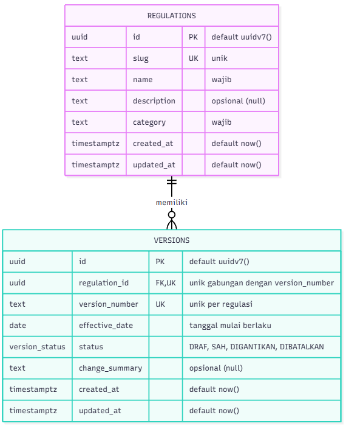
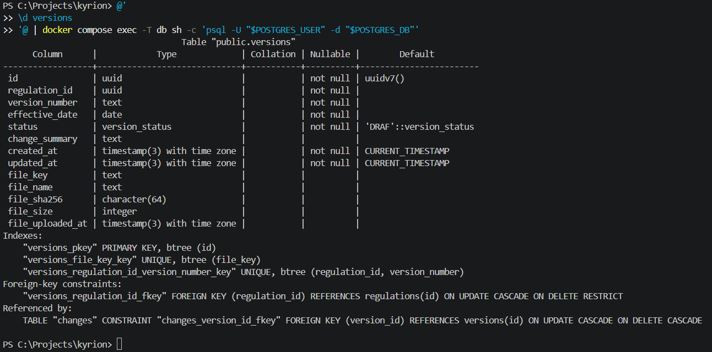
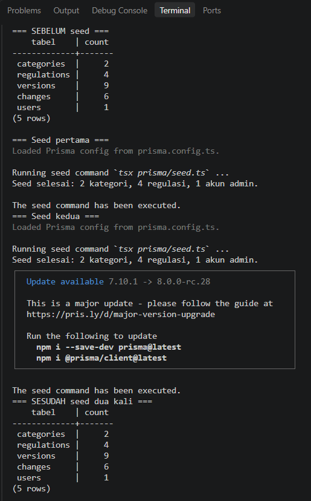
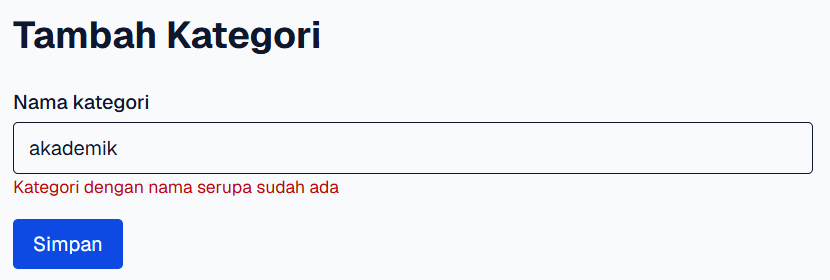
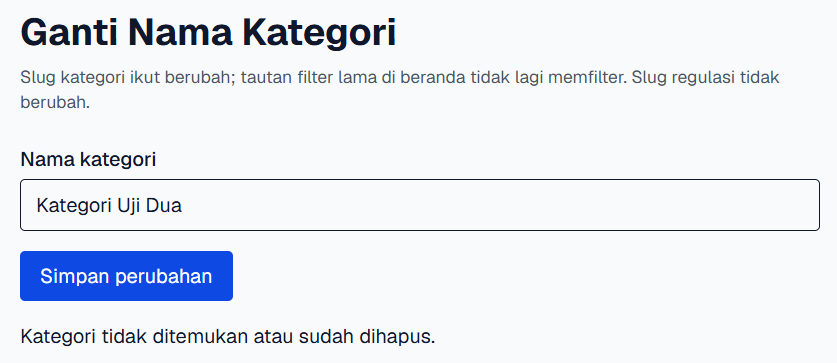

# Dokumen Teknis Modul 6 — PostgreSQL dan Prisma ORM

Nama/NIM : Arif Mufti Tharsa / 105224041
Repositori : https://github.com/arifmuftitharsa/kyrion

Pull request kode (Tugas 2 PAW, v0.2): https://github.com/arifmuftitharsa/kyrion/pull/3 (branch `praktikum/modul-06`)
Hash merge commit PR tersebut: `58a4f08` (tag `v0.2`)

Kode Modul 6 dikerjakan lewat Tugas 2 PAW di branch `praktikum/modul-06` (keputusan 24 Oktober 2026). Commit yang dirujuk dokumen ini:

| Commit | Isi |
|---|---|
| `ddb91e8` | PostgreSQL lewat Docker Compose |
| `afaf6d2` | Prisma 7.10.1 |
| `439084a` | skema, migrasi `init`, seed |
| `36938dd`, `3857d40` | halaman membaca dari PostgreSQL, versi berlaku |
| `61b633e`, `99e0d9e` | CRUD regulasi, perbaikan seed |
| `33f58d2` | CRUD versi Draf |
| `736ede7` | kategori sebagai entitas, migrasi `kategori` |
| `a637140` | akun Admin dan migrasi `users` |
| `51dc49a` | unggah dan unduh PDF versi, migrasi `berkas_versi` |
| `4c8e97a` | entitas Change dan migrasi `perubahan_versi` |
| `3f0c9fd` | skrip demo rollback (bagian 5), branch `docs/modul-06-dokumen-teknis` |

Lingkungan: PostgreSQL 18.6 di Docker Compose (`127.0.0.1:5433`), Prisma 7.10.1, Next.js 16.4.2. Pengujian bagian 3 dan 5 dijalankan pada 30 Oktober 2026 di basis data lokal.

## 1. Rancangan Data

Kyrion menyimpan regulasi kampus beserta riwayat versinya. Dua entitas utama untuk modul ini adalah **Regulation** (induk) dan **Version** (anak), dengan relasi 1:N: satu regulasi punya banyak versi. Skema final memuat tiga entitas pendukung: **Category** (induk Regulation), **Change** (anak Version, butir perubahan antarversi), dan **User** (akun Admin).



ERD di atas belum memuat tabel `categories` yang ditambahkan kemudian. ERD final ada di `../tugas-2/erd-v0.2.png`.

**Kunci dan constraint unik**

| Tabel | Primary key | Foreign key | Constraint unik |
|---|---|---|---|
| `categories` | `id` (uuid, default `uuidv7()`) | tidak ada | `slug` |
| `regulations` | `id` | `category_id` ke `categories.id` | `slug` |
| `versions` | `id` | `regulation_id` ke `regulations.id` | `(regulation_id, version_number)` dan `file_key` |
| `changes` | `id` | `version_id` ke `versions.id` | tidak ada |
| `users` | `id` | tidak ada | `email` |

Alasan constraint unik: `slug` ditulis server selalu dari nama (`createSlug`), sehingga nama yang mirip (beda huruf besar-kecil atau spasi) menghasilkan slug yang sama dan ditolak. `(regulation_id, version_number)` memastikan nomor versi tidak kembar dalam satu regulasi. `file_key` unik agar satu berkas di disk hanya dimiliki satu versi.

**Aturan onDelete dan alasannya**

| Relasi | Aturan | Alasan dari sisi data produk |
|---|---|---|
| Category ke Regulation | Restrict | Kategori yang masih punya regulasi tidak boleh hilang; hanya kategori kosong yang boleh dihapus. |
| Regulation ke Version | Restrict | Versi Sah adalah riwayat resmi sebuah regulasi. Bila memakai Cascade, satu penghapusan regulasi akan menghapus seluruh riwayatnya, termasuk versi Sah. |
| Version ke Change | Cascade | Aplikasi hanya mengizinkan penghapusan versi berstatus Draf, jadi yang ikut terhapus hanya butir perubahan versi Draf, yang memang tidak bermakna tanpa versinya. |

Batas yang perlu dicatat dengan jujur: Restrict hanya mencegah penghapusan **induk** yang masih punya anak. Aturan "versi Sah tidak boleh dihapus" dan aturan "lima kolom berkas terisi bersama" ditegakkan oleh aplikasi, bukan oleh basis data. Output `\d versions` (bagian 2) tidak menampilkan CHECK constraint maupun trigger.

## 2. Skema dan Migrasi

Isi `apps/web/prisma/schema.prisma`:

```prisma
generator client {
  provider = "prisma-client"
  output   = "../generated/prisma"
}

datasource db {
  provider = "postgresql"
}

enum VersionStatus {
  DRAF
  SAH
  DIGANTIKAN
  DIBATALKAN

  @@map("version_status")
}

enum UserRole {
  ADMIN
  SIVITAS

  @@map("user_role")
}

model User {
  id           String   @id @default(dbgenerated("uuidv7()")) @db.Uuid
  // Selalu huruf kecil; dinormalisasi oleh skema Zod dan seed sebelum disimpan.
  email        String   @unique
  // Default SIVITAS: baris tanpa peran eksplisit tidak otomatis menjadi Admin.
  role         UserRole @default(SIVITAS)
  // Null untuk akun SSO (v0.3) yang tidak memakai kata sandi.
  passwordHash String?  @map("password_hash")
  isActive     Boolean  @default(true) @map("is_active")
  createdAt    DateTime @default(now()) @map("created_at") @db.Timestamptz(3)
  updatedAt    DateTime @default(now()) @updatedAt @map("updated_at") @db.Timestamptz(3)

  @@map("users")
}

model Category {
  id          String       @id @default(dbgenerated("uuidv7()")) @db.Uuid
  name        String
  // Selalu createSlug(name); unik sehingga nama mirip (beda kapital/spasi) ditolak.
  slug        String       @unique
  createdAt   DateTime     @default(now()) @map("created_at") @db.Timestamptz(3)
  updatedAt   DateTime     @default(now()) @updatedAt @map("updated_at") @db.Timestamptz(3)
  regulations Regulation[]

  @@map("categories")
}

model Regulation {
  id          String    @id @default(dbgenerated("uuidv7()")) @db.Uuid
  slug        String    @unique
  name        String
  description String?
  categoryId  String    @map("category_id") @db.Uuid
  createdAt   DateTime  @default(now()) @map("created_at") @db.Timestamptz(3)
  updatedAt   DateTime  @default(now()) @updatedAt @map("updated_at") @db.Timestamptz(3)
  // Restrict: kategori yang masih punya regulasi tidak bisa dihapus.
  category    Category  @relation(fields: [categoryId], references: [id], onDelete: Restrict)
  versions    Version[]

  @@index([categoryId])
  @@map("regulations")
}

// Versi berlaku tidak disimpan; dihitung oleh lapisan domain.
model Version {
  id             String        @id @default(dbgenerated("uuidv7()")) @db.Uuid
  regulationId   String        @map("regulation_id") @db.Uuid
  versionNumber  String        @map("version_number")
  effectiveDate  DateTime      @map("effective_date") @db.Date
  status         VersionStatus @default(DRAF)
  // Null untuk versi pertama (tidak ada versi sebelumnya).
  changeSummary  String?       @map("change_summary")
  // Berkas PDF (F-12). Null untuk versi tanpa berkas (mis. versi seed).
  // Kelima kolom selalu ditulis bersama dalam satu pernyataan.
  // Nama asli tersanitasi, hanya untuk tampilan dan header unduhan.
  fileName       String?       @map("file_name")
  // Nama berkas di disk, dibuat server (UUID); unik agar satu berkas milik satu versi.
  fileKey        String?       @unique @map("file_key")
  fileSize       Int?          @map("file_size")
  fileSha256     String?       @map("file_sha256") @db.Char(64)
  fileUploadedAt DateTime?     @map("file_uploaded_at") @db.Timestamptz(3)
  createdAt      DateTime      @default(now()) @map("created_at") @db.Timestamptz(3)
  updatedAt      DateTime      @default(now()) @updatedAt @map("updated_at") @db.Timestamptz(3)
  // Restrict: regulasi yang punya versi (termasuk Sah) tidak bisa dihapus.
  regulation     Regulation    @relation(fields: [regulationId], references: [id], onDelete: Restrict)
  changes        Change[]

  @@unique([regulationId, versionNumber])
  @@map("versions")
}

enum ChangeSource {
  CHANGELOG
  PERBANDINGAN

  @@map("change_source")
}

// Butir perubahan sebuah versi terhadap pendahulunya (F-04), dicatat manual oleh Admin.
model Change {
  id          String       @id @default(dbgenerated("uuidv7()")) @db.Uuid
  versionId   String       @map("version_id") @db.Uuid
  description String
  source      ChangeSource
  // Halaman di dokumen sumber; opsional, bilangan bulat >= 1 (dijaga Zod).
  page        Int?
  createdAt   DateTime     @default(now()) @map("created_at") @db.Timestamptz(3)
  updatedAt   DateTime     @default(now()) @updatedAt @map("updated_at") @db.Timestamptz(3)
  // Cascade: hanya versi Draf yang bisa dihapus, jadi hanya Change Draf yang ikut hilang.
  version     Version      @relation(fields: [versionId], references: [id], onDelete: Cascade)

  @@index([versionId])
  @@map("changes")
}
```

Folder `apps/web/prisma/migrations` (semuanya di-commit):

```
20261024092703_init
20261025010554_kategori
20261025045220_users
20261025052017_berkas_versi
20261025102950_perubahan_versi
migration_lock.toml
```

Potongan `migration.sql` untuk tiga constraint yang paling penting. Constraint RESTRICT dan unik gabungan dibuat di migrasi `init`, sedangkan CASCADE untuk `changes` baru dibuat di migrasi `perubahan_versi`:

```sql
-- 20261024092703_init/migration.sql, baris 35
CREATE UNIQUE INDEX "versions_regulation_id_version_number_key" ON "versions"("regulation_id", "version_number");

-- 20261024092703_init/migration.sql, baris 38
ALTER TABLE "versions" ADD CONSTRAINT "versions_regulation_id_fkey" FOREIGN KEY ("regulation_id") REFERENCES "regulations"("id") ON DELETE RESTRICT ON UPDATE CASCADE;

-- 20261025102950_perubahan_versi/migration.sql, baris 23
ALTER TABLE "changes" ADD CONSTRAINT "changes_version_id_fkey" FOREIGN KEY ("version_id") REFERENCES "versions"("id") ON DELETE CASCADE ON UPDATE CASCADE;
```

Hasil `\d versions` di psql:



Gambar menunjukkan tiga hal. Pertama, bagian `Indexes` memuat `versions_regulation_id_version_number_key` (unik gabungan) dan `versions_file_key_key` (unik). Kedua, bagian `Foreign-key constraints` memuat `versions_regulation_id_fkey` dengan `ON DELETE RESTRICT`. Ketiga, bagian `Referenced by` memuat `changes_version_id_fkey` dengan `ON DELETE CASCADE`. `ON UPDATE CASCADE` pada kedua foreign key adalah bawaan Prisma, bukan pilihan saya. Tidak ada CHECK constraint dan tidak ada trigger.

## 3. Seed dan Prisma Client

`apps/web/prisma/seed.ts` mengisi 2 kategori, 4 regulasi, 8 versi, 6 butir Change, dan 1 akun Admin. Semua regulasi dan versinya fiktif dan ditandai `[DATA SINTETIS]`. Seed dijalankan lewat `prisma db seed`, yang memanggil `tsx prisma/seed.ts` (`prisma.config.ts` baris 12).

**Kenapa seed bisa dijalankan ulang.** Setiap baris ditulis dengan `upsert` berdasarkan kunci unik: kategori dan regulasi per `slug`, versi per kunci gabungan `regulationId_versionNumber`, akun Admin per `email`. Baris yang sudah ada diperbarui, bukan digandakan. Butir Change tidak punya kunci unik alami, jadi per versi seed dilakukan `deleteMany` lalu `createMany` dalam satu `$transaction` bentuk larik. Itu aman karena versi seed bukan Draf sehingga Admin tidak bisa menambah Change di sana.

Keluaran `npx prisma db seed` yang dijalankan dua kali, dengan jumlah baris dihitung sebelum dan sesudahnya:



| Tabel | Sebelum seed | Sesudah seed dua kali |
|---|---|---|
| categories | 2 | 2 |
| regulations | 4 | 4 |
| versions | 9 | 9 |
| changes | 6 | 6 |
| users | 1 | 1 |

Jumlah versi 9 terdiri dari 8 versi dari seed ditambah 1 versi sisa pengujian (Pedoman Tugas Akhir versi 14, status Draf) yang tidak ada di daftar seed, sehingga seed tidak menyentuhnya. Karena yang dibandingkan adalah jumlah sebelum dan sesudah, versi itu tidak mengganggu bukti.

**Kenapa seed tidak mengimpor `lib/prisma.ts`.** Baris pertama `lib/prisma.ts` adalah `import "server-only"`. Paket itu sengaja melempar galat bila modulnya diimpor di luar lingkungan server Next.js, supaya kode server tidak bocor ke browser. Seed dijalankan langsung oleh `tsx`, tanpa Next.js, jadi mengimpor `lib/prisma.ts` akan membuat seed gagal. Karena itu seed membuat `PrismaClient` sendiri dengan adapter `PrismaPg`, dan memanggil `loadEnvConfig` sendiri untuk memuat `.env.local` yang biasanya dimuat oleh Next.

**Penanganan akun Admin di seed.** Kredensial dibaca dari `ADMIN_SEED_EMAIL` dan `ADMIN_SEED_PASSWORD` di `.env.local`, tidak ada di repositori. Kata sandi minimal 15 karakter (NIST SP 800-63B-4), disimpan hanya sebagai hash scrypt, dan pesan galat seed sengaja tidak memuat nilai apa pun agar rahasia tidak masuk log terminal.

## 4. Operasi CRUD

Operasi basis data ada di `apps/web/lib/data/*.ts`. Server Action di `apps/web/app/admin/**/actions.ts` memanggilnya, menangkap galat domain, lalu mengembalikan pesan tetap ke formulir. Galat tak terduga dicatat dengan `console.error` dan pengguna hanya melihat pesan umum, sehingga pesan mentah Prisma (nama tabel dan constraint) tidak sampai ke pengguna.

| Entitas | Aksi (fungsi) | Metode Prisma | Galat yang ditangani |
|---|---|---|---|
| Category | Baca daftar dan detail | `findMany`, `findUnique` | tidak ada (hasil kosong ditangani pemanggil) |
| Category | Cek nama serupa (`isCategorySlugTaken`) | `count` | tidak ada |
| Category | Tambah (`createCategory`) | `create` | P2002 menjadi `CategorySlugTakenError` |
| Category | Ganti nama (`renameCategory`) | `update` | P2002 (nama serupa), P2025 menjadi `CategoryNotFoundError` |
| Category | Hapus (`deleteEmptyCategory`) | `deleteMany` dengan `regulations: { none: {} }` | P2003 menjadi `CategoryHasRegulationsError`; bila `count` 0, kategori dicari ulang untuk membedakan "tidak ada" dari "masih dipakai" |
| Regulation | Baca | `findMany`, `findUnique`, `count` | tidak ada |
| Regulation | Tambah (`createRegulation`) | `create` | P2002 menjadi `SlugTakenError`, P2003 menjadi `CategoryNotFoundError` |
| Regulation | Ubah (`updateRegulation`) | `update` | P2002, P2003 (kategori hilang), P2025 menjadi `RegulationNotFoundError` |
| Regulation | Hapus (`deleteRegulation`) | `delete` | P2003 menjadi `RegulationHasVersionsError`, P2025 |
| Version | Baca (`getAdminVersions`, `findVersion`, `findVersionFile`) | `findMany`, `findFirst` | tidak ada (hasil kosong menjadi `undefined`) |
| Version | Tambah (`createVersion`, status selalu DRAF) | `create` | P2002 menjadi `VersionNumberTakenError`, P2003 menjadi `RegulationNotFoundError` |
| Version | Ubah (`updateDraftVersion`) | `updateMany` dengan `status: "DRAF"` di `where` | P2002; `count` 0 menjadi `VersionNotEditableError` |
| Version | Hapus (`deleteDraftVersion`) | `deleteMany` dengan `status: "DRAF"` di `where` | `count` 0 menjadi `VersionNotEditableError` |
| Change | Tambah, ubah, hapus butir perubahan (`changes.ts`) | `tx.version.updateMany`, lalu `tx.change.create`, `updateMany`, `deleteMany` dalam transaksi | P2003 (versi terhapus di antara penguncian dan insert) diperlakukan sama dengan versi yang tidak lagi Draf |

Catatan desain: Version memakai `updateMany` dan `deleteMany` dengan syarat status di `where`, bukan `update` dan `delete`. Cek status dan penulisan terjadi dalam satu perintah SQL, sehingga tidak ada celah antara "cek lalu tulis" bila ada request lain di antaranya. Akibatnya Version tidak pernah menghasilkan P2025; baris yang tidak cocok hanya membuat `count` bernilai 0, dan itulah yang diperiksa.

**Pesan P2002 di formulir.** Menambah kategori `akademik` (huruf kecil) padahal `Akademik` sudah ada:



Pesan ini muncul dari pra-cek `isCategorySlugTaken` di Server Action, karena duplikat biasa tertangkap sebelum perintah `create` dijalankan. Jalur P2002 dari basis data (`catch` di `simpanKategori`) adalah lapis kedua yang hanya tercapai bila request lain merebut slug setelah pra-cek, dan itu tidak bisa saya tiru dengan tangan. Teks pesan yang dilihat pengguna sama untuk kedua jalur. Bukti bahwa constraint unik itu sendiri ada di basis data adalah indeks `categories_slug_key` dan `versions_regulation_id_version_number_key`.

**Pesan P2025 di formulir.** Formulir "Ganti Nama Kategori" dibuka di tab A, kategorinya dihapus lewat tab B, lalu formulir di tab A dikirim:



`update` melempar P2025, yang diterjemahkan menjadi `CategoryNotFoundError`, lalu `gantiNamaKategori` mengembalikan pesan umum "Kategori tidak ditemukan atau sudah dihapus."

## 5. Transaksi dan Rollback

**Galat saat menghapus tanpa transaksi (RESTRICT).** Dua perintah `DELETE` biasa dijalankan langsung di psql pada 30 Oktober 2026, masing-masing sebagai proses terpisah agar urutan keluarannya benar:

```
=== Sebelum ===
 categories | regulations | versions 
------------+-------------+----------
          2 |           4 |        9
(1 row)

=== Hapus kategori yang masih punya regulasi ===
ERROR:  update or delete on table "categories" violates RESTRICT setting of foreign key constraint "regulations_category_id_fkey" on table "regulations"
DETAIL:  Key (id)=(01a17097-f889-7f09-8ef9-7910b18166c2) is referenced from table "regulations".
=== Hapus regulasi yang masih punya versi ===
ERROR:  update or delete on table "regulations" violates RESTRICT setting of foreign key constraint "versions_regulation_id_fkey" on table "versions"
DETAIL:  Key (id)=(01a16d3c-6561-70f2-b2a1-b7fa08492d8b) is referenced from table "versions".
=== Sesudah ===
 categories | regulations | versions 
------------+-------------+----------
          2 |           4 |        9
(1 row)
```

Kedua penghapusan ditolak oleh basis data dan jumlah baris tidak berubah. Di aplikasi, galat RESTRICT PostgreSQL ini dipetakan adapter `pg` menjadi kode Prisma **P2003** (dicatat di komentar `categories.ts` dan `regulations.ts`), lalu diterjemahkan menjadi `CategoryHasRegulationsError` atau `RegulationHasVersionsError`.

**Bukti rollback.** Skrip demo `apps/web/prisma/demo-rollback.ts` (commit `3f0c9fd`) menjalankan dua perintah dalam satu `$transaction` bentuk larik pada versi Pedoman Akademik `2025/2026` yang punya 2 butir Change:

```ts
await prisma.$transaction([
  prisma.change.deleteMany({ where: { versionId: versi.id } }),
  prisma.change.create({
    data: {
      versionId: VERSI_TIDAK_ADA, // UUID yang tidak ada di tabel versions
      description: "Butir uji yang sengaja gagal",
      source: "CHANGELOG",
    },
  }),
]);
```

Perintah pertama menghapus semua Change milik versi itu. Perintah kedua sengaja gagal karena melanggar foreign key `changes_version_id_fkey`. Keluaran skrip:

```
Jumlah Change sebelum: 2
Transaksi gagal, kode galat: P2003
Jumlah Change sesudah: 2
```

Jumlah Change tetap 2, jadi seluruh transaksi dibatalkan walaupun perintah pertama berurutan lebih dulu. Keluaran ini membuktikan data tidak berubah; bahwa `deleteMany` sempat berjalan di dalam transaksi saya simpulkan dari urutan eksekusinya, bukan dari pengamatan langsung.

**Pemilihan bentuk transaksi.** Kode saya memakai dua bentuk. Bentuk larik `$transaction([...])` dipakai di seed dan di skrip demo, karena dua perintahnya tidak saling bergantung pada hasil sebelumnya. Bentuk interaktif `$transaction(async (tx) => ...)` dipakai di `changes.ts`: `tx.version.updateMany` dengan syarat status Draf dijalankan lebih dulu, dan keputusan menambah, mengubah, atau menghapus Change bergantung pada hasil itu. Rollback transaksi interaktif di `changes.ts` tidak saya uji terpisah; bukti rollback di atas memakai bentuk larik.

**Perbedaan dengan contoh modul.** Contoh modul memakai Item dan Ulasan. Di Kyrion, pasangan induk-anak terdekat adalah Version dan Change, dan skrip demo meniru pola `deleteMany` lalu perintah kedua yang gagal dari modul.

## 6. Skenario Uji

Sepuluh skenario diuji pada 25 Oktober 2026 pada kode Tugas 2 (v0.2). Komposisinya 8 skenario CRUD (nomor 1 sampai 8: empat untuk Regulasi, empat untuk Versi) dan 2 skenario relasi (nomor 9 dan 10). Bukti tangkapan layar ada di folder `../tugas-2/screenshots/`. Skenario 9 memakai tangkapan layar DB dari skenario 8 sebagai bukti kedua karena kondisi basis datanya sama (Pedoman Tugas Akhir berisi 4 versi). Daftar skenario ini tidak memuat skenario rollback; rollback dibuktikan terpisah di bagian 5. Skenario lanjutan 11 sampai 20 ada di README bagian 5 dan tidak dihitung di sini.

| No | Entitas | Operasi | Tujuan | Masukan | Hasil diharapkan | Hasil aktual | Status | Bukti |
|---|---|---|---|---|---|---|---|---|
| 1 | Regulasi | Create | Menambah regulasi baru | Nama "Pedoman Cuti Akademik", kategori Akademik, deskripsi sintetis | Tersimpan, slug dibuat server | Muncul di daftar admin; baris ada di DB dengan slug pedoman-cuti-akademik | Lulus | [skenario-01-regulasi-create-ui.png](../tugas-2/screenshots/skenario-01-regulasi-create-ui.png), [skenario-01-regulasi-create-db.png](../tugas-2/screenshots/skenario-01-regulasi-create-db.png) |
| 2 | Regulasi | Read | Alamat yang tidak ada ditangani | Buka /regulasi/tidak-ada | Halaman tidak ditemukan, status 404 | "Regulasi tidak ditemukan", Network: 404 Not Found | Lulus | [skenario-02-regulasi-read-ui.png](../tugas-2/screenshots/skenario-02-regulasi-read-ui.png) |
| 3 | Regulasi | Update | Mengubah deskripsi | Deskripsi diganti teks baru | Tersimpan, deskripsi baru tampil | Deskripsi baru tampil di halaman publik; updated_at lebih baru dari created_at | Lulus | [skenario-03-regulasi-update-ui.png](../tugas-2/screenshots/skenario-03-regulasi-update-ui.png), [skenario-03-regulasi-update-db.png](../tugas-2/screenshots/skenario-03-regulasi-update-db.png) |
| 4 | Regulasi | Delete | Menghapus regulasi tanpa versi | Hapus Pedoman Cuti Akademik | Terhapus | Hilang dari daftar; count di DB = 0 | Lulus | [skenario-04-regulasi-delete-ui.png](../tugas-2/screenshots/skenario-04-regulasi-delete-ui.png), [skenario-04-regulasi-delete-db.png](../tugas-2/screenshots/skenario-04-regulasi-delete-db.png) |
| 5 | Versi | Create | Menambah versi | Versi 15 Pedoman Tugas Akhir, 1 Agustus 2027, ringkasan | Tersimpan sebagai Draf | Tampil paling atas sebagai Draf; DB: 15, DRAF, 2027-08-01 | Lulus | [skenario-05-versi-create-ui.png](../tugas-2/screenshots/skenario-05-versi-create-ui.png), [skenario-05-versi-create-db.png](../tugas-2/screenshots/skenario-05-versi-create-db.png) |
| 6 | Versi | Read | Daftar versi admin | Buka daftar versi Pedoman Akademik | Terurut dari tanggal terbaru, status tampil | Tiga versi terurut 1 Agu 2027 → 1 Agu 2024 dengan label status Sah dan Digantikan | Lulus | [skenario-06-versi-read-ui.png](../tugas-2/screenshots/skenario-06-versi-read-ui.png) |
| 7 | Versi | Update | Mengubah versi Draf | Ringkasan versi 15 diganti | Tersimpan, status tetap Draf | Ringkasan baru tampil; DB: status DRAF, updated_at lebih baru | Lulus | [skenario-07-versi-update-ui.png](../tugas-2/screenshots/skenario-07-versi-update-ui.png), [skenario-07-versi-update-db.png](../tugas-2/screenshots/skenario-07-versi-update-db.png) |
| 8 | Versi | Delete | Menghapus versi Draf | Hapus versi 15 | Terhapus, versi lain utuh | Versi 15 hilang; DB tinggal 14, 13, 12, 11 | Lulus | [skenario-08-versi-delete-ui.png](../tugas-2/screenshots/skenario-08-versi-delete-ui.png), [skenario-08-versi-delete-db.png](../tugas-2/screenshots/skenario-08-versi-delete-db.png) |
| 9 | Relasi | Read | Publik hanya melihat versi yang pernah disahkan | Buka /regulasi/pedoman-tugas-akhir | Hanya versi 11; Draf dan Dibatalkan tidak tampil | Versi berlaku 11 dan riwayat hanya versi 11, padahal DB berisi 4 versi | Lulus | [skenario-09-relasi-read-ui.png](../tugas-2/screenshots/skenario-09-relasi-read-ui.png), [skenario-08-versi-delete-db.png](../tugas-2/screenshots/skenario-08-versi-delete-db.png) |
| 10 | Relasi | Delete | Regulasi yang masih punya versi tidak boleh dihapus | Hapus Pedoman Tugas Akhir (4 versi) | Ditolak dengan pesan jelas | "Regulasi ini memiliki 4 versi dan tidak dapat dihapus…"; DB tetap 4 versi | Lulus | [skenario-10-relasi-delete-ui.png](../tugas-2/screenshots/skenario-10-relasi-delete-ui.png), [skenario-10-relasi-delete-db.png](../tugas-2/screenshots/skenario-10-relasi-delete-db.png) |

**Hasil: 10 dari 10 skenario lulus (100%)**, di atas ambang lulus ⌈0,9 × 10⌉ = 9.

## 7. Kendala dan Penyelesaian

**Urutan keluaran psql tidak sesuai urutan perintah.** Saat membuktikan RESTRICT dengan satu skrip psql, galat penghapusan regulasi muncul setelah baris `=== Sesudah ===`, seolah terjadi belakangan. Penyebab yang saya duga: psql menulis galat dan hasil lewat jalur keluaran yang berbeda, dan keduanya tidak sinkron saat lewat pipe. Penyelesaian: setiap pernyataan dijalankan sebagai proses psql terpisah lewat fungsi PowerShell, sehingga urutannya sama dengan urutan perintah.

**Docker Desktop belum menyala.** `docker compose` gagal terhubung ke Docker API (`dockerDesktopLinuxEngine` tidak ditemukan). Penyelesaian: menyalakan Docker Desktop, menjalankan `docker compose up -d db`, lalu memastikan kontainer `kyrion-db-1` berstatus healthy sebelum perintah psql dijalankan.

**Tanda kutip PowerShell merusak perintah psql satu baris.** Perintah `psql -c` dengan tanda kutip bersarang menghasilkan keluaran yang tidak konsisten. Penyelesaian: menulis SQL sebagai here-string dan mengalirkannya lewat stdin, `@'...'@ | docker compose exec -T db sh -c 'psql ...'`.

**Nama regulasi ganda sempat diterima.** Gejala: pada uji manual, nama regulasi yang sama bisa ditambahkan lewat formulir. Penyebab: slug di seed ditulis manual dan tidak dihitung dari nama (misalnya "Pedoman Akademik Program Sarjana" ber-slug `pedoman-akademik`), sehingga pengecekan slug unik tidak mendeteksinya. Penyelesaian: seed menghitung slug dengan `createSlug(nama)`, sama dengan aplikasi, dan dua nama seed disesuaikan agar slug dan URL tetap (commit `99e0d9e`).

**Tanggal tersimpan salah.** Gejala: masukan 01/07/2027 tersimpan sebagai 7 Januari. Penyebab: `<input type="date">` mengikuti bahasa browser, sedangkan kolom `effective_date` bertipe `date`. Penyelesaian: masukan diganti tiga kolom (tanggal, nama bulan, tahun) sehingga tidak bergantung pada bahasa browser (commit `33f58d2`).

**Unggah PDF: berkas bernama "undefined" dan body terpotong.** Gejala: berkas opsional yang tidak dipilih terbaca sebagai berkas bernama "undefined" (dari busboy di Next), dan unggahan yang melewati batas ukuran terpotong di proxy sebelum validasi server berjalan. Penyelesaian: pemeriksaan berkas opsional yang mengenali nama "undefined", ditambah cek ukuran di klien. Keduanya diperbaiki sebelum commit `51dc49a`.

**Berkas di penyimpanan tidak cocok dengan catatan DB.** Gejala: pada skenario 16 percobaan pertama, berkas di penyimpanan berukuran 15443 byte dengan hash berbeda dari catatan DB (15442 byte), sehingga unduhan ditolak 500 "Berkas gagal diverifikasi". Penyebabnya belum dipastikan; dugaan saya berkas diubah dari luar aplikasi. Penyelesaian: tidak ada perubahan kode. Versi dihapus lewat UI lalu diunggah ulang, dan percobaan kedua berhasil. Penolakan itu sendiri membuktikan verifikasi hash berfungsi.

**Versi `latest` Prisma adalah rilis kandidat.** Gejala: tag `latest` Prisma mengarah ke versi rilis kandidat (kotak pemberitahuan "Update available 7.10.1 -> 8.0.0-rc.28" masih muncul saat seed dijalankan). Penyelesaian: versi dikunci ke 7.10.1 (commit `afaf6d2`) dan pemberitahuan itu diabaikan.

**Urutan keluaran psql tidak sesuai urutan perintah.** Gejala: saat membuktikan RESTRICT dengan satu skrip psql, galat penghapusan regulasi muncul setelah baris `=== Sesudah ===`, seolah terjadi belakangan. Penyebab yang saya duga: psql menulis galat dan hasil lewat jalur keluaran yang berbeda, dan keduanya tidak sinkron saat lewat pipe. Penyelesaian: setiap pernyataan dijalankan sebagai proses psql terpisah lewat fungsi PowerShell, sehingga urutannya sama dengan urutan perintah.

**Docker Desktop belum menyala.** Gejala: `docker compose` gagal terhubung ke Docker API (`dockerDesktopLinuxEngine` tidak ditemukan). Penyelesaian: menyalakan Docker Desktop, menjalankan `docker compose up -d db`, lalu memastikan kontainer `kyrion-db-1` berstatus healthy sebelum perintah psql dijalankan.

**Tanda kutip PowerShell merusak perintah psql satu baris.** Gejala: perintah `psql -c` dengan tanda kutip bersarang menghasilkan keluaran yang tidak konsisten. Penyelesaian: SQL ditulis sebagai here-string dan dialirkan lewat stdin, `@'...'@ | docker compose exec -T db sh -c 'psql ...'`.

## 8. Catatan Pemanfaatan AI

- **Alat:** Claude.
- **Perintah utama:** (1) memandu penyusunan Dokumen Teknis bagian demi bagian; (2) menghasilkan skrip `apps/web/prisma/demo-rollback.ts` untuk bukti rollback; (3) menyusun draf teks Dokumen Teknis ini dari keluaran dan kode yang saya kumpulkan. (4) untuk kode Tugas 2 yang dirujuk bagian 2 sampai 4 (skema, migrasi, seed, dan CRUD), Claude menulis kode langsung di repositori dan memandu Tugas Pendahuluan Modul 6; entri lengkap per commit ada di `AI_LOG.md` (entri 24 dan 25 Oktober 2026 yang bertanda [PRAK]).
- **Bagian yang digunakan:** skrip `demo-rollback.ts` (commit `3f0c9fd`) dan kerangka serta draf kalimat Dokumen Teknis. Isi kode yang dirujuk (`seed.ts`, `categories.ts`, `regulations.ts`, `versions.ts`, `changes.ts`) adalah kode saya sendiri.
- **Cara memverifikasi:** semua keluaran (psql, seed dua kali, RESTRICT, rollback) saya jalankan sendiri di basis data lokal dan salin dari terminal; tangkapan layar saya ambil sendiri. Jumlah baris sebelum dan sesudah dibandingkan. Skrip rollback saya jalankan dan hasilnya (kode P2003, jumlah Change tetap 2) dicocokkan dengan dugaan dari komentar di kode. Setiap klaim tentang kode dicek ulang terhadap isi berkasnya. Untuk kode Tugas 2, saya menjalankan uji manual sendiri (CRUD, penolakan Zod, constraint, hasilnya dicek dengan `psql`) dan 20 skenario di README bagian 5, ditambah uji otomatis Vitest (`npm test`).