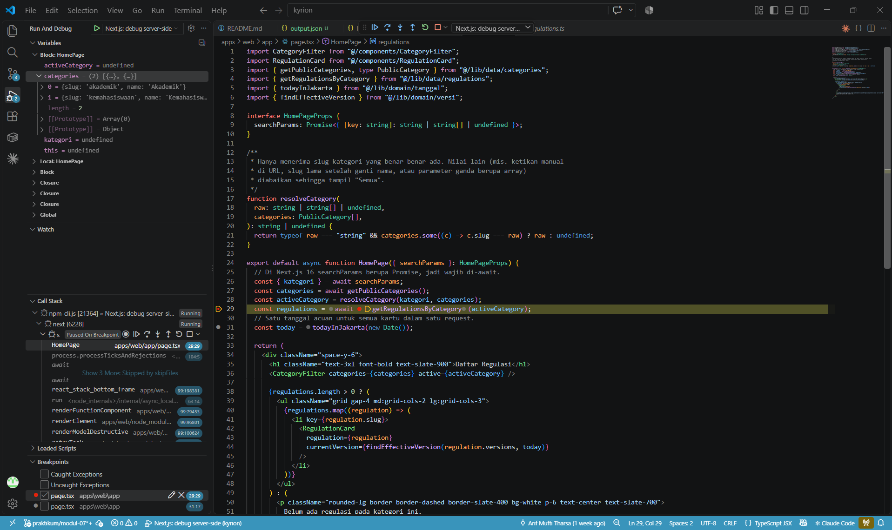
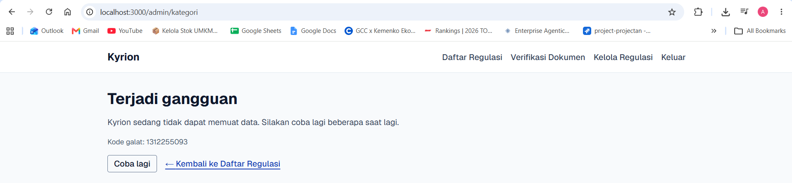

# Dokumen Teknis Modul 7 — Debugging dan Telaah Kode

Nama/NIM : Arif Mufti Tharsa / 105224041
Repositori : https://github.com/arifmuftitharsa/kyrion
Pull request: https://github.com/arifmuftitharsa/kyrion/pull/10 (merge commit `af4e3c9`)

> Catatan konteks: kode pada Modul 7 diterapkan ke fitur Kyrion yang terdekat dengan contoh modul. Kyrion tidak memiliki entitas Item atau Ulasan; entitasnya adalah Category, Regulation, Version, Change, dan User. Hapus item berulasan pada modul dipetakan ke hapus kategori yang masih berisi regulasi, dan Galat 1 (boolean) diuji secara terisolasi karena Kyrion tidak memiliki kolom boolean pada formulirnya. Alasan lengkap ada di bagian 4.

## 1. Lingkungan dan Konfigurasi Debugger

### Versi dan hash commit awal

| Komponen | Versi |
|----------|-------|
| Node.js | v24.19.0 |
| Next.js | 16.4.2 (Turbopack) |
| Prisma | 7.10.1 |
| Zod | 4.6.7 |
| Vitest | v5.0.4 |
| Peramban | Chrome 156.0.8078.81 (64-bit) |
| Sistem operasi | Windows 11 Version 26H2 (Build 26300.9711) |

Hash commit awal (sebelum kode usulan AI ditambahkan): `fb37a19`.

### .vscode/launch.json

```json
{
  "version": "0.2.0",
  "configurations": [
    {
      "name": "Next.js: debug server-side",
      "type": "node-terminal",
      "request": "launch",
      "command": "npm run dev -- --inspect",
      "cwd": "${workspaceFolder}/apps/web"
    },
    {
      "name": "Next.js: debug client-side",
      "type": "chrome",
      "request": "launch",
      "url": "http://localhost:3000"
    }
  ]
}
```

Berkas ini di-commit pada `4096835`. Aturan `.gitignore` diubah dari `.vscode/` menjadi `.vscode/*` dengan pengecualian `!.vscode/launch.json` agar berkas ini ikut terlacak. Konfigurasi server-side memakai `node-terminal` dengan `--inspect` supaya proses `next dev` membuka port inspector yang dapat dipasangi debugger VS Code; konfigurasi client-side membuka Chrome untuk kode yang berjalan di peramban.

### Konfigurasi log Prisma

Untuk melihat kueri SQL yang dikirim aplikasi, saya menambahkan opsi `log: ["query", "warn", "error"]` pada `apps/web/lib/prisma.ts`. Perubahan ini bersifat sementara untuk penelusuran dan dikembalikan dengan `git restore` sebelum commit, sehingga tidak masuk ke riwayat.

Contoh bentuk opsinya pada konstruktor `PrismaClient` (tanpa nilai rahasia; koneksi tetap dari `DATABASE_URL`):

```ts
return new PrismaClient({
  adapter: new PrismaPg({ connectionString }),
  log: ["query", "warn", "error"],
});
```

Saya tidak mencatat apakah opsi ini aktif saat bukti pada bagian 3 diambil ulang. Karena itu log di bagian 3 tidak saya pakai sebagai bukti kueri SQL. Kesimpulan tentang `DELETE` pada bagian 3.3 dibaca dari stack trace, bukan dari log kueri.

### Debugger berhenti di Server Component



## 2. Daftar Galat

| No | Issue | Gejala | Lapisan | Akar penyebab | Commit perbaikan |
|----|-------|--------|---------|---------------|------------------|
| 1 | #7 | Nilai "false" dari formulir terbaca true | Validasi (skema Zod) | Nilai formulir selalu berupa string. `z.coerce.boolean()` memanggil `Boolean()` pada string itu, dan string tidak kosong, termasuk `"false"`, bernilai true. | `7471ffc` |
| 2 | #8 | Hapus kategori kosong tidak berpindah halaman | Server Action (alur kontrol) | `redirect()` bekerja dengan melempar error khusus `NEXT_REDIRECT`. Karena dipanggil di dalam `try`, error itu ditangkap blok `catch` (yang hanya mencatat log), sehingga Next.js tidak pernah menerima perintah pindah halaman. | `961198e` |
| 3 | #9 | Hapus kategori berisi regulasi gagal tanpa pesan | Basis data (constraint FK) dan Server Action | Relasi regulasi ke kategori memakai `onDelete: Restrict`, jadi basis data menolak penghapusan dengan kode `P2003`. Kode usulan AI tidak memeriksa jumlah regulasi sebelum menghapus, dan `catch`-nya hanya mencatat log lalu mengembalikan `{}`, sehingga tidak ada pesan untuk pengguna. | `961198e` |

Commit kode usulan AI (sebelum perbaikan): `ff3b7c9` (Galat 1) dan `3169014` (Galat 2 dan 3). Setiap galat punya commit usulan AI dan commit perbaikan yang terpisah agar bukti sebelum dan sesudah dapat diulang dari riwayat git.

## 3. Catatan Penelusuran

**Asal bukti.** Galat diterapkan, ditemukan, dan diperbaiki pada sesi praktikum 6 November 2026 (commit `ff3b7c9` pukul 16.32 sampai `961198e` pukul 17.18 WIB). Log dan keluaran uji pada bagian 3.1 sampai 3.3 saya ambil ulang pada 8 November 2026 antara pukul 21.05 dan 21.30 WIB dengan `git switch --detach` ke `ff3b7c9`, `7471ffc`, `3169014`, dan `961198e`. Waktu perpindahan tercatat di `git reflog`, dan waktu pembuatan commit tercatat di `git log`.

### 3.1 Galat 1 — nilai "false" terbaca true (issue #7)

**Langkah reproduksi** (disalin dari issue #7)

1. Dari `apps/web`, jalankan `npm test -- status-boolean`.
2. Tes membangun `FormData` dengan `tersedia = "false"`, mengubahnya dengan `Object.fromEntries`, lalu memanggil `skemaStatus.parse`.
3. Hasil yang diharapkan: `tersedia` bernilai `false`.

Kyrion tidak memiliki kolom boolean pada formulirnya, sehingga galat ini diuji lewat tes Vitest terisolasi pada `apps/web/lib/status-boolean.test.ts`, bukan lewat tampilan antarmuka.

**Bukti sebelum perbaikan** (commit `ff3b7c9`)

Kode usulan AI:

```ts
tersedia: z.coerce.boolean(),
```

Berkas tes memiliki dua kasus (`"true"` menjadi true dan `"false"` menjadi false). Pada kode usulan AI, kasus `"false"` gagal pada setiap percobaan (3 dari 3 percobaan), sedangkan kasus `"true"` lulus. Kegagalan terjadi di `status-boolean.test.ts:22:44`. Keluaran salah satu percobaan, dijalankan pada commit `ff3b7c9` dengan `npm test -- status-boolean` dari `apps/web`:

```text
> web@0.1.0 test
> vitest run status-boolean


 RUN  v5.0.4 C:/Projects/kyrion/apps/web

 ❯ lib/status-boolean.test.ts (2 tests | 1 failed) 15ms
   ❯ skemaStatus (usulan AI) (2)
     ✓ "true" menjadi true 12ms
     × "false" menjadi false 3ms

 FAIL  lib/status-boolean.test.ts > skemaStatus (usulan AI) > "false" menjadi false
AssertionError: expected true to be false // Object.is equality

- Expected
+ Received

- false
+ true

 ❯ lib/status-boolean.test.ts:22:44
     20|
     21|   it('"false" menjadi false', () => {
     22|     expect(dariFormulir("false").tersedia).toBe(false);
       |                                            ^
     23|   });
     24| });

 Test Files  1 failed (1)
      Tests  1 failed | 1 passed (2)
   Start at  21:05:25
   Duration  438ms (import 81%, transform 9%, tests 8%, worker 2%)
```

**Akar penyebab dan perbaikan** (commit `7471ffc`)

`FormData` hanya membawa string. `z.coerce.boolean()` di Zod 4 memakai `Boolean()` JavaScript pada nilai masukan, dan `Boolean("false")` bernilai `true` karena hanya string kosong yang bernilai false. Perbaikannya mengganti skema dengan `z.stringbool()`, yang memetakan string ke boolean secara eksplisit:

```ts
// sebelum
tersedia: z.coerce.boolean(),

// sesudah
tersedia: z.stringbool(),
```

**Bukti sesudah perbaikan**

Perintah yang sama dijalankan tiga kali pada commit `7471ffc` (`1..3 | ForEach-Object { npm test -- status-boolean }`). Kedua kasus lulus pada ketiga percobaan (3 dari 3). Percobaan pertama ditampilkan lengkap; percobaan kedua dan ketiga diringkas.

```text
> web@0.1.0 test
> vitest run status-boolean


 RUN  v5.0.4 C:/Projects/kyrion/apps/web

 ✓ lib/status-boolean.test.ts (2 tests) 13ms
   ✓ skemaStatus (usulan AI) (2)
     ✓ "true" menjadi true 12ms
     ✓ "false" menjadi false 0ms

 Test Files  1 passed (1)
      Tests  2 passed (2)
   Start at  21:05:51
   Duration  197ms (import 76%, tests 13%, transform 7%, worker 4%)
```

```text
Percobaan 2: Test Files  1 passed (1) | Tests  2 passed (2) | Start at  21:05:52
Percobaan 3: Test Files  1 passed (1) | Tests  2 passed (2) | Start at  21:05:53
```

### 3.2 Galat 2 — redirect() tertelan catch (issue #8)

**Langkah reproduksi** (disalin dari issue #8)

1. Dari `apps/web`, jalankan `npm run dev`, masuk sebagai admin, buka `/admin/kategori`.
2. Tambahkan kategori kosong (tanpa regulasi), lalu buka halaman hapusnya.
3. Klik tombol hapus.
4. Hasil yang diharapkan: halaman berpindah ke `/admin/kategori`.

**Kode usulan AI** (commit `3169014`, `apps/web/app/admin/kategori/actions.ts`)

```ts
export async function hapusKategori(id: string): Promise<StatusForm> {
  await wajibAdmin();
  const idValid = skemaIdKategori.safeParse(id);
  if (!idValid.success) return { pesan: PESAN_TIDAK_DITEMUKAN };
  try {
    await getPrisma().category.delete({ where: { id: idValid.data } });
    revalidatePath("/", "layout");
    redirect("/admin/kategori");
  } catch (e) {
    console.log("Gagal menghapus");
  }
  return {};
}
```

**Bukti sebelum perbaikan**

Breakpoint pada baris `catch` tetap berwarna abu-abu (Unbound breakpoint) dan debugger tidak pernah berhenti, sehingga penelusuran memakai perubahan sementara pada baris `catch` (`console.log("Gagal menghapus")` menjadi `console.log("Gagal menghapus", e)`) dan membaca keluarannya pada terminal `next dev`. Perubahan sementara itu tidak di-commit. Pada commit `3169014`, blok `catch` menangkap error dengan digest `NEXT_REDIRECT;push;/admin/kategori;307;` (terbukti dari log percobaan yang dilampirkan di bawah). Tampilan peramban pada percobaan yang dilampirkan: halaman `/admin/kategori/uji-galat-dua/hapus` menampilkan "Halaman tidak ditemukan" (404), bukan berpindah ke daftar kategori.

```text
 GET /admin/kategori/uji-galat-dua/hapus 200 in 692ms (next.js: 649ms, proxy.ts: 5ms, application-code: 38ms)
Gagal menghapus Error: NEXT_REDIRECT
    at hapusKategori (app\admin\kategori\actions.ts:126:13)
  124 |     await getPrisma().category.delete({ where: { id: idValid.data } });
  125 |     revalidatePath("/", "layout");
> 126 |     redirect("/admin/kategori");
      |             ^
  127 |   } catch (e) {
  128 |     console.log("Gagal menghapus", e);
  129 |   } {
  digest: 'NEXT_REDIRECT;push;/admin/kategori;307;'
}
 POST /admin/kategori/uji-galat-dua/hapus 200 in 344ms (next.js: 11ms, proxy.ts: 5ms, application-code: 328ms)
  └─ ƒ hapusKategori("01a1bb7e-6c58-7694-a760-4ef05596b59a") in 284ms app/admin/kategori/actions.ts
```

Cara membaca log: stack trace menunjuk baris 126 (`redirect`), jadi `delete` pada baris 124 dan `revalidatePath` pada baris 125 sudah selesai tanpa melempar error. Yang dilempar baris 126 adalah `NEXT_REDIRECT`, dan `catch` pada baris 127 menangkapnya. Yang gagal bukan penghapusannya, melainkan perpindahan halaman.

Catatan jujur: pada percobaan pertama (sebelum penelusuran ini) halaman berakhir di `/admin/kategori`, sedangkan pada percobaan berikutnya, termasuk yang dilampirkan di atas, halaman hapus menampilkan 404 setelah klik. Dugaan saya, halaman hapus dirender ulang setelah `POST` untuk kategori yang sudah terhapus sehingga memanggil halaman tidak ditemukan. Ini dugaan, bukan sesuatu yang saya buktikan dengan debugger. Yang terbukti dari log adalah `NEXT_REDIRECT` tertangkap `catch` dan perpindahan ke `/admin/kategori` yang dimaksud tidak dijalankan.

**Akar penyebab dan perbaikan** (commit `961198e`)

`redirect()` tidak mengembalikan nilai; ia melempar error `NEXT_REDIRECT` yang dikenali Next.js untuk memindahkan halaman. `catch` yang menangkap semua error ikut menangkap lemparan ini, sehingga sinyal redirect tidak pernah sampai. Perbaikannya memindahkan `revalidatePath` dan `redirect` ke luar blok `try`, setelah penghapusan berhasil. Berkas `actions.ts` dikembalikan ke versi yang sama dengan `fb37a19` (versi awal sebelum usulan AI), yang memang sudah memisahkan keduanya. Fungsi `hapusKategori` hasil perbaikan pada commit `961198e` (juga menjadi perbaikan Galat 3):

```ts
export async function hapusKategori(id: string): Promise<StatusForm> {
  await wajibAdmin();

  const idValid = skemaIdKategori.safeParse(id);
  if (!idValid.success) return { pesan: PESAN_TIDAK_DITEMUKAN };

  // Pra-cek memberi pesan yang tepat (jumlah regulasi) sebelum menyentuh constraint.
  const kategori = await findCategoryById(idValid.data);
  if (!kategori) return { pesan: PESAN_TIDAK_DITEMUKAN };
  if (!kategoriBolehDihapus(kategori.regulationCount)) {
    return { pesan: pesanTolakHapusKategori(kategori.regulationCount) };
  }

  try {
    await deleteEmptyCategory(idValid.data);
  } catch (e) {
    // Regulasi bisa ditambahkan request lain setelah pra-cek.
    if (e instanceof CategoryHasRegulationsError) {
      const terbaru = await findCategoryById(idValid.data);
      return { pesan: pesanTolakHapusKategori(terbaru?.regulationCount ?? 1) };
    }
    if (e instanceof CategoryNotFoundError) return { pesan: PESAN_TIDAK_DITEMUKAN };
    console.error("hapusKategori gagal:", e);
    return { pesan: "Kategori gagal dihapus. Coba lagi." };
  }

  revalidatePath("/", "layout");
  redirect("/admin/kategori"); // di luar try
}
```

**Bukti sesudah perbaikan**

Langkah reproduksi diulang pada commit `961198e` tanpa perubahan sementara apa pun. Pada kedua percobaan (2 dari 2), setelah klik hapus halaman berada di `/admin/kategori`, kategori **Uji Galat Dua** sudah tidak ada di daftar, dan terminal tidak mencetak `NEXT_REDIRECT` maupun error apa pun. Log kedua percobaan:

```text
Percobaan 1:
 GET /admin/kategori/uji-galat-dua/hapus 200 in 89ms (next.js: 47ms, proxy.ts: 3ms, application-code: 38ms)
 GET /admin/kategori 200 in 43ms (next.js: 14ms, proxy.ts: 4ms, application-code: 25ms)
 POST /admin/kategori/uji-galat-dua/hapus 200 in 80ms (next.js: 12ms, proxy.ts: 3ms, application-code: 65ms)
  └─ ƒ hapusKategori("01a1bb87-0c9a-73eb-9e8c-29a8ac73fb1d") in 12ms app/admin/kategori/actions.ts

Percobaan 2:
 GET /admin/kategori/uji-galat-dua/hapus 200 in 44ms (next.js: 11ms, proxy.ts: 3ms, application-code: 30ms)
 GET /admin/kategori 200 in 36ms (next.js: 7ms, proxy.ts: 3ms, application-code: 26ms)
 POST /admin/kategori/uji-galat-dua/hapus 200 in 84ms (next.js: 15ms, proxy.ts: 3ms, application-code: 66ms)
  └─ ƒ hapusKategori("01a1bb88-08d6-7734-8ea4-9c86e5ad48c2") in 19ms app/admin/kategori/actions.ts
```

### 3.3 Galat 3 — hapus kategori berisi regulasi gagal tanpa pesan (issue #9)

**Langkah reproduksi** (disalin dari issue #9)

1. Buat kategori kosong, lalu buka halaman hapusnya di **Tab A**.
2. Di **Tab B**, tambahkan satu regulasi pada kategori yang sama.
3. Kembali ke Tab A, lalu klik tombol hapus.
4. Hasil yang diharapkan: muncul pesan penolakan dan kategori tetap ada.

Halaman hapus menyembunyikan tombol hapus bila kategori sudah berisi regulasi, sehingga galat hanya dapat direproduksi lewat dua tab (kondisi balapan: halaman dimuat saat kategori masih kosong, lalu regulasi ditambahkan sebelum tombol diklik).

**Bukti sebelum perbaikan**

Dengan perubahan sementara pada `catch` yang sama seperti Galat 2 (`console.log("Gagal menghapus", e)`), terminal `next dev` menampilkan error Prisma `P2003` pada constraint `regulations_category_id_fkey` (1 dari 1 percobaan). Stack trace menunjuk baris 124 (`category.delete`), jadi penghapusan itulah yang ditolak basis data (`RestrictViolation`). Error tertangkap `catch` pada baris 127 dan tidak ada yang diteruskan ke pengguna.

```text
 POST /admin/regulasi/baru 200 in 107ms (next.js: 6ms, proxy.ts: 3ms, application-code: 98ms)
  └─ ƒ simpanRegulasi({}, {}) in 33ms app/admin/regulasi/actions.ts
Gagal menghapus Error [PrismaClientKnownRequestError]: 
Invalid `__TURBOPACK__imported__module__$5b$project$5d2f$lib$2f$prisma$2e$ts__$5b$app$2d$rsc$5d$__$28$ecmascript$29$__["getPrisma"])().category.delete()` invocation in
C:\Projects\kyrion\apps\web\.next\dev\server\chunks\ssr\_11oesn95mnzda._.js:203:160

  200 };
  201 // Usulan AI (Modul 7, galat 2 dan 3): tampak ringkas dan rapi.
  202 try {
→ 203     await (0, __TURBOPACK__imported__module__$5b$project$5d2f$lib$2f$prisma$2e$ts__$5b$app$2d$rsc$5d$__$28$ecmascript$29$__["getPrisma"])().category.delete(
Foreign key constraint violated on the constraint: `regulations_category_id_fkey`
    at async hapusKategori (app\admin\kategori\actions.ts:124:5)
  122 |   // Usulan AI (Modul 7, galat 2 dan 3): tampak ringkas dan rapi.
  123 |   try {
> 124 |     await getPrisma().category.delete({ where: { id: idValid.data } });
      |     ^
  125 |     revalidatePath("/", "layout");
  126 |     redirect("/admin/kategori");
  127 |   } catch (e) { {
  code: 'P2003',
  meta: {
    modelName: 'Category',
    driverAdapterError: Error [DriverAdapterError]: RestrictViolation
        at async hapusKategori (app\admin\kategori\actions.ts:124:5)
      122 |   // Usulan AI (Modul 7, galat 2 dan 3): tampak ringkas dan rapi.
      123 |   try {
    > 124 |     await getPrisma().category.delete({ where: { id: idValid.data } });
          |     ^
      125 |     revalidatePath("/", "layout");
      126 |     redirect("/admin/kategori");
      127 |   } catch (e) { {
      [cause]: [Object]
    }
  },
  clientVersion: '7.10.1'
}
 POST /admin/kategori/uji-galat-tiga/hapus 200 in 146ms (next.js: 45ms, proxy.ts: 4ms, application-code: 98ms)
  └─ ƒ hapusKategori("01a1bb83-6478-7599-b113-d616fecd91d2") in 84ms app/admin/kategori/actions.ts
 GET /admin/regulasi 200 in 104ms (next.js: 16ms, proxy.ts: 3ms, application-code: 85ms)
 GET /admin/kategori/uji-galat-tiga/hapus 200 in 52ms (next.js: 13ms, proxy.ts: 2ms, application-code: 36ms)
```

Aksi `hapusKategori` versi usulan AI mengembalikan `{}` setelah `catch`, sehingga aksi itu sendiri tidak menghasilkan pesan apa pun untuk pengguna. Pada log ada `GET` ke halaman hapus setelah `POST`; halaman yang dimuat ulang itu menampilkan pesan "Kategori ini dipakai 1 regulasi dan tidak dapat dihapus..." dari pemeriksaan jumlah regulasi di halaman, bukan dari aksi. Jadi galatnya ada di aksi (tidak ada pesan dan error tertelan), bukan di halaman.

**Akar penyebab dan perbaikan** (commit `961198e`)

Relasi `Regulation.categoryId` memakai `onDelete: Restrict`, jadi basis data menolak `DELETE` pada kategori yang masih punya regulasi. Kode usulan AI langsung menghapus tanpa pra-pemeriksaan dan menelan error dalam `catch` yang hanya mencatat log. Perbaikannya (versi awal `fb37a19`) memeriksa dulu jumlah regulasi dengan `findCategoryById` dan `kategoriBolehDihapus`, lalu menolak dengan pesan; error basis data yang diharapkan dipetakan ke tipe error khusus (`CategoryHasRegulationsError`, `CategoryNotFoundError`) yang diubah menjadi pesan, dan error tak terduga dicatat dengan `console.error` lalu dijawab dengan pesan umum.

**Bukti sesudah perbaikan**

Langkah reproduksi dua tab diulang pada commit `961198e` dengan kategori **Uji Galat Lima** (1 dari 1 percobaan). Di Tab A halaman hapus dimuat saat kategori masih kosong, lalu satu regulasi ditambahkan lewat Tab B, kemudian tombol hapus di Tab A diklik tanpa memuat ulang halaman. Setelah klik, pesan "Kategori ini dipakai 1 regulasi dan tidak dapat dihapus. Hanya kategori tanpa regulasi yang dapat dihapus." muncul di bawah tombol pada halaman yang sama. Karena halaman tidak dimuat ulang (log tidak mencatat `GET` sesudah `POST`), pesan itu berasal dari hasil aksi `hapusKategori`, berbeda dengan kondisi sebelum perbaikan. Terminal tidak mencetak error apa pun. Daftar `/admin/kategori` sesudahnya masih memuat **Uji Galat Lima** dengan jumlah regulasi 1, sehingga kategori tidak terhapus.

```text
 POST /admin/regulasi/baru 200 in 84ms (next.js: 5ms, proxy.ts: 3ms, application-code: 76ms)
  └─ ƒ simpanRegulasi({}, {}) in 21ms app/admin/regulasi/actions.ts
 POST /admin/kategori/uji-galat-lima/hapus 200 in 70ms (next.js: 44ms, proxy.ts: 4ms, application-code: 23ms)
  └─ ƒ hapusKategori("01a1bb89-c600-7996-a85c-35be6fe93438") in 14ms app/admin/kategori/actions.ts
```

Catatan jujur: cabang `catch` untuk `CategoryHasRegulationsError` tidak sempat direproduksi. Pada pengujian dua tab, pra-pemeriksaan yang sudah berjalan menolak penghapusan lebih dulu.

### 3.4 Verifikasi akhir

Dijalankan dari `apps/web` pada commit `af4e3c9` (`main` setelah PR #10 digabung):

| Pemeriksaan | Hasil |
|-------------|-------|
| `npm test` (dari `apps/web`) | 194 lulus, 2 dilewati |
| `npx tsc --noEmit` | bersih |
| `npm run lint` | bersih |
| `npm run build` | berhasil |

`npx tsc --noEmit` selesai tanpa mencetak galat apa pun, dan `npm run lint` hanya mencetak baris perintahnya tanpa temuan. Keluaran `npm test` dan `npm run build` (daftar tes dan daftar rute diringkas dengan `[...]`):

```text
> web@0.1.0 test
> vitest run

 RUN  v5.0.4 C:/Projects/kyrion/apps/web

 ✓ lib/crypto/data-terlindung.test.ts (12 tests) 6ms
 [...]
 ✓ lib/status-boolean.test.ts (2 tests) 15ms
 ✓ lib/crypto/password.test.ts (15 tests) 1832ms

 Test Files  18 passed (18)
      Tests  194 passed | 2 skipped (196)
   Start at  21:30:46
   Duration  2.03s (tests 70%, import 16%, transform 10%, worker 4%)
```

```text
> web@0.1.0 build
> next build

▲ Next.js 16.4.2 (Turbopack)
  Creating an optimized production build ...
✓ Compiled successfully in 1226ms
  Running TypeScript ...
  Finished TypeScript in 1229ms ...
✓ Generating static pages using 26 workers (10/10) in 720ms
  Finalizing page optimization ...

Route (app)
┌ ƒ /
├ ƒ /_not-found
├ ƒ /admin/kategori
├ ƒ /admin/kategori/[slug]/hapus
[...]
└ ƒ /verifikasi

ƒ Proxy (Middleware)
ƒ  (Dynamic)  server-rendered on demand
```

## 4. Keputusan Teknis

### 4.1 `z.stringbool()` dibanding alternatif lain

| Opsi | Perilaku | Penilaian |
|------|----------|-----------|
| `z.coerce.boolean()` | Memanggil `Boolean()`; `"false"` menjadi true | Salah untuk data formulir (sumber Galat 1) |
| `z.enum(["true","false"])` lalu `transform` | Hanya menerima dua string persis | Ketat dan jelas, tetapi tidak menerima nilai bawaan HTML seperti `"on"` dari checkbox |
| Perbandingan manual `value === "true"` | Semua selain `"true"` menjadi false | Menelan nilai tak terduga diam-diam |
| `z.stringbool()` | Memetakan sekumpulan string tertentu ke true atau false dan menolak string lain | Dipilih |

`z.stringbool()` dipilih karena pemetaannya eksplisit dan nilai di luar kumpulan itu ditolak dengan `ZodError` (`invalid_value`), bukan diam-diam dianggap true. Pada Zod 4.6.7 (diperiksa di dokumentasi zod.dev), nilai true bawaan adalah `"true"`, `"1"`, `"yes"`, `"on"`, `"y"`, `"enabled"` dan nilai false bawaan `"false"`, `"0"`, `"no"`, `"off"`, `"n"`, `"disabled"`, tidak peka huruf besar-kecil. Ini lebih luas daripada yang tertulis di teks modul (hanya `"true"` dan `"false"`). Jika kelak diperlukan aturan yang lebih sempit, `z.stringbool({ truthy: ["true"], falsy: ["false"] })` dapat membatasinya.

### 4.2 Aturan hapus kategori berisi regulasi: tolak, Cascade, atau transaksi

Padanan "hapus item berulasan" pada Kyrion adalah hapus kategori yang masih berisi regulasi.

- **Cascade** ditolak. Menghapus kategori akan ikut menghapus semua regulasi di dalamnya beserta turunannya (versi dan perubahan), padahal PRD-Kyrion.md menetapkan bahwa versi Sah tidak boleh hilang (bagian 5.1 dan N-07, diwujudkan dengan `onDelete: Restrict` dari Regulation ke Version).
- **Transaksi** (hapus anak dulu, baru induk) menjamin atomik, tetapi hasil akhirnya sama dengan Cascade: data turunan hilang. Transaksi tidak menyelesaikan pertanyaan "apakah boleh dihapus".
- **Tolak dengan pesan** dipilih. Aturan bisnis F-10 pada PRD-Kyrion.md menyatakan hanya kategori kosong yang boleh dihapus, dan skema mewujudkannya dengan `onDelete: Restrict` dari Category ke Regulation. Basis data memang melarang; aplikasi cukup menyampaikannya dengan jelas kepada admin.

Tiga lapis dipakai bersama, masing-masing menutup celah yang tidak ditutup lapis sebelumnya:

1. **Pra-pemeriksaan di aksi** (`findCategoryById` dan `kategoriBolehDihapus`) memberi pesan yang ramah beserta jumlah regulasinya.
2. **Hapus bersyarat di lapisan data** (`deleteEmptyCategory` di `lib/data/categories.ts`): `deleteMany` dengan `where: { id, regulations: { none: {} } }`, sehingga pengecekan "kosong" dan penghapusan terjadi dalam satu pernyataan SQL. Bila tidak ada baris terhapus, kode memeriksa ulang untuk membedakan "tidak ada" (`CategoryNotFoundError`) dari "masih dipakai" (`CategoryHasRegulationsError`).
3. **Constraint `Restrict` di basis data** sebagai pengaman akhir: bila regulasi masuk tepat di tengah pernyataan hapus, basis data menolak dengan `P2003`, yang dipetakan ke `CategoryHasRegulationsError`.

Pra-pemeriksaan saja tidak cukup karena ada jeda antara pemeriksaan dan penghapusan (kondisi balapan dua tab pada Galat 3); lapis 2 dan 3 menutup jeda itu. Dari ketiga lapis, hanya lapis 1 yang teruji pada percobaan setelah perbaikan. Lapis 2 dan 3 saya baca dari kode dan tidak direproduksi terpisah. Penolakan `P2003` oleh basis data sendiri teramati pada kode usulan AI di bagian 3.3.

### 4.3 Nilai turunan saat render dibanding `useEffect`

Butir ini tidak dikerjakan pada Modul 7 versi saya karena hanya tiga galat yang diperbaiki dan tidak ada galat state turunan. Tidak ada klaim hasil uji untuk butir ini.

### 4.4 Galat ditangani di Server Action atau diteruskan ke `error.tsx`

| Jenis galat | Contoh di Kyrion | Penanganan |
|-------------|------------------|------------|
| Galat yang diharapkan | `P2002` (duplikat), `P2003` (masih dipakai), `P2025` (tidak ditemukan) | Dipetakan di lapisan data (`toDomainError` di `lib/data/categories.ts`) ke galat bertipe: `CategorySlugTakenError`, `CategoryHasRegulationsError`, `CategoryNotFoundError`. Server Action menangkapnya dan mengubahnya menjadi pesan yang dikembalikan sebagai status formulir |
| Galat aksi yang tak terduga | Kegagalan basis data lain | `console.error` lalu pesan umum "Kategori gagal dihapus. Coba lagi." Galat tidak ditelan diam-diam |
| Galat saat render | Server Component gagal memuat data | Diteruskan ke `app/error.tsx`, yang menampilkan kode galat (digest) dan tombol "Coba lagi" |

Pembagian ini mengikuti kebutuhan pengguna: galat yang bisa diperbaiki pengguna ditampilkan sebagai pesan di tempat, sedangkan galat yang bukan salah pengguna dicatat untuk pengembang dan ditampilkan sebagai halaman galat umum. `app/error.tsx` sudah ada di repositori sehingga tidak perlu dibuat baru (YAGNI).

Bukti `error.tsx` berfungsi (dijalankan pada commit `961198e`): kontainer basis data dihentikan dengan `docker stop kyrion-db-1`, lalu `/admin/kategori` dimuat ulang. Pemanggilan `findActiveAdminById` gagal dengan `P1001` (basis data tidak terjangkau) pada saat halaman dirender. Galat ini tidak ditangani di Server Action karena terjadi saat render, sehingga diteruskan ke `app/error.tsx`. Halaman menampilkan "Terjadi gangguan", pesan umum, dan **Kode galat: 1312255093**, tanpa membocorkan detail galat ke pengguna.



Setelah kontainer basis data dinyalakan kembali (`docker start kyrion-db-1`) dan tombol "Coba lagi" diklik, halaman Kelola Kategori tampil normal kembali. Digest yang sama tercatat di log server (`digest: '1312255093'`), sehingga kode di layar dapat dilacak ke galat aslinya. Baris terakhir berasal dari `useEffect` pada `error.tsx` baris 20. Sebagian blok kode di log diringkas dengan `[...]`.

```text
GET /admin/kategori 200 in 103ms (next.js: 14ms, proxy.ts: 5ms, application-code: 83ms)
⨯ Error [PrismaClientKnownRequestError]: 
Invalid `{imported module ./lib/prisma.ts}["getPrisma"])().user.findFirst()` invocation in
C:\Projects\kyrion\apps\web\.next\dev\server\chunks\ssr\[root-of-the-server]__0vgev47uowsq7._.js:805:158

[...]
Can't reach database server at 127.0.0.1:5433
    at async findActiveAdminById (lib\data\users.ts:28:15)
    at async wajibAdmin (lib\sesi.ts:43:24)
    at async HalamanKelolaKategori (app\admin\kategori\page.tsx:9:3)
[...]
  code: 'P1001',
[...]
  clientVersion: '7.10.1',
  digest: '1312255093'
}
 GET /admin/kategori 500 in 120ms (next.js: 7ms, proxy.ts: 3ms, application-code: 110ms)
[browser] galat aplikasi 1312255093 
    at Galat.useEffect (app/error.tsx:20:13)
  18 |
  19 |   useEffect(() => {
> 20 |     console.error("galat aplikasi", digest);
     |             ^
  21 |   }, [digest]);
```

## 5. Telaah Kode

**Pull request pasangan:** https://github.com/zulka1/ShiinaLab-PCBuilder/pull/5 (Week 7, sudah di-merge pasangan).

**Komentar yang saya berikan:** review saya pada PR tersebut hanya berisi komentar "Done" dan belum memuat tiga komentar berformat `baris | kategori | masalah | perbaikan`, blok `suggestion`, maupun komentar `Nit:`. Bagian ini belum terpenuhi.

**Komentar yang saya terima pada PR #10:** pasangan (zulka1) memberi persetujuan (Approve) tanpa komentar teknis pada baris kode; satu-satunya komentar menanyakan siapa yang akan menggabungkan PR. Karena itu tidak ada komentar yang diterapkan atau ditolak. PR digabungkan oleh saya sendiri dengan "Create a merge commit" (`af4e3c9`).

## 6. Kendala dan Penyelesaian

| Kendala | Penyebab | Penyelesaian |
|---------|----------|--------------|
| `P1001` saat menjalankan aplikasi | Kontainer basis data Docker belum berjalan | Menjalankan kembali Docker dan basis data sebelum `npm run dev` |
| Breakpoint berwarna abu-abu (Unbound) dan tidak pernah berhenti | Sesuai bagian troubleshooting modul: berkas belum dikompilasi atau konfigurasi tidak menjalankan `--inspect`; tidak berhasil dipulihkan pada sesi ini | Mengubah baris `catch` sementara agar mencetak `e` dan membaca keluarannya di terminal `next dev`; perubahan tidak di-commit |
| Galat 3 tidak dapat direproduksi langsung | Halaman hapus menyembunyikan tombol hapus bila kategori berisi regulasi | Reproduksi dengan dua tab (kondisi balapan) |
| Galat 1 tidak dapat direproduksi lewat antarmuka | Kyrion tidak memiliki kolom boolean pada formulirnya | Menguji skema secara terisolasi dengan tes Vitest |
| Perintah PowerShell gagal atau keluarannya terpotong | Tanda petik ganda pada argumen perintah native dan pengkodean keluaran | Mengganti bentuk perintah dan menghindari tanda petik ganda di argumen |

## 7. Catatan Pemanfaatan AI

- **Alat:** Claude 
- **Perintah utama:** meminta bantuan membaca kerangka dan rubrik Modul 7, memandu langkah reproduksi dan penelusuran, menyusun draf issue, dan menyusun draf dokumen ini.
- **Bagian kode:** kode pada `apps/web/lib/status-boolean.test.ts` (skema `z.coerce.boolean()`) dan versi `hapusKategori` pada commit `3169014`. Kode itu disusun dengan bantuan Claude dengan mengadaptasi contoh pada teks Modul 7 ke entitas Kyrion, lalu ditempel dan di-commit oleh saya.
- **Galat yang ditemukan:** tiga galat pada bagian 2 (konversi boolean, `redirect()` di dalam `try`, dan `P2003` yang tertelan).
- **Perubahan yang saya lakukan:** mengganti `z.coerce.boolean()` dengan `z.stringbool()` dan mengembalikan `hapusKategori` ke versi `fb37a19`, ditambah `launch.json` dan catatan AI.
- **Cara verifikasi:** menjalankan ulang langkah reproduksi untuk tiap galat dan membandingkan hasil sebelum dan sesudah (tes Vitest 3 dari 3 gagal menjadi 3 dari 3 lulus, log terminal, dan pesan pada antarmuka), serta `npm test`, `npx tsc --noEmit`, `npm run lint`, dan `npm run build` yang bersih.
- **Pencatatan:** baris `[PRAK]` pada `AI_LOG.md` (commit `0053d74`).