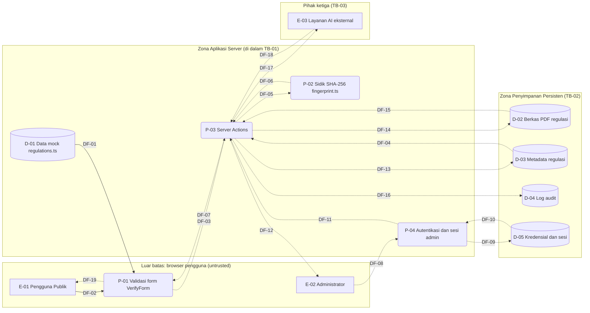
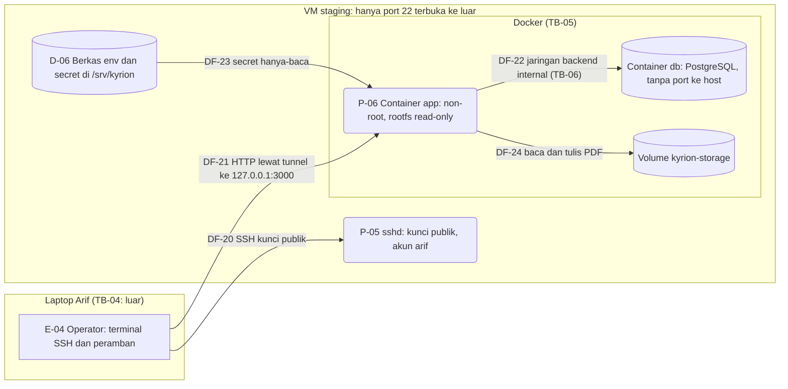
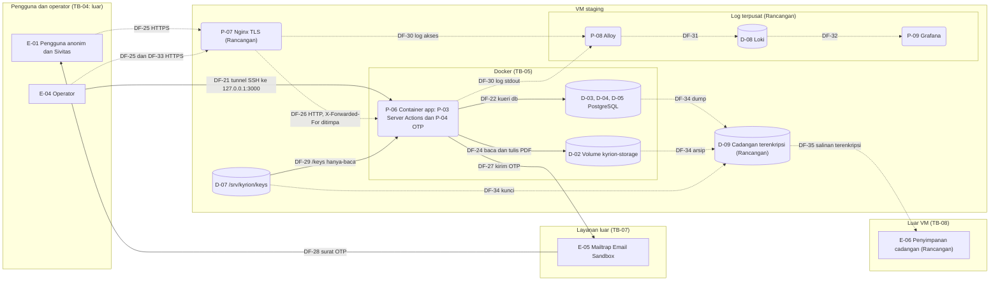

# Data Flow Diagram

Pemetaan elemen aliran data sistem, trust boundary, dan diagramnya.

## Elemen

| ID | Nama | Tipe | Status |
|----|------|------|--------|
| E-01 | Pengguna Publik / Tamu (pembaca dan verifikator regulasi) | Entitas Eksternal | Berjalan |
| E-02 | Administrator / Pengelola Regulasi | Entitas Eksternal | Rancangan |
| E-03 | Penyedia Layanan AI Eksternal | Entitas Eksternal | Rancangan |
| P-01 | Validasi Formulir dan Penanganan Input Klien (VerifyForm) | Proses | Berjalan |
| P-02 | Kalkulasi dan Pencocokan Sidik Berkas SHA-256 (fingerprint.ts) | Proses | Berjalan (modul) |
| P-03 | Penanganan Logika Server / Server Actions | Proses | Rancangan |
| P-04 | Pengelolaan Autentikasi dan Otorisasi Sesi Admin | Proses | Rancangan |
| D-01 | Berkas Data Mock Regulasi (regulations.ts) | Data Store | Berjalan (mock) |
| D-02 | Penyimpanan Berkas Dokumen PDF Regulasi | Data Store | Rancangan |
| D-03 | Basis Data Metadata Regulasi | Data Store | Rancangan |
| D-04 | Tabel / Berkas Log Audit Riwayat Perubahan | Data Store | Rancangan |
| D-05 | Basis Data / Tabel Kredensial Admin dan Sesi | Data Store | Rancangan |

## Trust Boundary

- TB-01 Browser klien vs Zona Aplikasi Server. Luar (untrusted): E-01, E-02, P-01. Dalam: P-02, P-03, P-04, D-01. Alasan: sisi browser di bawah kendali penuh pengguna (skrip, DOM, memori lokal bisa dimanipulasi), sedangkan server berjalan di lingkungan milik Kyrion.
- TB-02 Zona Aplikasi Server vs Zona Penyimpanan Persisten. Zona aplikasi: P-03, P-04. Zona penyimpanan: D-02, D-03, D-04, D-05. Alasan: aplikasi menangani input publik yang rawan celah logika, sedangkan penyimpanan dilindungi kredensial koneksi dan prinsip hak akses minimal.
- TB-03 Zona Aplikasi Server vs Pihak Ketiga. Dalam: P-03. Luar: E-03. Alasan: layanan AI di luar kendali Kyrion, dihubungkan lewat internet publik, ketersediaan tidak dijamin dan responsnya tidak boleh dipercaya begitu saja.
- Asumsi (bukan fakta dokumen): PRD tidak menetapkan lokasi perhitungan hash. Asumsi Arif: di server, karena fingerprint.ts memakai node:crypto. Berkas unggahan diproses transient di memori server tanpa data store; konsekuensinya (DoS akibat berkas besar) dirujuk ke threat model.

## Aliran Data

| ID | Dari | Ke | Data | Menyeberang TB | Status |
|----|------|----|------|----------------|--------|
| DF-01 | D-01 | P-01 | Data katalog regulasi mock (dioper via props page.tsx) | TB-01 | Berjalan |
| DF-02 | E-01 | P-01 | Input formulir dan berkas PDF unggahan di browser | – | Berjalan |
| DF-03 | P-01 | P-03 | Berkas unggahan (transient buffer) dan ID regulasi terpilih | TB-01 | Rancangan |
| DF-04 | D-03 | P-03 | Pembacaan metadata regulasi dan sidik berkas SHA-256 resmi | TB-02 | Rancangan |
| DF-05 | P-03 | P-02 | Buffer berkas PDF dan sidik resmi regulasi untuk verifikasi | – | Rancangan |
| DF-06 | P-02 | P-03 | Status validasi sidik berkas (cocok / tidak cocok) | – | Rancangan |
| DF-07 | P-03 | P-01 | Hasil verifikasi keaslian regulasi (status dan pesan galat) | TB-01 | Rancangan |
| DF-08 | E-02 | P-04 | Kredensial masuk admin (nama pengguna dan kata sandi) | TB-01 | Rancangan |
| DF-09 | P-04 | D-05 | Kueri pencarian akun kredensial admin | TB-02 | Rancangan |
| DF-10 | D-05 | P-04 | Data rekaman hash kata sandi dan salt untuk verifikasi | TB-02 | Rancangan |
| DF-11 | P-04 | P-03 | Konteks sesi admin valid (authorization token/claims) | – | Rancangan |
| DF-12 | P-03 | E-02 | Respons hasil operasi admin (notifikasi berhasil / gagal) | TB-01 | Rancangan |
| DF-13 | P-03 | D-03 | Operasi tulis/pembaruan metadata regulasi dan status versi | TB-02 | Rancangan |
| DF-14 | P-03 | D-02 | Simpan berkas dokumen PDF regulasi versi baru | TB-02 | Rancangan |
| DF-15 | D-02 | P-03 | Pembacaan berkas fisik PDF regulasi resmi | TB-02 | Rancangan |
| DF-16 | P-03 | D-04 | Rekaman log audit (ID admin, timestamp, jenis aksi) | TB-02 | Rancangan |
| DF-17 | P-03 | E-03 | Prompt teks; autentikasi memakai API key A-10 dari environment server | TB-03 | Rancangan |
| DF-18 | E-03 | P-03 | Hasil inferensi / ringkasan analisis dari model AI | TB-03 | Rancangan |
| DF-19 | P-01 | E-01 | Tampilan hasil verifikasi di browser | – | Rancangan |

DF-xx adalah aliran data DFD; berbeda dari F-30 (fitur sidik berkas di PRD).

## Diagram

## Pembaruan sec-0.2

Bagian di atas tidak diubah (menggambarkan kondisi sec-0.1). Tugas 2 menambah lingkungan penerapan di VM staging. Pemetaan penerapan: P-01 sampai P-04 berjalan di dalam container app; D-02 diwujudkan sebagai volume Docker kyrion-storage; D-03, D-04, dan D-05 diwujudkan sebagai tabel di container db (PostgreSQL) dengan volume kyrion-pgdata.

### Elemen baru

| ID | Nama | Tipe | Status |
|----|------|------|--------|
| E-04 | Operator sistem (Arif): terminal SSH dan peramban dari laptop | Entitas Eksternal | Berjalan |
| P-05 | Layanan SSH di VM (sshd: hanya kunci publik, hanya akun arif) | Proses | Berjalan |
| P-06 | Container app kyrion-web:hardened (non-root, rootfs read-only, semua kapabilitas dilepas) | Proses | Berjalan |
| D-06 | Berkas konfigurasi dan secret di host VM (/srv/kyrion/env/ dan /srv/kyrion/secrets/) | Data Store | Berjalan |

### Trust boundary baru

- TB-04 Laptop Arif vs VM staging. Luar: E-04. Dalam: P-05 dan semua yang ada di VM. Alasan: VM hanya dapat dijangkau lewat SSH dengan kunci (port 22); aplikasi hanya terikat ke 127.0.0.1 di VM dan dibuka dari laptop lewat SSH tunnel.
- TB-05 Host VM vs container. Luar: sistem operasi VM dan D-06. Dalam: P-06 dan container db. Alasan: proses di dalam container berjalan tanpa hak istimewa (non-root, tanpa kapabilitas, no-new-privileges), sehingga kompromi aplikasi tidak otomatis menjadi kompromi host.
- TB-06 Jaringan frontend vs jaringan backend internal. Alasan: container db hanya berada di jaringan backend yang bersifat internal dan tidak mempublikasikan port ke host, sehingga hanya container app yang dapat menjangkaunya.

### Aliran data baru

| ID | Dari | Ke | Data | Menyeberang TB | Status |
|----|------|----|------|----------------|--------|
| DF-20 | E-04 | P-05 | Login SSH dengan kunci publik (kata sandi dimatikan) | TB-04 | Berjalan |
| DF-21 | E-04 | P-06 | Permintaan HTTP lewat SSH tunnel ke 127.0.0.1:3000 di VM | TB-04, TB-05 | Berjalan |
| DF-22 | P-06 | D-03, D-04, D-05 (container db) | Kueri basis data lewat jaringan backend internal | TB-06 | Berjalan |
| DF-23 | D-06 | P-06 | Kunci induk HMAC sebagai secret hanya-baca | TB-05 | Berjalan |
| DF-24 | P-06 | D-02 | Baca dan tulis berkas PDF versi di volume kyrion-storage | TB-05 | Berjalan |

### Diagram lingkungan VM

## Pembaruan sec-0.3

Bagian sebelumnya tidak diubah. Kondisi per 21 Nov 2026 (rilis v0.3, merge main 16acfdb). Status "Rancangan" untuk elemen baru berlaku sampai kontrolnya terpasang pada tahap Tugas 3 dan diperbarui lagi di akhir sec-0.3. Elemen dan aliran yang tidak disebut di bagian "Status terkini" belum diverifikasi ulang di tahap ini; status lamanya tetap berlaku.

### Status terkini elemen lama

| ID | Keadaan di v0.3 |
|----|-----------------|
| E-01 | Mencakup pengguna anonim (hanya halaman /masuk dan dua endpoint OTP) dan Sivitas setelah login. Semua halaman baca wajib login (PRD bagian 4.3). Berjalan. |
| E-02 | Admin masuk dengan kode OTP, tanpa kata sandi. Berjalan. |
| E-03 | Tetap Rancangan: asisten AI dijadwalkan v1.0 (PRD bagian 4). |
| P-03 | Berjalan di container app (P-06). |
| P-04 | Berjalan: Better Auth dengan OTP email, sesi di tabel sessions, pembatasan laju di memori proses (3 permintaan per 60 detik per IP untuk kirim OTP dan masuk dengan OTP). |
| D-02 | Berjalan: volume Docker kyrion-storage. |
| D-03 | Berjalan: tabel categories, regulations, versions, changes, dan signing_keys di PostgreSQL. |
| D-04 | Berjalan: tabel audit_logs. |
| D-05 | Berjalan sebagai tabel users, sessions, accounts, dan verifications. Tidak ada lagi hash kata sandi. |
| DF-08 | Berubah: permintaan kirim kode OTP dan masuk dengan kode OTP (tanpa kata sandi). |
| DF-10 | Tidak berlaku sejak v0.3 (tidak ada hash kata sandi yang dibaca). |
| DF-17, DF-18 | Tetap Rancangan (bergantung pada E-03). |

### Elemen baru

| ID | Nama | Tipe | Status |
|----|------|------|--------|
| E-05 | Layanan email Mailtrap Email Sandbox (pengirim OTP) | Entitas Eksternal | Berjalan |
| E-06 | Penyimpanan cadangan di luar VM | Entitas Eksternal | Rancangan |
| P-07 | Reverse proxy Nginx (TLS 1.2 dan 1.3, HSTS) | Proses | Rancangan |
| P-08 | Grafana Alloy (pengumpul log) | Proses | Rancangan |
| P-09 | Grafana (dasbor dan peringatan) | Proses | Rancangan |
| D-07 | Folder kunci penandatangan dan keyring (/srv/kyrion/keys) | Data Store | Berjalan |
| D-08 | Loki (penyimpanan log) | Data Store | Rancangan |
| D-09 | Cadangan terenkripsi age (dump db, arsip storage, kunci) | Data Store | Rancangan |

### Trust boundary baru

- TB-07 VM staging vs layanan email eksternal. Luar: E-05. Alasan: layanan pihak ketiga di jalur internet publik dengan token API; sandbox menangkap semua surat sehingga kepemilikan alamat tidak terbukti (PRD bagian 14).
- TB-08 VM staging vs penyimpanan cadangan di luar VM. Luar: E-06. Alasan: cadangan keluar dari kendali host; hanya salinan terenkripsi age yang boleh melintas.
- TB-04 diperluas: setelah P-07 terpasang, port 80 dan 443 menjadi jalur layanan web dari luar VM, SSH tetap untuk operator, dan port 3000 dilepas dari host. Sebelum itu akses ke app lewat SSH tunnel (DF-21).

### Aliran data baru

| ID | Dari | Ke | Data | Menyeberang TB | Status |
|----|------|----|------|----------------|--------|
| DF-25 | E-01, E-04 | P-07 | Permintaan HTTPS (TLS 1.2 atau 1.3); HTTP port 80 dialihkan ke HTTPS | TB-04 | Rancangan |
| DF-26 | P-07 | P-06 | Permintaan HTTP ke app di jaringan Docker; X-Forwarded-For ditimpa dengan alamat klien nyata | TB-05 | Rancangan |
| DF-27 | P-06 | E-05 | Permintaan API kirim OTP (alamat email dan kode OTP; token API di header) | TB-07 | Berjalan |
| DF-28 | E-05 | E-01 | Surat OTP diterima pengguna (di staging: inbox sandbox milik Arif) | TB-07 | Berjalan |
| DF-29 | D-07 | P-06 | Kunci privat penandatangan dan keyring dibaca lewat /keys hanya-baca | TB-05 | Berjalan |
| DF-30 | P-06, P-07, host VM (kernel dan UFW) | P-08 | Log aplikasi (stdout), log akses Nginx, dan log kernel | TB-05 | Rancangan |
| DF-31 | P-08 | D-08 | Pengiriman log ke Loki dengan stempel waktu UTC | - | Rancangan |
| DF-32 | D-08 | P-09 | Kueri log dan evaluasi aturan peringatan | - | Rancangan |
| DF-33 | E-04 | P-09 | Dasbor dan peringatan lewat Nginx (HTTPS) | TB-04 | Rancangan |
| DF-34 | D-02, D-03, D-06, D-07 | D-09 | Dump db, arsip storage, dan kunci, dienkripsi dengan age | TB-08 | Rancangan |
| DF-35 | D-09 | E-06 | Salinan cadangan terenkripsi di luar VM | TB-08 | Rancangan |

### Diagram sec-0.3

Garis putus-putus adalah elemen atau aliran berstatus Rancangan.

