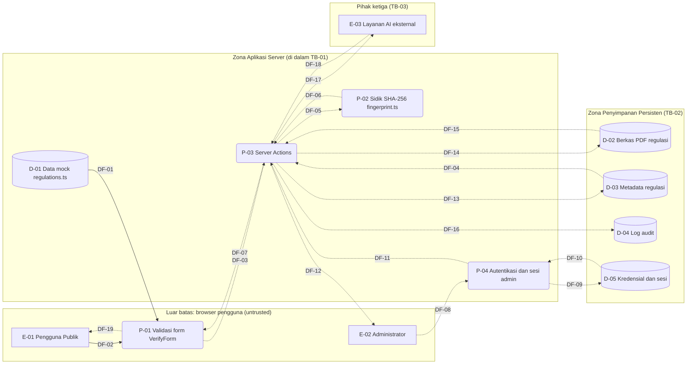

# Data Flow Diagram

Pemetaan elemen aliran data sistem, trust boundary, dan diagramnya.

## Elemen

| ID | Nama | Tipe | Status |
|----|------|------|--------|
| E-01 | Pengguna Publik / Tamu (pembaca dan verifikator regulasi) | Entitas Eksternal | Berjalan |
| E-02 | Administrator / Pengelola Regulasi | Entitas Eksternal | Rancangan |
| E-03 | Penyedia Layanan AI Eksternal | Entitas Eksternal | Rancangan |
| P-01 | Validasi Formulir dan Penanganan Input Klien (VerifyForm) | Proses | Berjalan |
| P-02 | Kalkulasi dan Pencocokan Sidik Berkas SHA-256 (fingerprint.ts) | Proses | Berjalan (modul) |
| P-03 | Penanganan Logika Server / Server Actions | Proses | Rancangan |
| P-04 | Pengelolaan Autentikasi dan Otorisasi Sesi Admin | Proses | Rancangan |
| D-01 | Berkas Data Mock Regulasi (regulations.ts) | Data Store | Berjalan (mock) |
| D-02 | Penyimpanan Berkas Dokumen PDF Regulasi | Data Store | Rancangan |
| D-03 | Basis Data Metadata Regulasi | Data Store | Rancangan |
| D-04 | Tabel / Berkas Log Audit Riwayat Perubahan | Data Store | Rancangan |
| D-05 | Basis Data / Tabel Kredensial Admin dan Sesi | Data Store | Rancangan |

## Trust Boundary

- TB-01 Browser klien vs Zona Aplikasi Server. Luar (untrusted): E-01, E-02, P-01. Dalam: P-02, P-03, P-04, D-01. Alasan: sisi browser di bawah kendali penuh pengguna (skrip, DOM, memori lokal bisa dimanipulasi), sedangkan server berjalan di lingkungan milik Kyrion.
- TB-02 Zona Aplikasi Server vs Zona Penyimpanan Persisten. Zona aplikasi: P-03, P-04. Zona penyimpanan: D-02, D-03, D-04, D-05. Alasan: aplikasi menangani input publik yang rawan celah logika, sedangkan penyimpanan dilindungi kredensial koneksi dan prinsip hak akses minimal.
- TB-03 Zona Aplikasi Server vs Pihak Ketiga. Dalam: P-03. Luar: E-03. Alasan: layanan AI di luar kendali Kyrion, dihubungkan lewat internet publik, ketersediaan tidak dijamin dan responsnya tidak boleh dipercaya begitu saja.
- Asumsi (bukan fakta dokumen): PRD tidak menetapkan lokasi perhitungan hash. Asumsi Arif: di server, karena fingerprint.ts memakai node:crypto. Berkas unggahan diproses transient di memori server tanpa data store; konsekuensinya (DoS akibat berkas besar) dirujuk ke threat model.

## Aliran Data

| ID | Dari | Ke | Data | Menyeberang TB | Status |
|----|------|----|------|----------------|--------|
| DF-01 | D-01 | P-01 | Data katalog regulasi mock (dioper via props page.tsx) | TB-01 | Berjalan |
| DF-02 | E-01 | P-01 | Input formulir dan berkas PDF unggahan di browser | – | Berjalan |
| DF-03 | P-01 | P-03 | Berkas unggahan (transient buffer) dan ID regulasi terpilih | TB-01 | Rancangan |
| DF-04 | D-03 | P-03 | Pembacaan metadata regulasi dan sidik berkas SHA-256 resmi | TB-02 | Rancangan |
| DF-05 | P-03 | P-02 | Buffer berkas PDF dan sidik resmi regulasi untuk verifikasi | – | Rancangan |
| DF-06 | P-02 | P-03 | Status validasi sidik berkas (cocok / tidak cocok) | – | Rancangan |
| DF-07 | P-03 | P-01 | Hasil verifikasi keaslian regulasi (status dan pesan galat) | TB-01 | Rancangan |
| DF-08 | E-02 | P-04 | Kredensial masuk admin (nama pengguna dan kata sandi) | TB-01 | Rancangan |
| DF-09 | P-04 | D-05 | Kueri pencarian akun kredensial admin | TB-02 | Rancangan |
| DF-10 | D-05 | P-04 | Data rekaman hash kata sandi dan salt untuk verifikasi | TB-02 | Rancangan |
| DF-11 | P-04 | P-03 | Konteks sesi admin valid (authorization token/claims) | – | Rancangan |
| DF-12 | P-03 | E-02 | Respons hasil operasi admin (notifikasi berhasil / gagal) | TB-01 | Rancangan |
| DF-13 | P-03 | D-03 | Operasi tulis/pembaruan metadata regulasi dan status versi | TB-02 | Rancangan |
| DF-14 | P-03 | D-02 | Simpan berkas dokumen PDF regulasi versi baru | TB-02 | Rancangan |
| DF-15 | D-02 | P-03 | Pembacaan berkas fisik PDF regulasi resmi | TB-02 | Rancangan |
| DF-16 | P-03 | D-04 | Rekaman log audit (ID admin, timestamp, jenis aksi) | TB-02 | Rancangan |
| DF-17 | P-03 | E-03 | Prompt teks; autentikasi memakai API key A-10 dari environment server | TB-03 | Rancangan |
| DF-18 | E-03 | P-03 | Hasil inferensi / ringkasan analisis dari model AI | TB-03 | Rancangan |
| DF-19 | P-01 | E-01 | Tampilan hasil verifikasi di browser | – | Rancangan |

DF-xx adalah aliran data DFD; berbeda dari F-30 (fitur sidik berkas di PRD).

## Diagram

