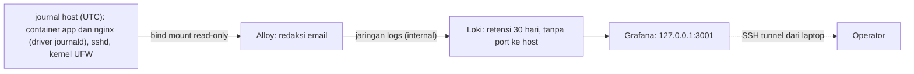

# Log terpusat Kyrion (Alloy, Loki, Grafana) untuk sec-0.3 Bagian B

Status: konfigurasi disusun 2026-11-23, **belum dijalankan dan belum diuji**. Risiko: R-15 (T-21, T-25, T-22).

## Arsitektur

- Tanpa docker.sock. Alloy hanya memasang /var/log/journal, /run/log/journal, dan /etc/machine-id (read-only); container read-only, semua kapabilitas dilepas.
- Loki hanya di jaringan `logs` (internal) tanpa `ports`. Grafana satu-satunya yang punya port, hanya 127.0.0.1:3001; kredensial admin dari secret (bukan bawaan), tanpa pendaftaran dan akses anonim.
- Container app dan nginx dikirim ke journald lewat overlay `compose.logging-journald.yaml` (tidak mengubah compose.vm.yaml). Overlay membuat ulang app dan nginx.
- Redaksi: email diganti `<email-disamarkan>` di Alloy sebelum masuk Loki (keputusan Arif). Journal lokal di VM tetap berisi email.
- Sumber: nginx (akses dan galat) dan stdout app lewat CONTAINER_NAME, sshd (ssh.service), baris `[UFW ` di kernel. audit_logs (tabel DB) tidak dikirim di Tugas ini.

## Cara menjalankan (Arif)

1. Isi `LOKI_TAG` di versions.env setelah membaca advisory Loki (**[KEPUTUSAN ARIF]**, tag sengaja kosong). Tag Alloy v1.19.0 dan Grafana 13.3.1 berasal dari pencarian web 2026-11-23 dan belum dikonfirmasi di situs resmi.
2. `.\deploy\uji\06-monitoring.ps1 -Fase siapkan` (tarik image, catat digest ke /srv/kyrion/monitoring/images.env, Trivy, validasi, bukti waktu NTP, rahasia admin Grafana). Baca hasil Trivy; bila ada HIGH/CRITICAL yang relevan, pilih tag lain.
3. Di VM, dari ~/kyrion-src, pasang overlay journald:
   `sudo docker compose -p kyrion-vm --env-file /srv/kyrion/env/kyrion.env -f compose.vm.yaml -f security/monitoring/compose.logging-journald.yaml up -d --no-deps app nginx`
4. `.\deploy\uji\06-monitoring.ps1 -Fase jalankan`.
5. Akses Grafana: `ssh -L 3001:127.0.0.1:3001 kyrion-staging`, buka http://127.0.0.1:3001, pengguna `kyrion-admin`, kata sandi dari `sudo cat /srv/kyrion/secrets/grafana_admin_password` (jangan ditempel ke chat).

Jangan menjalankan `docker image prune -a` (kyrion-web:tools dan kyrion-web:pra-entrypoint harus tetap).

## Uji yang diharapkan dari fase jalankan

Loki ready; Grafana health OK; hanya 127.0.0.1:3001 terbuka; jaringan logs Internal=true; log nginx dengan email sintetis muncul sebagai `<email-disamarkan>` dan teks asli tidak ditemukan.

## Catatan untuk dokumen risiko dan sec-0.3 (usulan, risk-register.md tidak diubah)

- Usulan baris risiko: **R-16**, T-25 dan T-22, kontrol: Alloy membaca journal host read-only (tanpa docker.sock), container read-only dan kapabilitas dilepas, Loki tanpa port, redaksi email; target L 3 ke 2. Aset baru: akses baca journal oleh container Alloy (journal memuat log semua unit).
- Selisih definisi D-3: R-09 di risk-register menyebut D-3 sebagai deteksi percobaan SSH, sedangkan laporan tahap 0 dan slide pekan 12 mendefinisikan D-3 sebagai pemindaian port. Teks lama tidak diubah; sumber log UFW dan sshd tersedia untuk keduanya, penentuan dilakukan di Tugas 7. D-1 (429 OTP per IP) memakai log nginx; ingat R-14 menyatakan D-1 menghitung semua respons non-2xx, bukan hanya 429. D-2 = 403/404 pada jalur sensitif.
- Batas memori (mem_limit): Loki 1 GB, Alloy 512 MB, Grafana 512 MB; belum diukur terhadap RAM tersedia 5,3 GB.
- Retensi 30 hari (720h) belum terukur muat di disk 12 GB bebas. Bila ternyata tidak muat, tanya Arif; angka tidak diturunkan sendiri.
- Aturan peringatan Grafana (D-1 sampai D-3) dibuat di Tugas 7.
