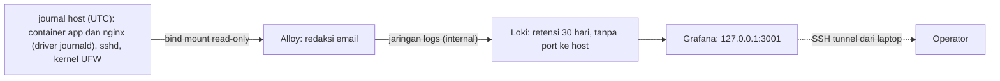

# Log terpusat Kyrion (Alloy, Loki, Grafana) untuk sec-0.3 Bagian B

Status: konfigurasi disusun 2026-11-23; **stack berjalan di VM dan uji redaksi email LULUS** pada run 2026-11-25 (penanda 1795588765, lihat "Hasil uji nyata"). Risiko: R-15 (T-21, T-25, T-22).

Sumber klaim hasil: `../bukti/06-monitoring-jalankan.txt` (disebut "jalankan") dan `../bukti/06-monitoring-siapkan.txt` (disebut "siapkan"). Hal yang tidak ada di kedua berkas ditandai "belum terbukti".

## Arsitektur

Bagian ini menjelaskan rancangan konfigurasi, bukan hasil uji.



- Tanpa docker.sock. Alloy hanya memasang /var/log/journal, /run/log/journal, dan /etc/machine-id (read-only); container read-only, semua kapabilitas dilepas.
- Loki hanya di jaringan `logs` (internal) tanpa `ports`. Grafana satu-satunya yang punya port, hanya 127.0.0.1:3001; kredensial admin dari secret (bukan bawaan), tanpa pendaftaran dan akses anonim.
- Container app dan nginx dikirim ke journald lewat overlay `compose.logging-journald.yaml` (tidak mengubah compose.vm.yaml). Overlay membuat ulang app dan nginx.
- Redaksi: email diganti `<email-disamarkan>` di Alloy sebelum masuk Loki (keputusan Arif). Lihat "Batas kontrol redaksi".
- Sumber yang dirancang: nginx (akses dan galat) dan stdout app lewat CONTAINER_NAME, sshd (ssh.service), baris `[UFW ` di kernel (lihat catatan filter di "Label di Loki"). audit_logs (tabel DB) tidak dikirim di Tugas ini. Masuknya log sshd dan kernel ke Loki belum terbukti dari berkas bukti.

## Cara menjalankan (Arif)

1. Tag image ada di versions.env; run siapkan menarik Alloy v1.19.0, Loki 3.7.10, dan Grafana 13.3.1 (digest ada di siapkan). Pemilihan `LOKI_TAG` adalah **[KEPUTUSAN ARIF]** setelah membaca advisory Loki. Konfirmasi tag di situs resmi: belum terbukti.
2. `.\deploy\uji\06-monitoring.ps1 -Fase siapkan` (tarik image, catat digest ke /srv/kyrion/monitoring/images.env, Trivy, validasi, bukti waktu NTP, rahasia admin Grafana). Baca hasil Trivy; bila ada HIGH/CRITICAL yang relevan, pilih tag lain.
3. Di VM, dari ~/kyrion-src, pasang overlay journald dari salinan yang dipasang skrip di `/srv/kyrion/monitoring/compose.logging-journald.yaml`:
   `sudo docker compose -p kyrion-vm --env-file /srv/kyrion/env/kyrion.env -f compose.vm.yaml -f /srv/kyrion/monitoring/compose.logging-journald.yaml up -d --no-deps app nginx`
   (Keberadaan berkas di jalur itu ada di siapkan dan jalankan; perintah pemasangan yang dipakai saat itu belum terbukti.)
4. `.\deploy\uji\06-monitoring.ps1 -Fase jalankan`.
5. Akses Grafana: `ssh -L 3001:127.0.0.1:3001 kyrion-staging`, buka http://127.0.0.1:3001, pengguna `kyrion-admin`, kata sandi dari `sudo cat /srv/kyrion/secrets/grafana_admin_password` (jangan ditempel ke chat).

Jangan menjalankan `docker image prune -a` (kyrion-web:tools dan kyrion-web:pra-entrypoint harus tetap).

## Hasil uji nyata (jalankan, 2026-11-25, penanda 1795588765)

| Pemeriksaan | Hasil |
|---|---|
| Loki `/ready` | OK |
| Grafana | versi 13.3.1, `database: ok` |
| Port monitoring (dari 3001, 3100, 12345) | hanya `127.0.0.1:3001` yang mendengarkan |
| Jaringan `kyrion-mon_logs` | `Internal` = true |
| Request uji (email mentah dan `%40`) | keduanya HTTP 200 |
| a. baris `{container=~"kyrion-vm-(app\|nginx)-1"}`, 10 menit | 2 (harus > 0) |
| b. baris tersamarkan | mentah = 1, `%40` = 1 |
| c. baris berisi `contoh.invalid`, selector sama, 10 menit | 0 |
| Uji redaksi | **LULUS** |

Stabilitas Alloy sesudah restart di run ini (status terakhir yang tercatat: `Up 1 second`) belum terbukti.

## Batas kontrol redaksi

- Redaksi terjadi di Alloy, sebelum log dikirim ke Loki. Journal di VM tidak melewati Alloy saat ditulis; apakah email asli tetap ada di journald VM belum diperiksa (belum terbukti).
- Bukti uji hanya 2 request pada 1 run, lewat nginx. Redaksi untuk stdout app, sshd, kernel, dan bentuk email lain belum terbukti.

## Label di Loki

- Nilai label `job` di Loki adalah `loki.source.journal.kontainer`, `loki.source.journal.sshd`, dan `loki.source.journal.kernel`, bukan `container`, `sshd`, dan `kernel` seperti di config.alloy. Ini hasil pengamatan di VM; keluarannya tidak tersimpan di kedua berkas bukti, sehingga belum terbukti dari berkas.
- Aturan deteksi harus memakai label `container` dan `unit`, bukan `job`. Dari kedua label itu, bukti hanya menunjukkan selector `container` (butir a); `unit` belum terbukti.
- Penyebab tertimpanya `job` belum terbukti.
- Selector `{job="kernel"}` di config.alloy baris 48 mungkin tidak pernah cocok, sehingga baris kernel non-UFW tidak dibuang (belum terbukti). Cara memeriksa di Grafana; hasil yang tidak kosong berarti filter tidak bekerja (hasil kosong saja belum membuktikan filter bekerja, mis. bila tidak ada log kernel pada rentang waktu itu):

  ```logql
  {job="loki.source.journal.kernel"} != "[UFW "
  ```

## Residu pemindaian Trivy (siapkan, 2026-11-23)

| Image | HIGH | CRITICAL | Rincian HIGH |
|---|---|---|---|
| Alloy | 15 | 0 | 4 paket Ubuntu, 11 `usr/bin/alloy` |
| Loki | 0 | 0 | - |
| Grafana | 20 | 0 | plugin datasource bawaan (`plugins-bundled`) |

Risiko residu yang diterima. Relevansi tiap temuan HIGH terhadap pemakaian di sini belum terbukti.

## Catatan Loki

Log Loki memuat error ring ("empty ring") berulang. Teks error itu tidak ada di kedua berkas bukti (belum terbukti dari berkas). Error itu tidak menghalangi penerimaan log: log container masuk (butir a dan b). Penyebabnya belum terbukti.

## Sumber daya

- Disk VM saat run (jalankan): root 78 persen terpakai, sisa 8,5 GB; build cache Docker 9,806 GB (sekitar 9,8 GB).
- Batas memori (`mem_limit`): Loki 1 GB, Alloy 512 MB, Grafana 512 MB; belum diukur.
- Retensi 30 hari (720h): belum diukur, termasuk apakah muat di sisa disk. Bila ternyata tidak muat, tanya Arif; angka tidak diturunkan sendiri.

## Catatan untuk dokumen risiko dan sec-0.3 (usulan, risk-register.md tidak diubah)

- Usulan baris risiko: **R-16**, T-25 dan T-22, kontrol: Alloy membaca journal host read-only (tanpa docker.sock), container read-only dan kapabilitas dilepas, Loki tanpa port, redaksi email; target L 3 ke 2. Aset baru: akses baca journal oleh container Alloy (journal memuat log semua unit).
- Selisih definisi D-3: R-09 di risk-register menyebut D-3 sebagai deteksi percobaan SSH, sedangkan laporan tahap 0 dan slide pekan 12 mendefinisikan D-3 sebagai pemindaian port. Teks lama tidak diubah; sumber log UFW dan sshd tersedia untuk keduanya, penentuan dilakukan di Tugas 7. D-1 (429 OTP per IP) memakai log nginx; ingat R-14 menyatakan D-1 menghitung semua respons non-2xx, bukan hanya 429. D-2 = 403/404 pada jalur sensitif.
- Aturan peringatan Grafana (D-1 sampai D-3) dibuat di Tugas 7.
