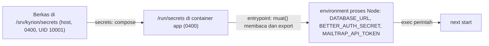

# Pengelolaan Rahasia Kyrion (sec-0.3 Bagian A1; R-11, T-17, T-27)

| | |
|---|---|
| Tanggal (UTC) | 2026-11-22 |
| Hash commit | f079344 (`git rev-parse --short HEAD`); bukti rahasia diambil di commit 44c994d (REVISION image app) |
| Perintah | `git rev-parse --short HEAD`; bukti VM: security/bukti/secrets-efektif.txt (commit 8460d22); gitleaks: perintah di security/bukti/gitleaks-catatan.txt |
| Sumber | apps/web/docker-entrypoint.sh, apps/web/Dockerfile, compose.vm.yaml, security/gitleaks.json, security/bukti/gitleaks-catatan.txt, .gitleaksignore, security/bukti/secrets-efektif.txt, security/risk-register.md, security/asset-inventory.md |

Tanpa nilai rahasia apa pun. Keterangan bertanda **(keterangan Arif)** berasal dari laporan Arif sesudah menjalankan perintah di VM, bukan dari berkas bukti di repo. Skala bukti: konfigurasi < konfigurasi efektif < uji negatif < bukti operasional.

Catatan bukti: security/bukti/secrets-efektif.txt hanya memuat tanggal dan REVISION image, tanpa daftar perintah. Cek "tidak terlihat" pada `docker inspect` memakai `grep -F` tanpa kontrol positif; karena itu hasilnya dirumuskan **"tidak ditemukan oleh grep -F"**, bukan "terbukti tidak terlihat".

## 1. Inventaris rahasia

Mode berkas dan pemilik dikutip dari secrets-efektif.txt (bagian "berkas rahasia di host" dan "/run/secrets di dalam container") kecuali dinyatakan lain.

| Rahasia | Tempat penyimpanan (VM) | Pemilik dan mode | Siapa yang membaca | Catatan |
|---------|-------------------------|------------------|--------------------|---------|
| URL basis data aplikasi (kyrion_database_url) | /srv/kyrion/secrets/kyrion_database_url, secret compose | 10001:10001, 0400 | proses app lewat entrypoint | Kini berisi URL peran kyrion_app (keterangan Arif). Isinya tidak diperiksa di berkas bukti. |
| Rahasia Better Auth (kyrion_better_auth_secret) | /srv/kyrion/secrets/kyrion_better_auth_secret | 10001:10001, 0400 | proses app | Memalsukan cookie sesi bila bocor (T-17). |
| Token API Mailtrap (kyrion_mailtrap_api_token) | /srv/kyrion/secrets/kyrion_mailtrap_api_token | 10001:10001, 0400 | proses app | Pengirim OTP (A-22). |
| Kunci induk HMAC (kyrion_master_key, A-16) | /srv/kyrion/secrets/kyrion_master_key | 10001:10001, 0400 | proses app lewat KYRION_MASTER_KEY_FILE (hanya jalurnya di environment); backup (root) | Jalur ini juga masuk cadangan terenkripsi. |
| Kunci Ed25519 dan keyring (A-17) | /srv/kyrion/keys/ (mount /keys) | folder 0700, berkas 0600, UID 10001 (asset-inventory.md) | app hanya-baca; service tools baca-tulis; backup (root) | Mode tidak diperiksa ulang di secrets-efektif.txt. |
| Kata sandi peran DB (kyrion_db_ddl_password, kyrion_db_app_password) | /srv/kyrion/secrets/ | root:root, 0600 | root lewat sudo (roles.sql dan uji peran) | Tidak di-mount ke container. |
| URL peran DDL (kyrion_database_url_ddl) | belum ada | - | - | Diusulkan di Tugas 2; **belum diterapkan**. |
| Cadangan URL superuser lama (kyrion_database_url.bak-superuser) | /srv/kyrion/secrets/ | root, 0400 **(keterangan Arif)** | root | Berisi kredensial superuser lama; harus dihapus (bagian 5). |
| Berkas lingkungan (kyrion.env, seed.env) | /srv/kyrion/env/ | kyrion.env 0600 (asset-inventory.md) | compose lewat --env-file; service tools lewat env_file seed.env | Isi tidak dibaca di sesi ini. |
| Kunci privat server TLS | /srv/kyrion/tls/server.key (compose.vm.yaml) | tidak ada bukti mode | nginx | Dibahas di firewall-rules.md. |
| Kunci privat age (cadangan) | laptop, C:\\Projects\\kyrion-backup-key\\age-key.txt, ACL dibatasi ke akun Arif **(keterangan Arif)** | - | Arif | Tidak pernah di repo; dikirim sementara ke VM saat uji pulih (backup-restore.md). |
| Kunci privat SSH (A-14) | laptop, folder .ssh, berpassphrase | - | Arif | Lihat data-classification.md, Keputusan 4. |

## 2. Mekanisme masuk ke container dan gagal tertutup

- compose.vm.yaml mendaftarkan empat secret untuk service `app` dan **tidak lagi** mengisi DATABASE_URL, BETTER_AUTH_SECRET, dan MAILTRAP_API_TOKEN lewat `environment`.
- [apps/web/docker-entrypoint.sh](apps/web/docker-entrypoint.sh) memuat tiga nilai (`muat`) dari /run/secrets lalu `exec "$@"`. Gagal tertutup: bila berkas tidak terbaca atau kosong, skrip mencetak `FATAL: rahasia <nama> tidak terbaca|kosong` ke stderr dan keluar dengan kode 1 sebelum aplikasi jalan. Nilai tidak pernah dicetak.
- Kunci induk HMAC tidak diekspor oleh entrypoint; aplikasi membaca berkasnya sendiri lewat KYRION_MASTER_KEY_FILE.
- Yang diuji: hanya cabang "berkas tidak terbaca" untuk kyrion_database_url (secrets-efektif.txt: `FATAL: rahasia kyrion_database_url tidak terbaca`, `exit=1`). Cabang "kosong" dan dua rahasia lain **belum diuji**.

## 3. Rencana rotasi

Keputusan Arif (2026-11-22): rahasia dirotasi segera bila dicurigai bocor dan sekali sebelum tag v1.0 (staging, ditinjau lagi di v1.0). Kunci induk HMAC dan kunci penandatangan tidak dirotasi rutin; bila perlu, ikuti prosedur Kriptografi. Pemilik dan pelaksana semua rotasi: Arif (operator tunggal).

| Rahasia | Frekuensi | Langkah | Dampak |
|---------|-----------|---------|--------|
| kyrion_better_auth_secret | Segera bila dicurigai bocor; sekali sebelum tag v1.0 (staging, ditinjau lagi di v1.0) (Keputusan Arif 2026-11-22) | Buat nilai acak baru, tulis ke berkas rahasia (0400, UID 10001), ganti-pasang container app. | Semua sesi login tidak valid; pengguna masuk ulang. |
| kyrion_mailtrap_api_token | Segera bila dicurigai bocor; sekali sebelum tag v1.0 (staging, ditinjau lagi di v1.0) (Keputusan Arif 2026-11-22) | Terbitkan token baru di Mailtrap, tulis ke berkas, ganti-pasang app, cabut token lama. | OTP gagal terkirim selama jeda. |
| kyrion_database_url (kyrion_app) | Segera bila dicurigai bocor; sekali sebelum tag v1.0 (staging, ditinjau lagi di v1.0) (Keputusan Arif 2026-11-22) | `ALTER ROLE kyrion_app PASSWORD ...` lewat roles.sql dengan nilai baru (mengubah kata sandi kedua peran), perbarui kyrion_db_app_password dan kyrion_database_url, ganti-pasang app. | Koneksi app terputus sebentar. |
| kyrion_db_ddl_password | Segera bila dicurigai bocor; sekali sebelum tag v1.0 (staging, ditinjau lagi di v1.0) (Keputusan Arif 2026-11-22) | Sama, untuk kyrion_ddl; perbarui URL DDL setelah diterapkan. | Hanya migrasi dan seed. |
| kyrion_master_key | Tidak dirotasi rutin (Keputusan Arif 2026-11-22); hanya bila perlu | **Ikuti prosedur Kriptografi; tidak ada prosedur di repo untuk rotasi ini.** Ganti kunci mengubah semua tag HMAC (KEPUTUSAN.md K-4); butuh perhitungan ulang tag (prisma/backfill-integritas.ts) dan cadangan baru. | Verifikasi gagal sampai tag dihitung ulang. |
| Kunci Ed25519 | Tidak dirotasi rutin (Keputusan Arif 2026-11-22); hanya bila perlu | Rotasi lewat prisma/kelola-kunci.ts (service tools), mengikuti prosedur Kriptografi. | Pengesahan baru memakai kunci baru; kunci lama tetap untuk verifikasi. |
| Kunci age | Segera bila dicurigai bocor; sekali sebelum tag v1.0 (staging, ditinjau lagi di v1.0) (Keputusan Arif 2026-11-22) | Buat pasangan baru, ganti age-recipient.txt, cadangan lama tetap butuh kunci lama. | Lihat backup-restore.md. |

Rotasi di atas adalah rencana, **belum diuji**.

## 4. Hasil gitleaks dan tiga fingerprint

- gitleaks 8.30.1, `gitleaks git`, riwayat penuh 190 commit (HEAD 44c994d), 2026-11-22 sekitar 07:52 UTC, dengan `--redact`.
- Sebelum .gitleaksignore: 3 temuan. Sesudah: 0 temuan; [security/gitleaks.json](security/gitleaks.json) berisi `[]`.
- Pemeriksaan isi dilakukan Arif secara manual (bukan oleh Claude); ketiganya dinilai false positive:

| # | Aturan | Lokasi | Alasan (dari gitleaks-catatan.txt) |
|---|--------|--------|--------------------------------------|
| 1 | curl-auth-user | security/bukti/bukti-sebelum-tahap-2.txt baris 95, commit 47075f4 | Uji rate limit dengan OTP sengaja salah 000000, email sintetis, IP rentang dokumentasi RFC 5737. |
| 2 | curl-auth-user | idem, baris 122, commit 47075f4 | Sama dengan butir 1. |
| 3 | private-key | apps/web/lib/crypto/penandatangan.test.ts baris 52-105, commit f186ed1 | Dua blok PEM berisi teks pengganti RAHASIAPEM, bukan kunci. |

Batas: bersih hanya terhadap aturan bawaan 8.30.1; fingerprint berbasis commit sehingga berubah bila riwayat ditulis ulang; .gitleaksignore belum di-commit saat scan akhir (dibaca dari folder kerja) dan kini sudah di-commit.

## 5. Residual yang jujur

| # | Residual | Status menurut bukti |
|---|----------|----------------------|
| 1 | Nilai rahasia tetap ada di environment proses Node (entrypoint memakai `export`), sehingga dapat dibaca lewat /proc/1/environ atau `docker exec env` oleh pihak yang sudah ada di dalam container atau di host sebagai root. T-17 turun, tidak hilang (R-11). | Diturunkan dari kode entrypoint. **Belum diuji** langsung. |
| 2 | Service tools masih memakai env_file seed.env dan DATABASE_URL superuser dari kyrion.env; diff kyrion_database_url_ddl belum diterapkan. | Dari keterangan Arif dan compose.vm.yaml di repo (belum diubah). Belum diterapkan di VM. |
| 3 | Salinan nilai yang sama masih ada di kyrion.env (rahasia lama sebelum dipindah). | Tidak ada berkas bukti; isi tidak dibaca. **Belum diperiksa.** |
| 4 | Berkas kyrion_database_url.bak-superuser (root 0400, kredensial superuser lama) masih ada. | Keterangan Arif; tidak muncul di secrets-efektif.txt. Harus dihapus; **belum dihapus**. |
| 5 | Superuser kyrion masih ada, dan POSTGRES_PASSWORD berada di environment container db (bukti sebelum: nama variabel terlihat lewat docker inspect). | Tidak diperiksa ulang sesudah kontrol. |
| 6 | Tidak diketahui apakah nilai rahasia diganti saat dipindah. Nilai lama pernah ada di environment compose (T-17); memindah tempat tidak mengganti nilai. | **Belum diketahui.** |
| 7 | Koneksi app atas nama kyrion_app belum terbukti langsung (pg_stat_activity tidak menangkap sesi app). Yang ada: login Better Auth berhasil dan 0 "permission denied" di log (keterangan Arif). | **Belum terbukti langsung.** |
| 8 | gitleaks hanya mengenali pola bawaan. | Terbatas. |

## 6. Tabel bukti per klaim

| Klaim | Bukti | Kekuatan |
|-------|-------|----------|
| Tiga rahasia tidak ada di daftar nama environment container app | secrets-efektif.txt, bagian "nama variabel lingkungan" | Konfigurasi efektif |
| Berkas rahasia 0400 di host (UID 10001) dan di /run/secrets | secrets-efektif.txt | Konfigurasi efektif |
| Nilai rahasia tidak ditemukan oleh `grep -F` pada `docker inspect` | secrets-efektif.txt (tanpa kontrol positif) | Konfigurasi efektif, lemah |
| Entrypoint gagal tertutup bila kyrion_database_url tidak terbaca | secrets-efektif.txt (FATAL, exit=1) | Uji negatif (satu cabang) |
| Riwayat repositori tidak berisi rahasia berpola dikenal | gitleaks-catatan.txt, gitleaks.json (`[]`) | Pemindaian efektif, terbatas aturan bawaan |
| Tiga temuan awal adalah false positive | pemeriksaan manual Arif | Penilaian manual |
| App berfungsi dengan rahasia dari /run/secrets (login berhasil) | keterangan Arif; tidak ada berkas bukti | Belum terbukti oleh berkas |
| App memakai peran kyrion_app | keterangan Arif | **Belum terbukti langsung** |
| Rotasi dan penghapusan .bak | - | **Belum terbukti** |
